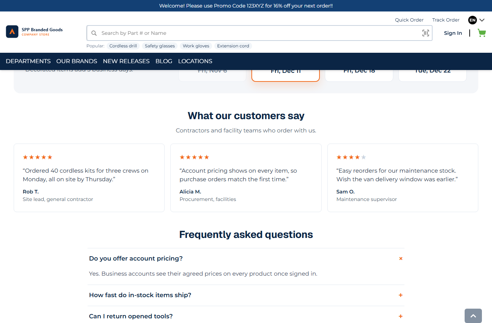
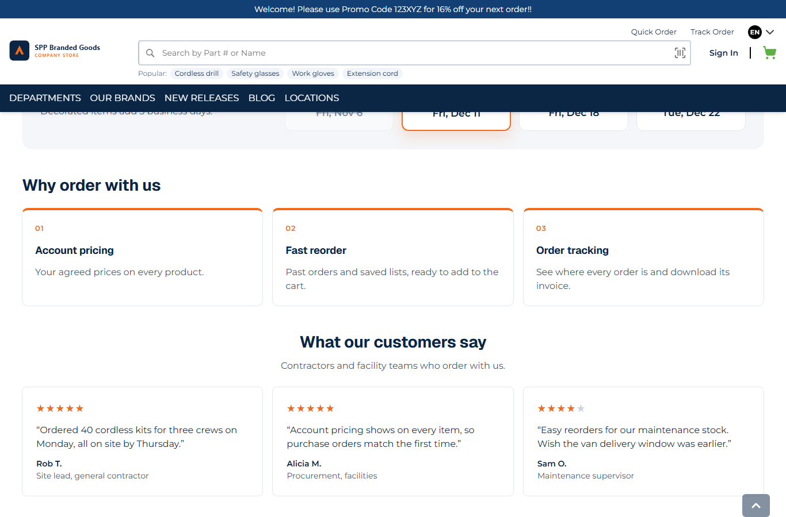

# 074: Can a widget load its data on the server like base widgets?

**Listed:** Partial. **Result here:** Yes, through the package's own route. Base widgets (products carousel, category
tiles) call an agent while the page renders on the server. A package widget renders in the browser (row 075), so it
cannot call an agent itself. It asks its package's **route**, which runs on the store's server with the store's
context. The data source, its address and any key stay on the server, as they do for a base widget. The difference is
when the data arrives: after the page has loaded, not in the page's HTML.

| Before: the theme's home, no highlights band | After: "Why order with us", its items loaded from the theme's route |
| --- | --- |
|  |  |

Store: MaxwellsHardware (`localhost:3000`), home page with spp-customization previewed, scrolled to the band above the
testimonials.

## The example: "Why order with us", from the store's data source

B2B stores repeat their account benefits on the home page, and the list belongs to the business (CMS, ERP), not to
the page layout. The new **`SppHighlights`** widget (`src/widgets/Highlights.tsx`) holds only the heading and how many
items to show (editor fields). On the page it calls:

```
GET /api/extensions/plugins/spp-customization/highlights?limit=3
{"store":"MaxwellsHardware","loadedAt":"2026-11-10T11:16:47.903Z","items":[{"id":1,"title":"Account pricing",...}, ...]}
```

- The **route** (`src/server.tsx`, `highlights`) runs on the store's server. It knows the store
  (`context.store.code`), reads the source (`getHighlights`, `src/server/data.ts`: a mock today, switched to the Znode
  API in row 095 without touching the widget) and cuts the list to `limit`.
- The **widget** shows a shimmer skeleton (one per item) while the route answers. It leaves the band out when the
  route fails or returns nothing, so the page never shows an empty box. Motion is off for `prefers-reduced-motion`.
- It is placed on the theme's home page (`src/pages/home.json`) and is in the page builder under "SPP · Content".

Full output: [output.txt](output.txt).

## How it renders

**In the webstore (base):** a base widget's data is loaded while the page renders: page-builder content → widget
component → **agent** → Znode API, all on the server, and the HTML already holds the data
([§9 A](../../RENDER-FLOW.md#9-home-content-and-package-pages-widgets)).

**How this customization joins it:** the page builder's content names `SppHighlights` → `RuntimeWidget` renders the
theme's component in the browser ([§9 B.2](../../RENDER-FLOW.md#9-home-content-and-package-pages-widgets)) → the
component fetches `/api/extensions/plugins/spp-customization/highlights` → the store's plugin route handler
`runPluginRoute` (enabled-for-store check, rate limit, timeout) calls the theme's `routes.highlights` with
`{ store, settings, cartNumber, user, znode() }` ([§7 B.5](../../RENDER-FLOW.md#7-cart-checkout-place-order)) → the
answer is JSON for the widget.

End-to-end flow, with file and line references in the webstore: [docs/RENDER-FLOW.md](../../RENDER-FLOW.md).

## Where

- `src/widgets/Highlights.tsx` (new): the widget and its editor fields
- `src/server.tsx`: `highlights` takes `?limit` and says when it was loaded
- `src/browser.tsx`, `znode-package.json`: `SppHighlights` registered
- `src/pages/home.json`: the band above the testimonials
- `src/styles/widgets.css`: cards, skeleton

## How a client does this

Put the data call in a route of the package (`routes: { name: async (request, context) => data }`, permission
`routes`) and fetch it from the widget in an effect. Keep the source's address and keys in the route (settings that
are not `browser: true`). When the data must be in the page's HTML (SEO), use a server slot or server page instead
(rows 053 and 089), not a widget.
