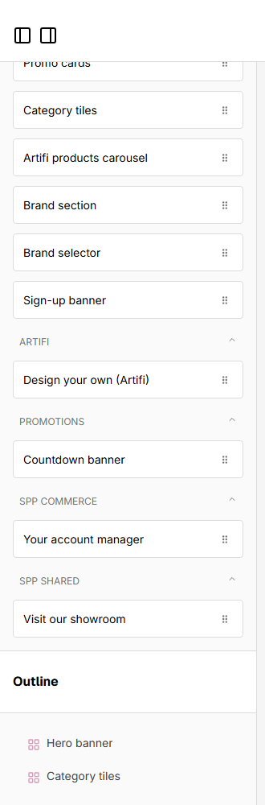
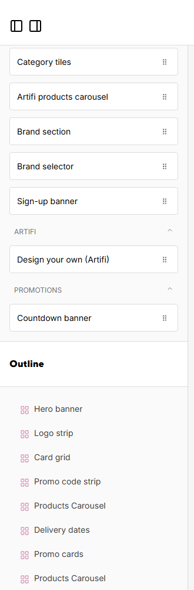

# 077: Can a widget be used on one store only?

**Listed:** Yes. **Result here:** Yes, confirmed.

| POCSppDemo: offered | POCStaplesPromo: not offered |
| --- | --- |
|  |  |

Page builder component lists, bottom of the list.

## The example: the showroom widget only where there is a showroom

**Visit our showroom** (spp-widgets, 060) was offered on every store. Only the Navigate store has a showroom and
will-call counter, so the package is placed for that store alone:

```
$ node scripts/registry.mjs stores POCSppDemo --package spp-widgets
  POCSppDemo        showroom widget offered: True
  POCStaplesPromo   showroom widget offered: False
  POCNvidia         showroom widget offered: False
  MaxwellsHardware  showroom widget offered: False
```

(before: `"stores": "*"`, offered on all four; `output.txt`.) A widget's availability follows its package's placement:
a widget in a theme is offered where the theme runs, a widget in a plugin or widget package where that package is
placed.


## How it renders

**In the webstore (base):** the page builder for a store ([§9 A](../../RENDER-FLOW.md#9-home-content-and-package-pages-widgets))

**How this customization joins it:** spp-widgets' `"stores"` decides which stores' editors get it ([§2 B.2](../../RENDER-FLOW.md#2-which-store-which-packages-every-request), [§9 B.4](../../RENDER-FLOW.md#9-home-content-and-package-pages-widgets))

End-to-end flow, with file and line references in the webstore: [docs/RENDER-FLOW.md](../../RENDER-FLOW.md).

## Where

`<plugin folder>/plugins.json`: spp-widgets `"stores": ["POCSppDemo"]`. No code change.

## How a client does this

Put the widget in its own `kind: widget` package (or in a plugin) and list the stores in its `"stores"`.
