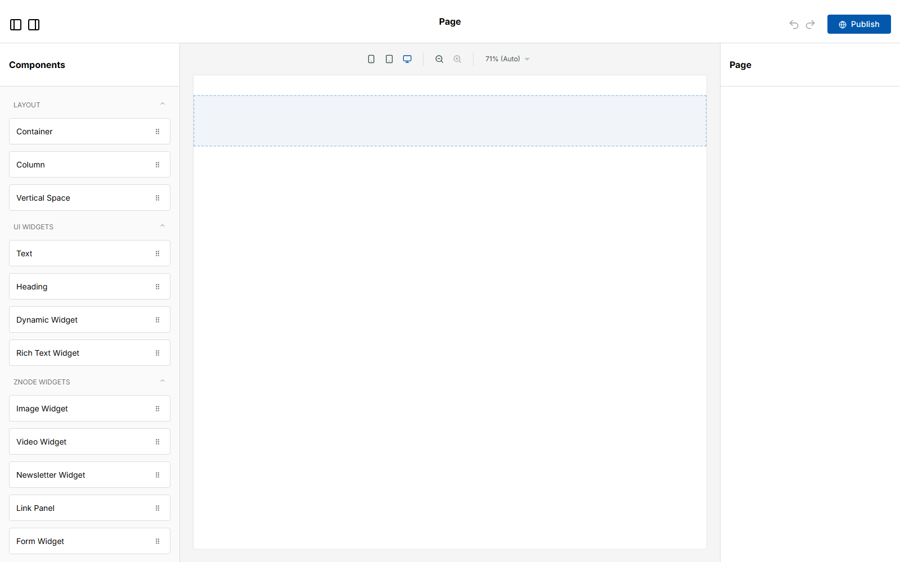
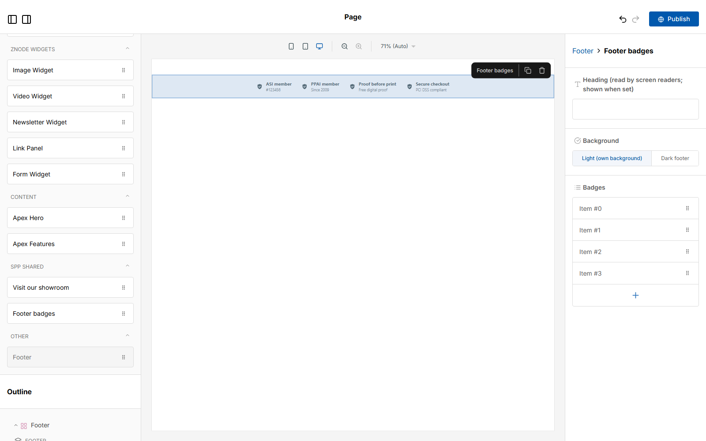
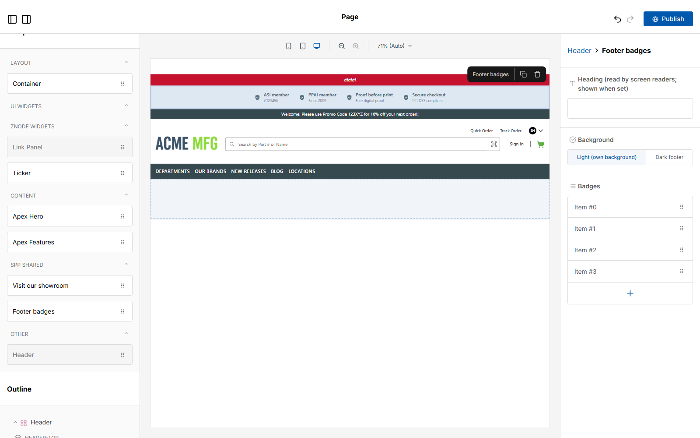

# 078: Can package widgets be used in header and footer pages?

**Listed:** Partial. **Result here:** Yes, in both. A package widget shows in the component list of the page
builder's **footer** and **header** layout pages, drops into their zones and is saved with them. On the store, the
saved header and footer go through `RuntimePageLayout`, which hands package widgets to a carrier. One store already
runs that way live: POCSppDemo's footer **is** a package widget (spp-base's `StoreFooter`).

There is a limit, and it comes from the theme, not the store. A footer page only accepts widgets inside the base
`Footer` widget's own zone: the page's root accepts nothing (`disabled: true`). A theme that replaces the footer with its
own widget and gives it no zone leaves nothing to drop into. That is the case on POCSppDemo, where even a base Text
cannot be dropped.

| Before: the footer page of MaxwellsHardware, empty | After: "Footer badges" dropped into the footer |
| --- | --- |
|  |  |

| After: the same widget in the header page (header-top zone) | On the store: POCSppDemo's footer, rendered by a package widget (`StoreFooter`) |
| --- | --- |
|  |  |

Page builder (`localhost:3001`), `?url=footer&pageCode=Footer` and `?url=header&pageCode=Header` for MaxwellsHardware.
`spp-widgets` was placed for MaxwellsHardware only while the pictures were taken (`registry.mjs stores`), then
restored to POCSppDemo.

## The example: membership and guarantee badges for the footer

Promotional-products stores show their industry memberships and guarantees in the footer ("ASI member #123456",
"PPAI member", "Proof before print", "Secure checkout"). The new **`SppFooterBadges`** widget ("Footer badges") is in
**spp-widgets**, the store-wide widget package, not in a theme: header and footer pages belong to the store, whatever
its theme. It has these fields:

- the badges (title and detail, reorderable)
- an optional heading, read by screen readers
- a background: "Light (own background)", the default, readable on any footer; or "Dark footer", light text for dark
  footers

**Published locally only** (the Znode CMS was not written to). The editor's Publish was pressed with every write
request blocked, and the pages it tried to send were saved here. The footer page has the badges in the base Footer's
zone:

```
footer.local.json   zone Footer-a9b198b0-...:footer      SppFooterBadges
header.local.json   zone Header-2dfaf874-...:header-top  SppFooterBadges, Ticker
```

Files: [footer.local.json](footer.local.json), [header.local.json](header.local.json).

## Why POCSppDemo's footer takes no drop (base page builder)

- `page-config-layout-map.ts`: the `footer` and `header` page configs have `disabled: true`, so the root renders
  `<DropZone zone="default-zone" allow={[]} />` (`extend-config.tsx:36`). Nothing goes at the top level.
- `FooterRender.tsx`: the base `Footer` renders `<DropZone zone="footer" />`, the only place a footer widget can go.
- POCSppDemo's saved footer is spp-base's `StoreFooter` (outline: "Store footer"). It is a package widget with its own
  markup and no zone, and the base `Footer` cannot be added a second time (greyed out in the list).
- For a theme that wants editable footers: render a `DropZone` in its footer widget, or keep the base `Footer`.

## How it renders

**In the webstore (base):** the root layout reads the "layout" page (`url: "layout"`, header and footer data) from the
CMS, and `PageLayout` renders them with the page-builder config: `HeaderRender` and `FooterRender` with their zones
([§8 A](../../RENDER-FLOW.md#8-header-footer-search)).

**How this customization joins it:** `RuntimePageLayout` (`RuntimePageSlots.tsx`) runs on the server around
`PageLayout`. Any item in `headerData` or `footerData` whose type a package provides is handed to a stock carrier,
Text in the header and Footer in the footer (`carryRuntimeWidgets`). The carrier (`RuntimeFooterCarrier`) renders
`RuntimeWidget` with the package's component and the saved props
([§8 B](../../RENDER-FLOW.md#8-header-footer-search), [§9 B.2](../../RENDER-FLOW.md#9-home-content-and-package-pages-widgets)).
In the editor, the store's widget types are added to the header and footer configs as to any page (`addRuntimeWidgets`).

End-to-end flow, with file and line references in the webstore: [docs/RENDER-FLOW.md](../../RENDER-FLOW.md).

## Where

- `src/shared-widgets/FooterBadges.tsx` (new), registered in `src/shared-widgets/browser.tsx`; styles in
  `src/shared-widgets/shared-widgets.css`; `spp-widgets.znode-package.json` lists `SppFooterBadges`
- `scripts/editor.mjs`:
  - `--query` opens another page (`"url=footer&pageCode=Footer"`)
  - `--drag-shot` screenshots the drag before the drop
  - a few small pointer moves at the drop point, so nested zones take the drop

## How a client does this

Put store-wide widgets (header and footer) in a widget package placed for the stores, open the footer or header page
in the page builder, and drop the widget into the Footer's zone or a header zone. Publishing that page saves it in the
CMS for the store.
