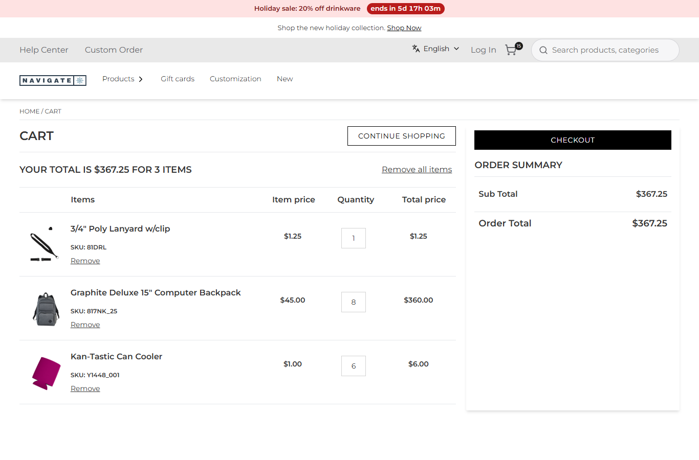
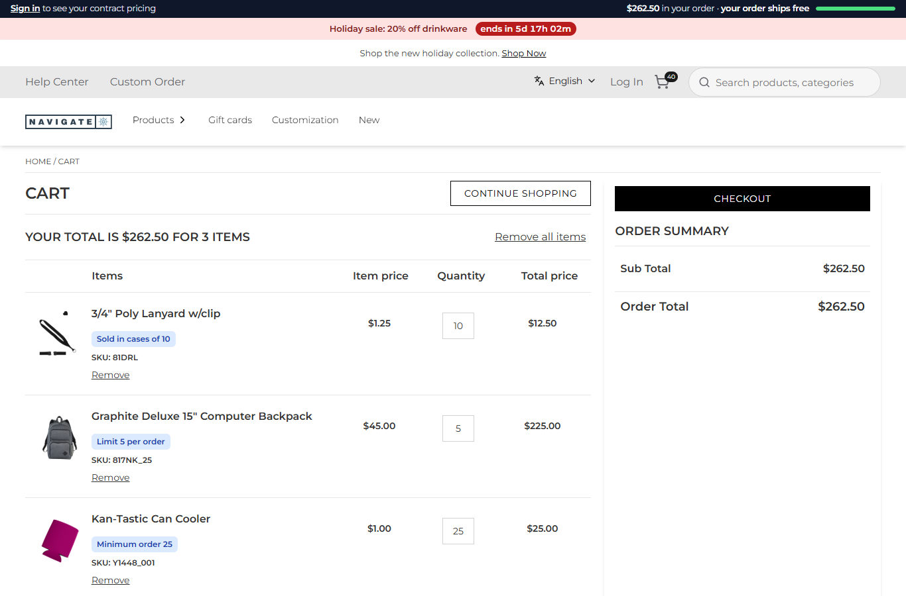
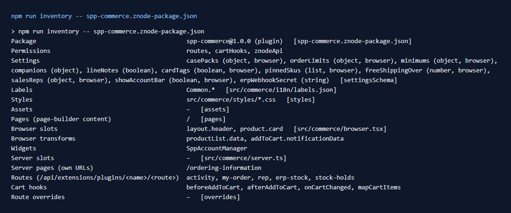

# 079: Can I create a complex plugin?

**Listed:** Yes. **Result here:** Yes, confirmed. `spp-commerce` is one plugin package that combines every plugin
capability the store has, rows 080-091. Two rows are blocked by the store: 087 (a plugin database) and 090 (events
between plugins).

| Before: the same cart, spp-commerce switched off | After: spp-commerce on: case pack, limit, minimum, line notes, the free-shipping meter |
| --- | --- |
|  |  |

Store: POCSppDemo (`sppdemo.localhost:3000`), its own theme. A new cart each time: 1 lanyard, 8 backpacks, 6 can
coolers. The plugin was switched off with `node scripts/registry.mjs enable false --package spp-commerce` for the
before picture, then on again. No deploy either way.

With the plugin on, the same three adds become 10 lanyards (a case), 5 backpacks (the order limit) and 25 can coolers
(the minimum). Each line explains its rule, and the bar shows $262.50 with "your order ships free".

## What the plugin is made of

| Row | Capability | In spp-commerce |
| --- | --- | --- |
| 080 | Code before and after add to cart | `beforeAddToCart` case packs, `afterAddToCart` activity log |
| 081, 113, 114 | React to cart changes, add or remove items, cart rules | `onCartChanged`: order limits, companion items, minimums |
| 082 | Change cart lines before they are shown | `mapCartItems`: line notes |
| 083 | Fill slots | `layout.header` (account bar), `product.card` (rule and stock-hold tags) |
| 084 | Transform data | `productList.data` (pins), `addToCart.notificationData` (popup quantity) |
| 085 | Read the cart and user | route `my-order` (`cartNumber`, `user`, `znode()`), free-shipping meter |
| 086 | Set cookies | route `rep` (`Set-Cookie` sales-rep link), read in a hook and in the browser |
| 088 | Labels | `Common.sppCommerce` in `src/commerce/i18n/labels.json` |
| 089 | A page with its own URL | `serverPages` `/ordering-information` |
| 091 | Webhooks | route `erp-stock` with `verifySignature` |
| 061, 067 | A widget, and its page content | `SppAccountManager`, `pages` `/` |
| 087, 090 | A database, events between plugins | blocked: not in the store |

The rules live in `src/commerce/rules.ts`, which has no store imports, so node can test them alone. The cart hooks,
the card tags, the cart-line notes, the popup transform and the ordering page all call it, so every place states the
same rule from the same settings.

Full inventory: [output.txt](output.txt).

## How it renders

**In the webstore (base):** the store's own pages, routes and agents ([§1-§9 A](../../RENDER-FLOW.md)).

**How this customization joins it:** the registry places the plugin for POCSppDemo. On each request the store loads
its browser part and its server part with the store's settings for it ([§2 B](../../RENDER-FLOW.md#2-which-store-which-packages-every-request)).

- **Browser part:** slots ([§4 B](../../RENDER-FLOW.md#4-worked-example-the-product-card-on-a-category-page),
  [§8 B](../../RENDER-FLOW.md#8-header-footer-search)), transforms, the widget
  ([§9 B](../../RENDER-FLOW.md#9-home-content-and-package-pages-widgets)), CSS, and labels
  ([§3 B](../../RENDER-FLOW.md#3-the-page-shell-root-layout-head-styles-labels-server-layout)).
- **Server part:** request and cart hooks ([§6 B](../../RENDER-FLOW.md#6-add-to-cart),
  [§7 B.1](../../RENDER-FLOW.md#7-cart-checkout-place-order)), routes
  ([§7 B.5](../../RENDER-FLOW.md#7-cart-checkout-place-order)) and the server page
  ([§9 B.1](../../RENDER-FLOW.md#9-home-content-and-package-pages-widgets)).
- Switching the entry off removes all of it at once.

End-to-end flow, with file and line references in the webstore: [docs/RENDER-FLOW.md](../../RENDER-FLOW.md).

## Where

No new code: this row is rows 080-091 together. See `src/commerce/` and each row's folder.

## How a client does this

Start from one capability (a slot or a route), keep the business rules in plain functions next to the plugin, and add
hooks, routes and pages that all call those functions. `npm run inventory -- <manifest>` lists what the built package
carries.
