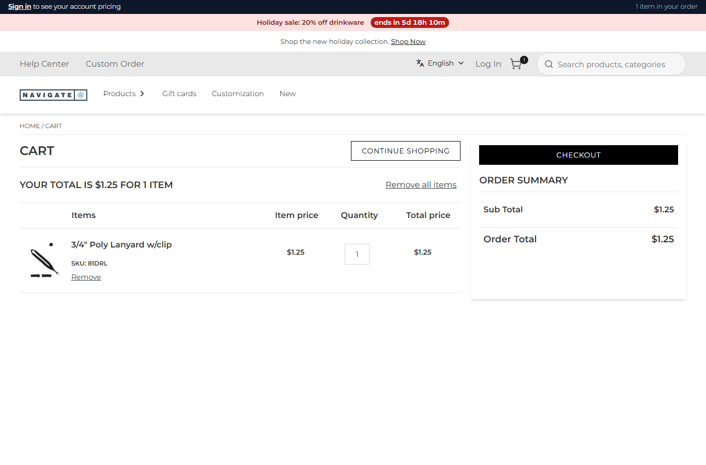

# 080: Can a plugin run code before and after add to cart?

**Listed:** Yes. **Result here:** Yes, confirmed: `beforeAddToCart` changes the request, `afterAddToCart` sees Znode's
answer.

| Before: 1 lanyard added → cart quantity 1 | After: 1 lanyard added → cart quantity 10 (a case pack) |
| --- | --- |
|  |  |

Store: POCSppDemo (`sppdemo.localhost:3000`), no preview (the spp-commerce plugin is placed for the store): "Add to
order" on the 3/4" Poly Lanyard (`81DRL`) with quantity 1, then the cart (a test cart in the local store).

## The example: case packs and an order activity log

Promotional products are often sold by the case. The spp-commerce plugin:

- **`beforeAddToCart`**: for SKUs in the `casePacks` setting (`{ "81DRL": 10 }`), the requested quantity is rounded up
  to whole packs **before the request goes to Znode**: 1 → 10, 11 → 20. Znode prices and stores the corrected line
  ($12.50, cart count 10).
- **`afterAddToCart`**: Znode's answer (`addToCartStatus`, `cartNumber`, `cartCount`) completes an activity record of
  what was asked, what was added and why, readable at `GET /api/extensions/plugins/spp-commerce/activity`:

  ```json
  {"sku":"81DRL","asked":1,"added":10,"rule":"case pack of 10","cartNumber":"C-10112026-1095","ok":true}
  ```

What the hooks receive was recorded first (a temporary version of this server part): the request is
`{ cartId, skuDetails: [{ sku, quantity, customData, personalizedDetails, ... }], localeId, userId }`, the response
`{ cartId, addToCartStatus, cartNumber, cartCount }`.

## How it renders

**In the webstore (base):** "Add to order" → `useAddToCart` → `POST /api/add-to-cart` (`apps/webstore/src/app/api/add-to-cart/route.ts`)
→ agent `addToCartProduct` → `POST {API_URL}commerceapi/v1/carts/add-to-cart` → cart cookie and count; the cart page
reads the lines back ([§6 A](../../RENDER-FLOW.md#6-add-to-cart), [§7 A](../../RENDER-FLOW.md#7-cart-checkout-place-order)).

**How this customization joins it:** the route calls `runBeforeAddToCart(request)` before the agent and
`runAfterAddToCart(response)` after it (`request-hooks.server.ts`): each enabled plugin's hook runs in order with
`{ store, settings, cookies }`; a returned object replaces the request ([§6 B](../../RENDER-FLOW.md#6-add-to-cart)). The
`activity` route runs through `runPluginRoute` ([§7 B.5](../../RENDER-FLOW.md#7-cart-checkout-place-order)).

End-to-end flow, with file and line references in the webstore: [docs/RENDER-FLOW.md](../../RENDER-FLOW.md).

## Where

- `src/commerce/server.ts` (new): the plugin's server part: `beforeAddToCart` (`roundToPacks`), `afterAddToCart`,
  `routes.activity`
- `spp-commerce.znode-package.json`: `build.server`; `"permissions": ["routes", "cartHooks"]`; setting `casePacks`

## How a client does this

Give a plugin a server part with `hooks.beforeAddToCart` / `hooks.afterAddToCart` (and declare `cartHooks`): return
the changed request from `before`; read Znode's answer in `after`.
