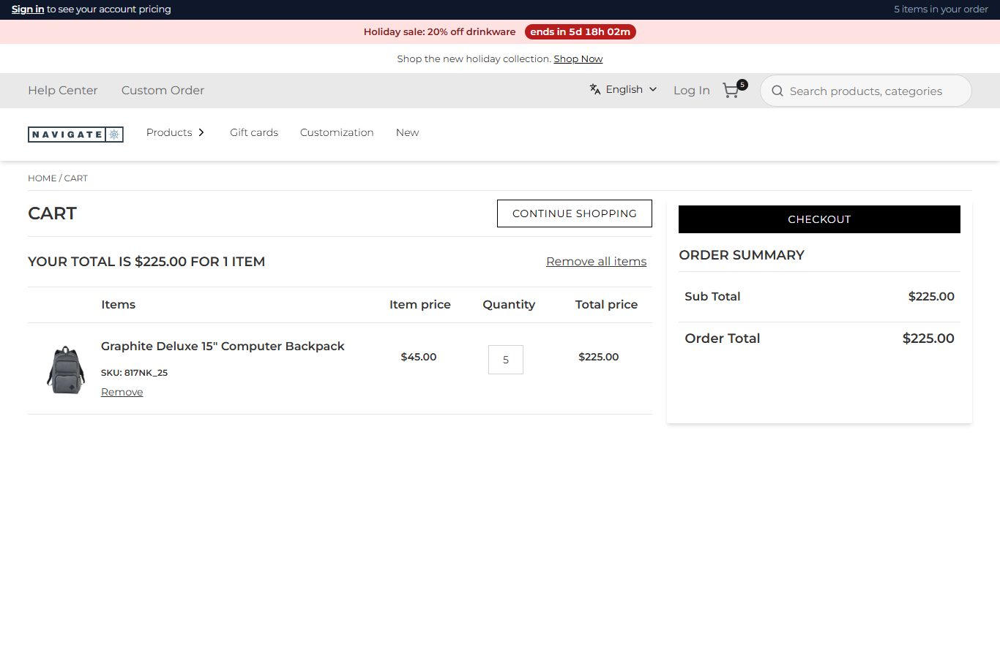

# 081: Can a plugin react when the cart changes?

**Listed:** Yes. **Result here:** Yes, confirmed: `onCartChanged` runs each time the cart is read and can change it
through `actions.removeLine` / `actions.addItem`, before the cart page shows it.

| Before: 8 backpacks added → the cart keeps 8 ($360) | After: 8 backpacks added → the cart shows 5, the order limit ($225) |
| --- | --- |
|  |  |

Store: POCSppDemo (`sppdemo.localhost:3000`), the spp-commerce plugin placed for the store. Quantity 8 on the Graphite
Deluxe 15" Computer Backpack (`817NK_25`, $45), "Add to cart", then the cart (a new test cart in the local store each
run). Before: `orderLimits` set to `{}`; after: `{ "817NK_25": 5 }`, the default.

## The example: "Limit 5 per order"

Promotional and B2B stores cap allocated or high-value items per order ("Limit 5 per order"). The cap belongs to the
store, not to the catalog, so it lives in the plugin's settings (`orderLimits`) and changes without a deploy
(`node scripts/registry.mjs set 'orderLimits={"817NK_25":5}' --package spp-commerce`).

- **`onCartChanged`** gets the cart as the webstore reads it, `{ cartNumber, lines: [{ id, sku, quantity, totalPrice,
  personalization }] }`. For a line over its limit (`overLimit` in `src/commerce/rules.ts`) it removes the line and adds
  the item again at the limit, its personalization kept: a plugin has no "set quantity" action.
- Each change is recorded with the add-to-cart activity of scenario 080:

  ```json
  {"sku":"817NK_25","asked":8,"added":5,"rule":"limit 5 per order","cartNumber":"C-10112026-1099","ok":true}
  ```

The rule holds however the quantity got there (the product page, the cart's quantity box, a reorder), because it runs
when the cart is read, not when an item is added. Full output: [output.txt](output.txt).

## How it renders

**In the webstore (base):** the cart page asks `GET /api/cart/get-cart-items` and `GET /api/cart/cart-summary`
(`apps/webstore/src/app/api/cart/*/route.ts`) → agent `getCartItems` → Znode `commerceapi/v1/{classType}/item-list/{classNumber}` →
`CartItems.tsx` renders each line ([§7 A](../../RENDER-FLOW.md#7-cart-checkout-place-order)).

**How this customization joins it:** both routes call `runCartHooks(cartNumber)` first (`cart-hooks.server.ts`): one at
a time per cart (a lock, as the page reads items and summary in parallel), each enabled plugin's `onCartChanged` gets
the cart as the previous plugin left it, with `actions` that call the agents `removeItemFromCart` and
`addToCartProduct` on the same cart. The route then reads the cart, so the page shows it already changed
([§7 B.1](../../RENDER-FLOW.md#7-cart-checkout-place-order)).

End-to-end flow, with file and line references in the webstore: [docs/RENDER-FLOW.md](../../RENDER-FLOW.md).

## Where

- `src/commerce/server.ts`: `hooks.onCartChanged`; the activity route now lists cart changes too
- `src/commerce/rules.ts` (new): `overLimit`, the rule without the hook (testable with node alone)
- `spp-commerce.znode-package.json`: setting `orderLimits` (default `{ "817NK_25": 5 }`)
- `scripts/cart-shot.mjs` (new): fills a new cart (`--add <productId>:<qty>`), screenshots the cart page, can remove a
  line (`--remove <productId>`) and print a route (`--route`)

## How a client does this

Give a plugin a server part with `hooks.onCartChanged` (and declare `cartHooks`): read `cart.lines`, change the cart
with `actions.removeLine(id)` / `actions.addItem({ sku, quantity, personalization })`. Keep the rule idempotent: it runs
on every cart read, so a cart that already follows it must not be changed again.
