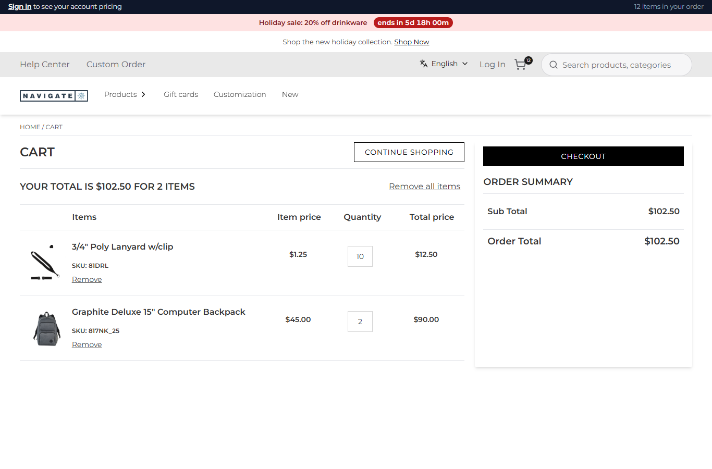
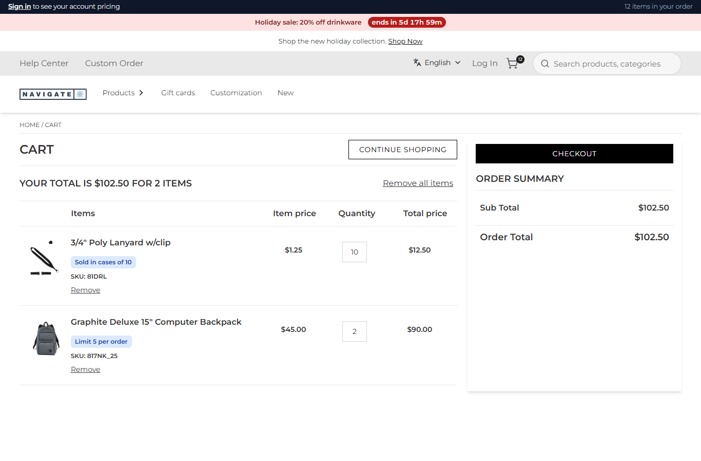

# 082: Can a plugin change cart lines before they are shown?

**Listed:** Yes. **Result here:** Yes, confirmed: `mapCartItems` gets the cart's lines before the cart page (and
checkout) shows them and returns them changed.

| Before: the lines as Znode returns them | After: "Sold in cases of 10" and "Limit 5 per order" under the lines they apply to |
| --- | --- |
|  |  |

Store: POCSppDemo (`sppdemo.localhost:3000`), the spp-commerce plugin placed for the store. Added: 1 × 3/4" Poly Lanyard
(`81DRL`, rounded to 10 by the case-pack rule of 080) and 2 × Graphite Deluxe 15" Computer Backpack (`817NK_25`, limit 5
from 081), then the cart. Before: setting `lineNotes` false; after: true (the default).

## The example: tell the shopper about the rules before they hit them

Scenarios 080 and 081 change quantities silently. Stores that sell by the case or cap items say so on the line
("Sold in cases of 10", "Limit 5 per order"), so a quantity of 10 is no surprise. `mapCartItems` gets
`{ cartNumber, cartItems: [{ sku, productName, productDescription, quantity, unitPrice, ... }] }` and adds the notes
after Znode's `productDescription`, which `CartItems.tsx` renders as HTML. The notes come from the same settings as
the rules (`casePacks`, `orderLimits`), so the notes and the rules cannot disagree.

- `lineNotes` / `withNotes` in `src/commerce/rules.ts`: the notes for a SKU, escaped, in a `ul.spp-line-notes`; a
  description that already has them is left as it is.
- `src/commerce/styles/commerce.css`: the notes as small blue tags.

The shopper's cart in Znode is not changed: only what the page shows.

## How it renders

**In the webstore (base):** the cart page asks `GET /api/cart/get-cart-items` (`apps/webstore/src/app/api/cart/get-cart-items/route.ts`)
→ agent `getCartItems` → Znode `commerceapi/v1/{classType}/item-list/{classNumber}` → `CartItems.tsx` renders each line,
`productDescription` through `dangerouslySetInnerHTML` ([§7 A](../../RENDER-FLOW.md#7-cart-checkout-place-order)).

**How this customization joins it:** after `runCartHooks` (081), the route passes the agent's answer to
`runMapCartItems(...)` (`request-hooks.server.ts`): each enabled plugin's `mapCartItems` gets the lines as the previous
plugin left them, with `{ store, settings, cookies }`; a returned object replaces them, and that is what the route
answers ([§7 B.1](../../RENDER-FLOW.md#7-cart-checkout-place-order)). The plugin's CSS is linked on every page of the
store ([§3 B.1](../../RENDER-FLOW.md)).

End-to-end flow, with file and line references in the webstore: [docs/RENDER-FLOW.md](../../RENDER-FLOW.md).

## Where

- `src/commerce/server.ts`: `hooks.mapCartItems`
- `src/commerce/rules.ts`: `lineNotes`, `withNotes`
- `src/commerce/styles/commerce.css`: `.spp-line-notes`
- `spp-commerce.znode-package.json`: setting `lineNotes` (default true)

## How a client does this

Give a plugin a server part with `hooks.mapCartItems` (and declare `cartHooks`): change the fields of
`cartItems[]` (name, description, image) and return the object. Return the data, never throw: a plugin that throws is
logged and skipped, and the shopper gets the lines unchanged.
