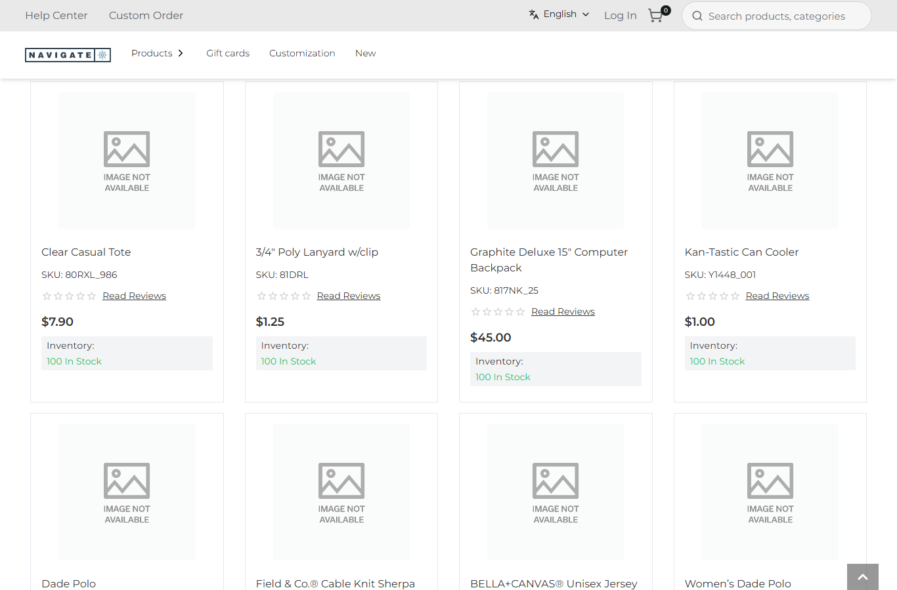
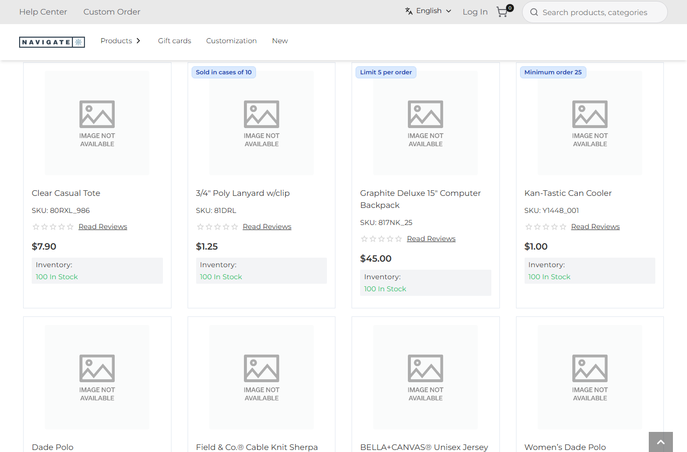

# 083: Can a plugin fill slots in the page?

**Listed:** Yes. **Result here:** Yes, confirmed. A plugin's browser part fills slots the same way a theme's does
(`slots: { "<slot>": Component }`), and it runs for the stores the plugin is placed for, whatever their theme. The
spp-commerce plugin now fills two slots: `layout.header` (the account bar, row 061) and **`product.card`** (below).
Its order next to a theme's output is rows 046-047.

| Before: Best Sellers, the store's cards | After: spp-commerce's ordering rules on the cards they apply to |
| --- | --- |
|  |  |

Store: POCSppDemo (`sppdemo.localhost:3000`), Best Sellers (`/category/1674`), its own theme (redpanda, no preview),
scrolled to the first row of cards.

## The example: tell the shopper the ordering rules on the card

Rows 080, 081 and 114 enforce three rules in the cart: case packs, a per-order limit, a minimum. A shopper should
know them before adding the item, so the plugin puts them on the product card:

- 3/4" Poly Lanyard (`81DRL`): **Sold in cases of 10**
- Graphite Deluxe Backpack (`817NK_25`): **Limit 5 per order**
- Kan-Tastic Can Cooler (`Y1448_001`): **Minimum order 25**

`RuleTags` (`src/commerce/slots/RuleTags.tsx`) reads the card's `product.sku` and calls `lineNotes` (`src/commerce/rules.ts`),
the same function that writes the cart-line notes of row 082. Card, cart and checkout always say the same thing. The
store's card (`children`) is kept as it is, and the tags sit over its top edge. A card without a rule is returned
untouched.

The rule settings (`casePacks`, `orderLimits`, `minimums`) are now `browser: true`, so the browser part can read them.
They are not secrets. A new setting, `cardTags`, turns the tags off.

## How it renders

**In the webstore (base):** listing → `ProductCard` (`base-components/.../product-card/ProductCard.tsx`), wrapped by
`withRuntimeWrapper(RuntimeProductCard, ...)` ([§4 A](../../RENDER-FLOW.md#4-worked-example-the-product-card-on-a-category-page)).

**How this customization joins it:** `RuntimeProductCard` renders `RuntimeSlot name="product.card"` with the card's
props. The slot reduces over the store's packages: the theme chain first, then plugins in registry order. Each gets
the previous output as `children`, so spp-commerce's `RuleTags` wraps whatever card the theme left
([§4 B](../../RENDER-FLOW.md#4-worked-example-the-product-card-on-a-category-page)). The plugin's CSS is linked like a
theme's ([§3 B.1](../../RENDER-FLOW.md#3-the-page-shell-root-layout-head-styles-labels-server-layout)).

End-to-end flow, with file and line references in the webstore: [docs/RENDER-FLOW.md](../../RENDER-FLOW.md).

## Where

- `src/commerce/slots/RuleTags.tsx` (new), registered in `src/commerce/browser.tsx` (`"product.card": RuleTags`)
- `src/commerce/styles/commerce.css`: `.spp-commerce-rules-card`
- `spp-commerce.znode-package.json`: rule settings `browser: true`, new `cardTags`

## How a client does this

In the plugin's browser part, return `slots: { "product.card": Component }`. Render `props.children` to keep the
card and add your part around it. Read only `browser: true` settings there, because they reach the shopper's browser.
