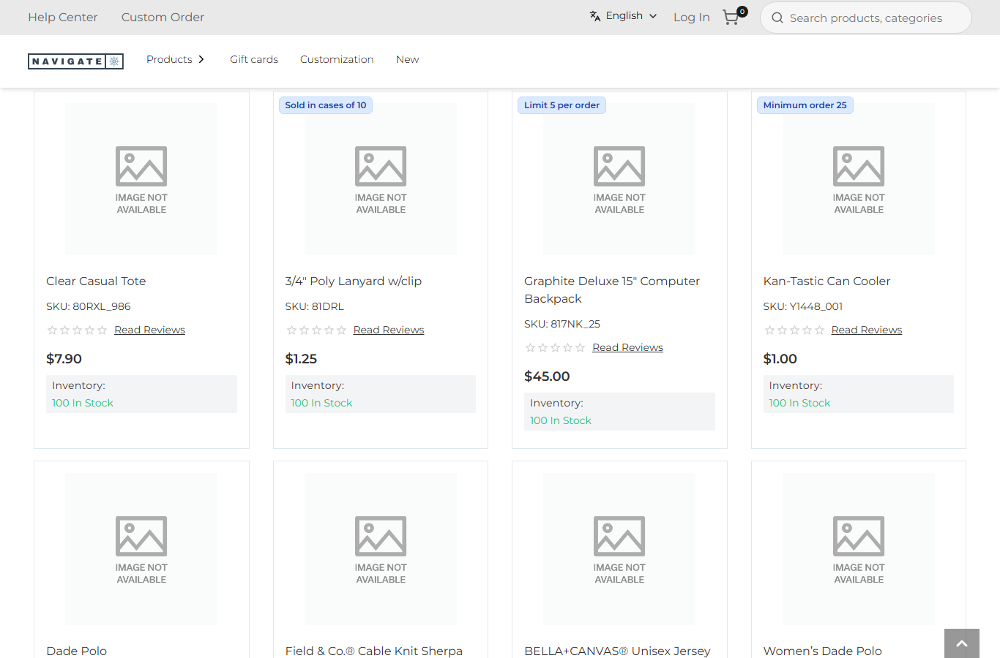
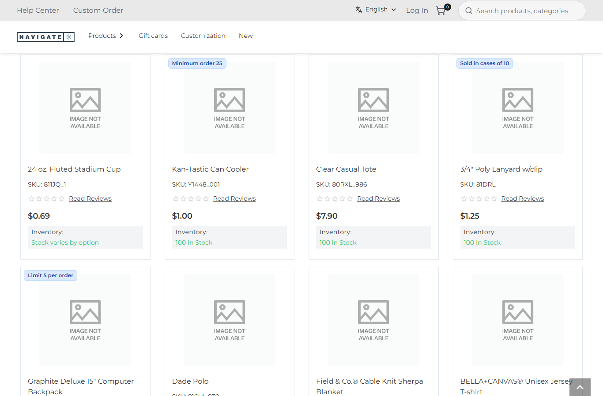
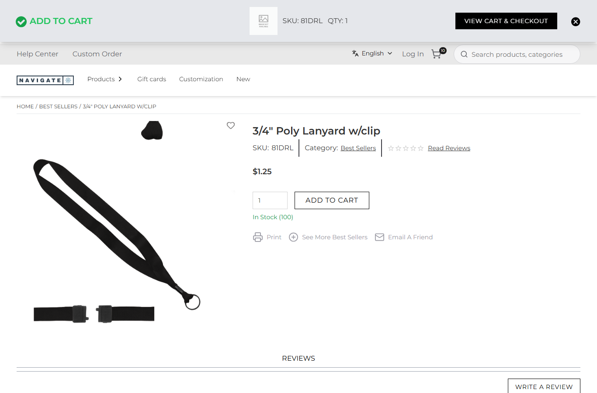

# 084: Can a plugin transform data (listing data, popup data)?

**Listed:** Yes. **Result here:** Yes, confirmed for both transforms the store has. A transform changes the data a
part of the page receives, not its markup: `productList.data` (category and search listings) and
`addToCart.notificationData` (the added-to-cart popup). The store's own components then render the changed data.

| Before: Best Sellers in the store's order | After: the promoted drinkware first (`pinnedSkus`) |
| --- | --- |
|  |  |

| Before: 1 lanyard added → the popup says QTY: 1, the cart has 10 | After: the popup says QTY: 10, what the cart got |
| --- | --- |
|  |  |

Store: POCSppDemo (`sppdemo.localhost:3000`), its own theme (redpanda, no preview): Best Sellers (`/category/1674`)
scrolled to the first row; the 3/4" Poly Lanyard's page (`/product/103808`) after "Add to cart" with quantity 1.

## The examples

**Merchandising pins (`productList.data`).** The holiday sale is on drinkware (the spp-promos bar), so the store
promotes the 24 oz. Fluted Stadium Cup (`811JQ_1`) and the Kan-Tastic Can Cooler (`Y1448_001`). They come first in
every listing they are in, in the order set. The rest keep the store's order, and the count, sort bar and facets are
unchanged. The list is a setting, `pinnedSkus`, so merchandisers change it without a deploy:

```
node scripts/registry.mjs set 'pinnedSkus=["811JQ_1","Y1448_001"]' --package spp-commerce
```

**The popup's quantity (`addToCart.notificationData`).** Row 080 rounds a lanyard add up to a case of 10 on the
server, but the store's popup showed the quantity typed (1), so it disagreed with the cart (10). The transform gives
the popup the quantity the cart really got. It uses `caseQuantity`, the same rounding as `beforeAddToCart`.

Both transforms are pure functions of the data and the plugin's browser settings (`src/commerce/transforms.ts`). The
logic (`pinFirst`, `caseQuantity`) is in `src/commerce/rules.ts`, next to the cart rules.

## How it renders

**In the webstore (base):** the listing's `ProductViews` renders `productData.productList` with the store's cards
([§4 A](../../RENDER-FLOW.md#4-worked-example-the-product-card-on-a-category-page)). After an add to cart, the store
fills `addToCartNotificationData` in its product store, and the popup renders it
([§6 A](../../RENDER-FLOW.md#6-add-to-cart)).

**How this customization joins it:**

- `RuntimeProductViews` runs `useRuntimeTransform("productList.data")`, which chains every package's transform in
  order. It hands the result to the store's listing (`cloneElement(children, { productData })`), or to a
  `productList.layout` slot when one is filled
  ([§4 B](../../RENDER-FLOW.md#4-worked-example-the-product-card-on-a-category-page)).
- `RuntimeAddToCartNotification` runs the `addToCart.notificationData` transforms on the popup data and writes the
  result back to the product store, before the shopper sees much of it ([§6 B](../../RENDER-FLOW.md#6-add-to-cart)).

End-to-end flow, with file and line references in the webstore: [docs/RENDER-FLOW.md](../../RENDER-FLOW.md).

## Where

- `src/commerce/transforms.ts` (new): `pinPromoted`, `popupQuantity`
- `src/commerce/rules.ts`: `pinFirst`, `caseQuantity`
- `src/commerce/browser.tsx`: `transforms: { "productList.data", "addToCart.notificationData" }`
- `spp-commerce.znode-package.json`: setting `pinnedSkus` (list, browser)

## How a client does this

In a package's browser part, return `transforms: { "<name>": (data) => changedData }`. Return a new object (or the
same one when there is nothing to change), never mutate the data, and keep it fast: a transform runs on every render
of that part.
