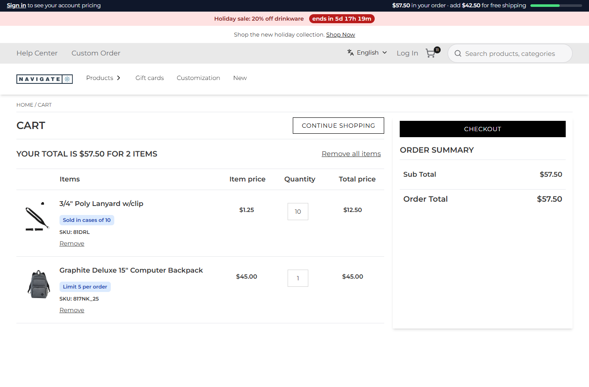

# 085: Can a plugin read the shopper's cart and user?

**Listed:** Yes. **Result here:** Yes, confirmed. A plugin route's `context` carries the shopper's `cartNumber` (from
their cart cookie) and `user` (from their session: id, name, account, role, budget). With `context.znode` (permission
`znodeApi`) the route reads that cart's lines from Znode with the store's headers. In the browser, a plugin also has
the store's `useCartCount()` and `useUser()` hooks.

| Before: the account bar says "11 items in your order" | After: "$57.50 in your order · add $42.50 for free shipping", with a meter |
| --- | --- |
|  |  |

Store: POCSppDemo (`sppdemo.localhost:3000`), its own theme. A new cart each time: 1 × 3/4" Poly Lanyard (a case of 10,
$12.50) and 1 × Graphite Deluxe Backpack ($45), then the cart page.

## The example: a free-shipping meter in the account bar

Most stores nudge the shopper toward their free-shipping threshold. The store's header only knows the item count, so
spp-commerce adds a route, **`GET /api/extensions/plugins/spp-commerce/my-order`** (`myOrder` in
`src/commerce/server.ts`). It:

- takes `context.cartNumber` and reads the lines with `context.znode("commerceapi/v1/Carts/item-list/<cart>")`, the
  same Znode call as the cart page's agent
- adds up the items and the subtotal, and works out the gap to `freeShippingOver` (a new setting, $100, the same
  threshold the theme's announcement bar advertises)
- returns the signed-in buyer's name and budget from `context.user` (`null` for a guest)

```json
{"cartNumber":"C-10112026-1115","lines":2,"items":11,"subtotal":57.5,"freeShippingOver":100,"remaining":42.5,"user":null}
```

The account bar (`src/commerce/slots/AccountBar.tsx`, slot `layout.header`) calls the route again whenever the cart's
item count changes (`host.stores.useCartCount()`). It shows the subtotal, what is left for free shipping and a progress
bar ("your order ships free" past the threshold). For a signed-in buyer it adds "budget left $…" when their account
sets a budget. The pictures show a guest: account rows need a signed-in buyer (see `SCENARIOS.md`).

**Whose data:** the cart is the one in the requesting browser's cookie, and the user the one in its session. A request
without a cart cookie gets no cart ([output.txt](output.txt)). That is the same trust the store's own cart page puts in
its cart cookie.

## How it renders

**In the webstore (base):** the header shows the cart count from the store's cart state; the cart page reads the lines
through the agent `getCartItems` → Znode `commerceapi/v1/{classType}/item-list/{classNumber}`
([§7 A](../../RENDER-FLOW.md#7-cart-checkout-place-order), [§8 A](../../RENDER-FLOW.md#8-header-footer-search)).

**How this customization joins it:**

- The bar fills `layout.header` ([§8 B](../../RENDER-FLOW.md#8-header-footer-search)) and fetches the route.
- The store's plugin route handler `runPluginRoute` builds the context ([§7 B.5](../../RENDER-FLOW.md#7-cart-checkout-place-order)):
  - `cartNumber` comes from the `CartNumber` cookie
  - `user` comes from `getSavedUserSession()` (userId, userName, accountId, accountCode, roleName, budgetAmount, …)
  - `znode(path)` fetches `{API_URL}path` with `getApiHeaders` and accepts only paths under the API root

End-to-end flow, with file and line references in the webstore: [docs/RENDER-FLOW.md](../../RENDER-FLOW.md).

## Where

- `src/commerce/server.ts`: `myOrder`, route `my-order`
- `src/commerce/slots/AccountBar.tsx`: the meter, the budget, the route call on cart changes
- `src/commerce/styles/commerce.css`: `.spp-commerce-account__order`, `__meter`
- `spp-commerce.znode-package.json`: permission `znodeApi`; setting `freeShippingOver` (number, browser, 100)

## How a client does this

Read `context.cartNumber` and `context.user` in a route (they are the requesting shopper's), fetch what you need with
`context.znode(...)` (declare `znodeApi`), and return only what the page needs. Call the route from a slot or widget,
and call it again when `useCartCount()` changes.
