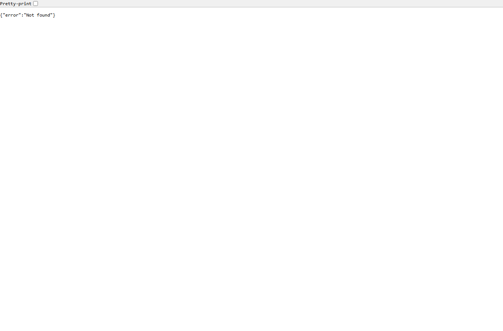
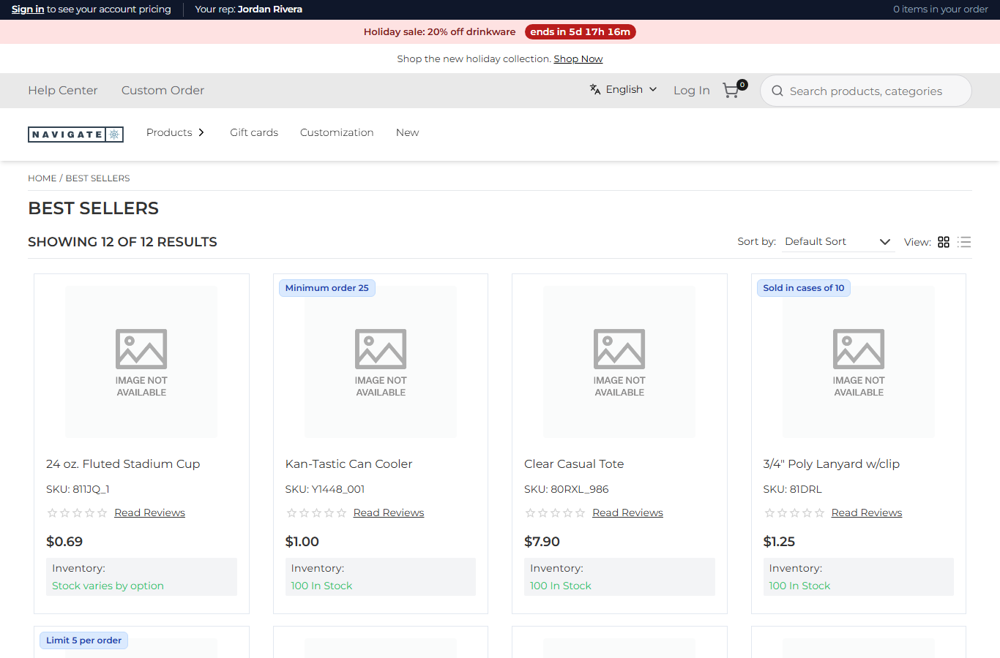

# 086: Can a plugin set cookies?

**Listed:** Partial. **Result here:** Yes, it can set them. Reading them back is limited:

| Where | Set a cookie | Read a cookie |
| --- | --- | --- |
| Plugin route | **Yes**: return a `Response` with `Set-Cookie` (sent as it is) | **No**: the route's request headers come without the shopper's cookies, and the context has no cookie reader |
| Cart hooks (`beforeAddToCart`, `afterAddToCart`, `mapCartItems`) | No | **Yes**: `context.cookies.get(name)` (and `delete`) |
| Browser part (slots, widgets) | Yes (`document.cookie`) | **Yes**, if the cookie is not `HttpOnly` |

| Before: a rep's link → `{"error":"Not found"}` | After: the same link → Best Sellers, "Your rep: Jordan Rivera" in the account bar |
| --- | --- |
|  |  |

Store: POCSppDemo (`sppdemo.localhost:3000`), its own theme. Link:
`/api/extensions/plugins/spp-commerce/rep?code=JR&to=/category/1674`.

## The example: sales-rep attribution

B2B and promotional-products stores sell through reps, and each rep sends customers links to the store. The store
should remember which rep a shopper came through and credit their orders to that rep.

- **`routes.rep`** (`src/commerce/server.ts`) handles `?code=JR&to=/category/1674`. For a rep in the `salesReps`
  setting (`{ "JR": "Jordan Rivera", "MP": "Maya Patel" }`) it answers **302** with
  `Set-Cookie: spp_rep=JR; Path=/; Max-Age=2592000; SameSite=Lax`, which lasts 30 days. An unknown code still
  redirects, without the cookie. A target that is not a path on this store (`//evil.example`) is replaced by `/`, so the
  route is not an open redirect.
- **The account bar** (`src/commerce/slots/AccountBar.tsx`) reads `spp_rep` after the page loads and shows "Your rep:
  Jordan Rivera".
- **`beforeAddToCart`** reads the cookie with `context.cookies.get("spp_rep")` and credits each add to the rep in the
  activity log:
  `{"sku":"81DRL","asked":1,"added":10,"rule":"case pack of 10","rep":"JR",...}`.

The cookie is not `HttpOnly`, so that the bar can read it; a rep code is not a secret (the `npx znode check` warning
about reading cookies in the browser is expected here). For a value that must stay private, set it `HttpOnly` and read
it only in a hook. Full output: [output.txt](output.txt).

## How it renders

**In the webstore (base):** the store's own cookies (cart, locale, session) are set by its proxy and routes
([§2 A](../../RENDER-FLOW.md#2-which-store-which-packages-every-request)).

**How this customization joins it:**

- `runPluginRoute` sends a `Response` returned by a route as it is, adding `Cache-Control: no-store` when it has none
  ([§7 B.5](../../RENDER-FLOW.md#7-cart-checkout-place-order)).
- The proxy adds the store's own cookies to the same answer.
- The request hooks get `cookies.get` / `cookies.delete` from `next/headers` (`request-hooks.server.ts`
  `hookContext`, [§6 B](../../RENDER-FLOW.md#6-add-to-cart)).
- The account bar is the `layout.header` slot ([§8 B](../../RENDER-FLOW.md#8-header-footer-search)).

End-to-end flow, with file and line references in the webstore: [docs/RENDER-FLOW.md](../../RENDER-FLOW.md).

## Where

- `src/commerce/server.ts`: `repRedirect`, `repRoute` (route `rep`), the rep credit in `beforeAddToCart`
- `src/commerce/slots/AccountBar.tsx`: `useRep`, "Your rep"
- `src/commerce/styles/commerce.css`: `.spp-commerce-account__rep`
- `spp-commerce.znode-package.json`: setting `salesReps` (object, browser)
- `scripts/cart-shot.mjs`: `--visit <path>` opens a link before the adds

## How a client does this

Return `new Response(body, { status, headers })` from a route, with `Set-Cookie` in the headers. Read the cookie in a
hook (`context.cookies.get`) or in the browser. To read it in a route as well, pass it in the query or body: routes
never see the shopper's cookies.
