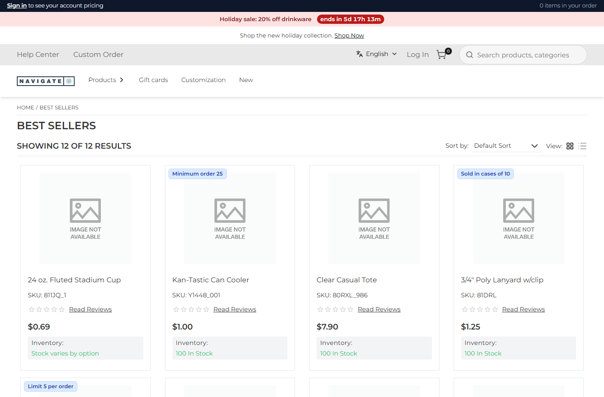
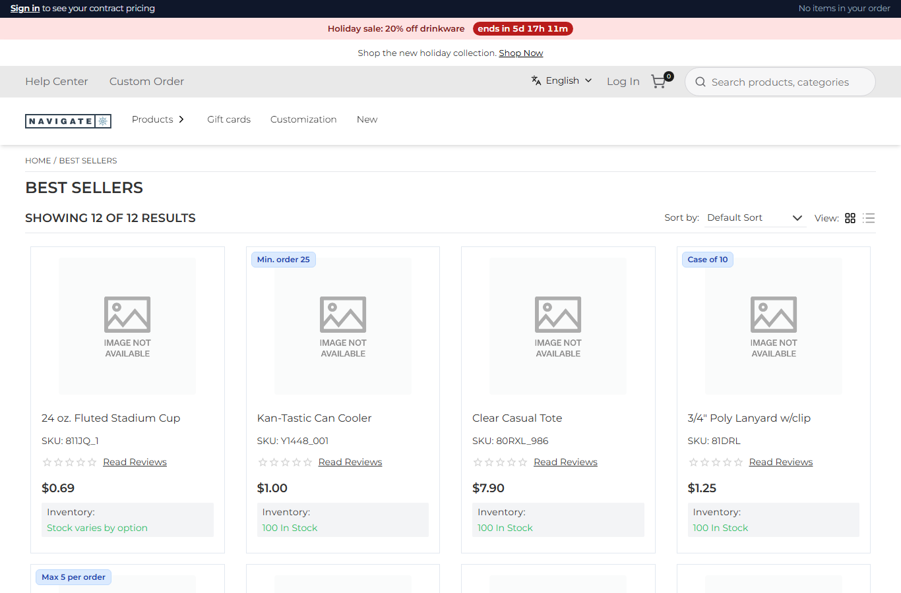
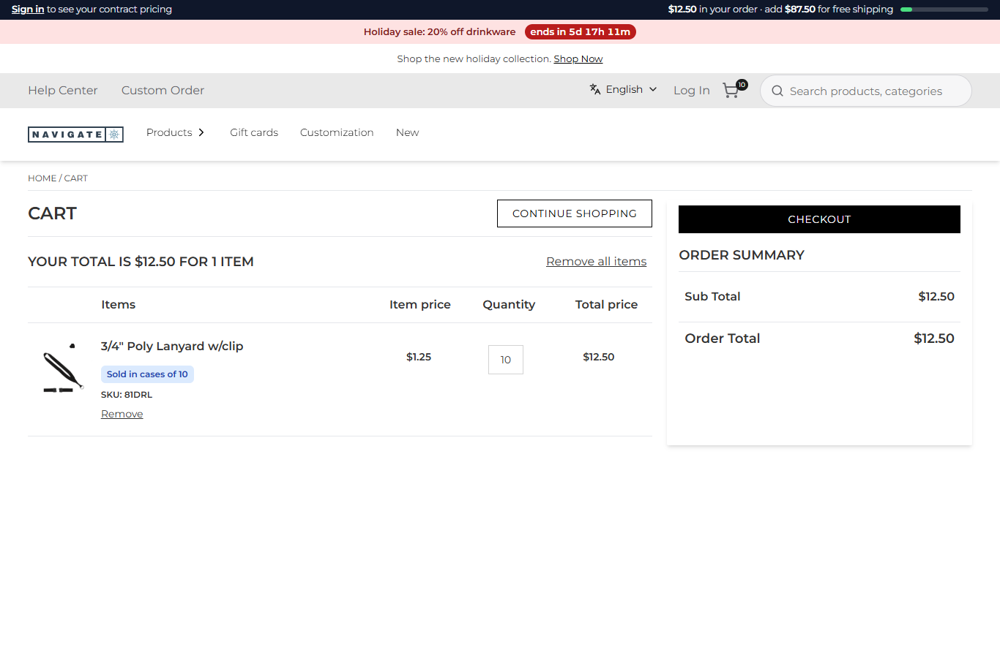
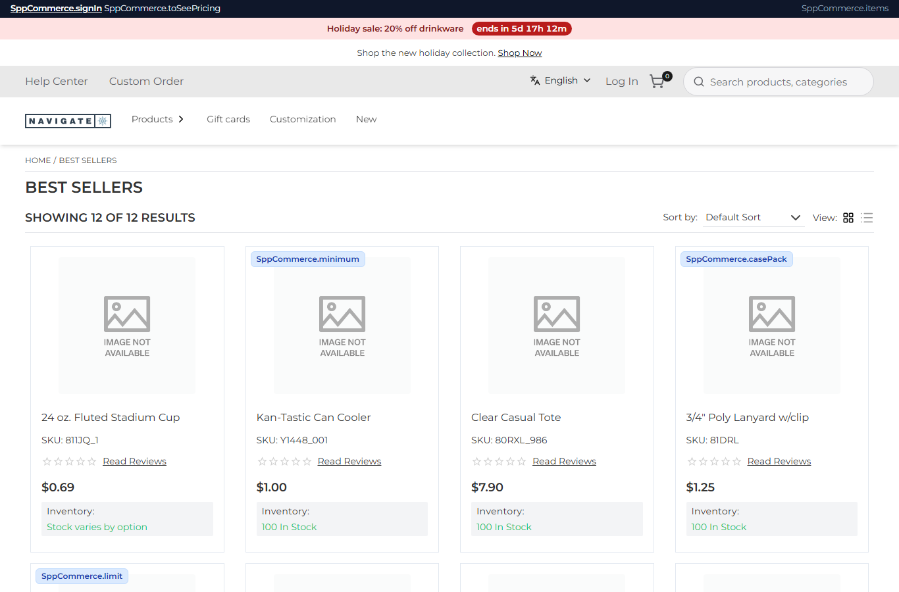

# 088: Can a plugin add labels and messages?

**Listed:** Yes. **Result here:** Yes, with one constraint found here. A plugin's `"messages"` file is deep-merged
into the store's messages, as a theme's is (row 032), and its browser parts read labels with next-intl's
`useTranslations`, which the store hands to packages. The constraint: the store's root layout sends the browser only
a fixed list of namespaces (`Common`, `Product`, `Layout`, `Login`, …). A **new top-level namespace** is merged on the
server but never reaches the browser, so browser parts print its raw keys. Labels nested **under a namespace the store
sends** (`Common.sppCommerce`) work.

| Before: spp-commerce's wording hard-coded in English | After: its own labels ("contract pricing", "Min. order 25", "Case of 10", ICU plural "No items in your order") |
| --- | --- |
|  |  |

| After: the meter's labels, with amounts and bold through `t.rich` | Tried first: a new namespace `SppCommerce`, whose raw keys show in the browser |
| --- | --- |
|  |  |

Store: POCSppDemo (`sppdemo.localhost:3000`), its own theme: Best Sellers, and a cart with one lanyard (a case of 10).

## The example: the plugin's UI in the store's B2B voice, translatable

Rows 083, 085 and 086 gave spp-commerce visible text: the account bar, the free-shipping meter and the rule tags on
cards. All of it was hard-coded English. Now every string is a label in `src/commerce/i18n/labels.json`, written in the
store's voice:

| Key (`Common.sppCommerce.*`) | Text |
| --- | --- |
| `toSeePricing` | to see your contract pricing |
| `items` | `{count, plural, =0 {No items in your order} one {# item in your order} other {# items in your order}}` |
| `inYourOrder`, `addForFreeShipping` | `<b>{amount}</b> in your order`, `add <b>{amount}</b> for free shipping` |
| `casePack`, `minimum`, `limit` | Case of `{count}`, Min. order `{count}`, Max `{count}` per order |
| `yourRep`, `signedInAs`, `budgetLeft`, … | the rest of the bar |

- The account bar (`AccountBar.tsx`) and the card tags (`RuleTags.tsx`) use `useTranslations("Common.sppCommerce")`.
  `t(key, values)` fills plain text and `t.rich(key, { b })` turns `<b>` into bold.
- `rules.ts` now returns the rules as facts (`ruleFacts`: rule and count), so the tags word them from labels.
- `znode-env.d.ts` declares the `next-intl` types a package uses, because the store supplies the module at run time.
- Also fixed: the "$" in the bar's amounts. A string `replace()` in row 086's edit had read `$$` as an escaped `$` and
  dropped it, so the bar printed "57.50". It shows "$12.50" again.

**Not covered by labels:** the cart-line notes (row 082) are written on the server by `mapCartItems`, and server hooks
get no translations. They stay in English, from the same rule facts.

## How it renders

**In the webstore (base):** `i18n/request.ts` loads `messages/<locale>.json` for next-intl. The root layout picks the
namespaces the browser needs, `fetchMessages(["Barcode", "Common", "Layout", …, "Product", "Price", "SwitchAccount"])`,
into `NextIntlClientProvider` ([§3 A](../../RENDER-FLOW.md#3-the-page-shell-root-layout-head-styles-labels-server-layout)).

**How this customization joins it:**

- `withRuntimeMessages` deep-merges every package's `"messages"` file, from the theme chain and the plugins, into
  those messages ([§3 B.7](../../RENDER-FLOW.md#3-the-page-shell-root-layout-head-styles-labels-server-layout)).
- Packages import `useTranslations` from `next-intl`, which the store provides (`store-modules.ts`), and read whatever
  the provider holds. That includes `Common.sppCommerce`, but not a namespace outside the layout's list.

End-to-end flow, with file and line references in the webstore: [docs/RENDER-FLOW.md](../../RENDER-FLOW.md).

## Where

- `src/commerce/i18n/labels.json` (new); `spp-commerce.znode-package.json`: `"messages": "src/commerce/i18n/labels.json"`
- `src/commerce/slots/AccountBar.tsx`, `src/commerce/slots/RuleTags.tsx`: labels through `useTranslations`
- `src/commerce/rules.ts`: `ruleFacts`
- `znode-env.d.ts`: `declare module "next-intl"`

## How a client does this

Add a `"messages"` file to the package. Nest its keys under a namespace the store already sends to the browser
(`Common.<yourPackage>`) and read them with `useTranslations("Common.<yourPackage>")`. A theme or another package can
reword them by merging the same keys.
