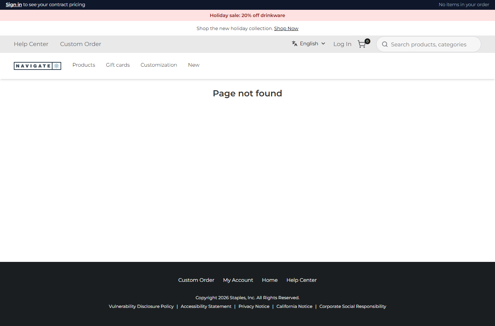
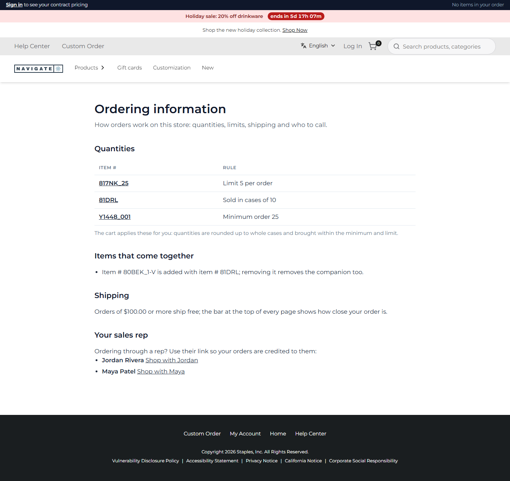
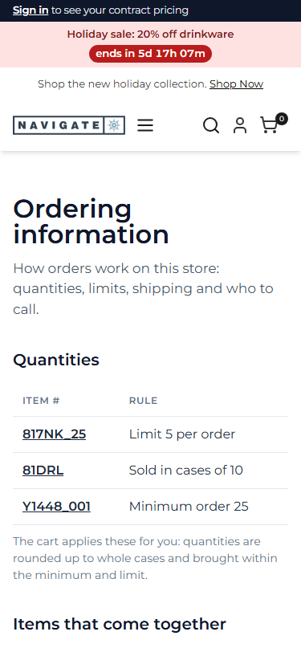

# 089: Can a plugin add a page with its own URL?

**Listed:** Partial. **Result here:** Yes, confirmed for a plugin. `serverPages` in a plugin's server part gives it a
whole page at a new URL. The store renders it on the server, inside its layout, with its own `<title>` and
description, for the stores the plugin is placed for. The theme does the same with `/spp-customization-welcome`
(row 039). Limits from the SDK: the path must be lowercase, and not under `/api`, `/login` or another store route. Not
in a sandboxed package.

| Before: `/ordering-information` → the store's 404 | After: the plugin's "Ordering information" page |
| --- | --- |
|  |  |

Phone: 

Store: POCSppDemo (`sppdemo.localhost:3000`), its own theme (redpanda).

## The example: an ordering-information page that cannot go out of date

B2B stores publish their ordering policies, and a hand-written CMS page drifts from what the cart really does. Here
spp-commerce writes the page **from the same settings its cart rules use**:

- **Quantities**: every SKU with a case pack, minimum or limit, worded by `ruleFacts` (`rules.ts`), each linked to the
  store's search
- **Items that come together**: the companions of row 113
- **Shipping**: the free-shipping threshold of the meter (row 085)
- **Your sales rep**: the reps of row 086, with their links ("Shop with Jordan" sets the rep cookie)

Change a setting with `scripts/registry.mjs` and the page, the card tags, the cart and the meter all change together.

The page is in the HTML the server sends, so search engines see it and nothing flashes. It has its own `<title>` and
meta description ([output.txt](output.txt)). On a store the plugin is not placed for (MaxwellsHardware), the URL does
not exist. Inside the store's layout, a theme sizes the page content's direct children (redpanda: `max-width: 1290px`),
so the page puts its own width on an inner box and works under any theme.

## How it renders

**In the webstore (base):** an unknown path falls to the store's not-found handling (redirect to `/404`).

**How this customization joins it:**

- The store's catch-all page checks the request path against the `serverPages` of the store's packages (the
  manifest's list and the server part's `serverPages`).
- For a match it calls `render({ path, searchParams }, { React, store, settings })` on the server and uses `metadata`
  for the page's `<title>` and description.
- The page renders inside the root layout, so the header and footer slots, the account bar and the theme's styles
  apply as on any page ([§9 B.1](../../RENDER-FLOW.md#9-home-content-and-package-pages-widgets)).
- `server.ts` has no JSX, so it builds the element with the store's React from the context:
  `context.React.createElement(OrderingInfoPage, { settings, storeCode })`.

End-to-end flow, with file and line references in the webstore: [docs/RENDER-FLOW.md](../../RENDER-FLOW.md).

## Where

- `src/commerce/OrderingInfoPage.tsx` (new): the page, a server component
- `src/commerce/server.ts`: `serverPages["/ordering-information"]` with `render` and `metadata`
- `spp-commerce.znode-package.json`: `"serverPages": ["/ordering-information"]`
- `src/commerce/styles/commerce.css`: `.spp-commerce-info`

## How a client does this

List the path in the manifest's `"serverPages"`, and give the server part `serverPages: { "/path": { render, metadata
} }`. `render` may be async, can fetch data and can call `redirect()` / `notFound()`. Read settings from the context:
they are the store's, not the browser's.
