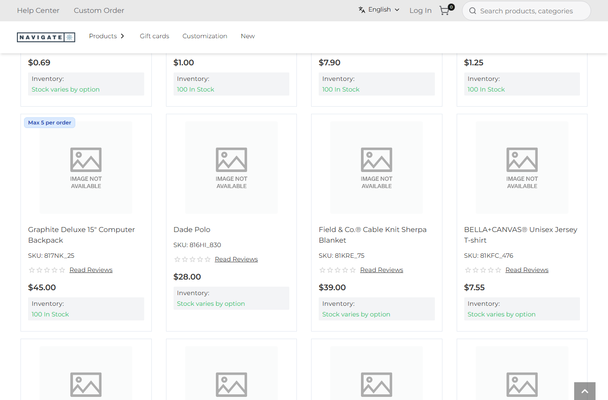
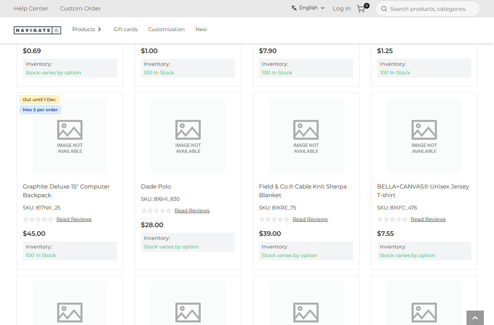

# 091: Can a plugin receive webhooks or callbacks?

**Listed:** Yes. **Result here:** Yes, confirmed. Any plugin route takes calls from other systems (ERP, payment,
punchout). It gets the body exactly as sent (`request.rawBody`) next to the parsed one, plus
`context.verifySignature(rawBody, signature, secret, options)`: an HMAC check in constant time (sha256 by default,
hex or base64, with an optional prefix such as `sha256=`). The store's limits apply: 64 KB body, 15 s, 120 calls a
minute per address.

| Before: the backpack's card shows only its order limit | After: the ERP's signed webhook put it on hold, and the card says "Out until 1 Dec" |
| --- | --- |
|  |  |

Store: POCSppDemo (`sppdemo.localhost:3000`), its own theme, Best Sellers scrolled to the second row. The browser that
took the pictures writes dates day-first ("1 Dec"). A US shopper sees "Dec 1".

## The example: stock holds pushed by the ERP

The ERP knows when an item goes on hold (supplier backorder, recall) before the store's inventory sync does. It calls
the store:

```
POST /api/extensions/plugins/spp-commerce/erp-stock
X-Erp-Signature: sha256=<hex HMAC-SHA256 of the body with the shared secret>
{"sku":"817NK_25","available":false,"backOn":"2026-12-01","note":"Restocking from supplier"}
```

- **`erpStock`** (`src/commerce/server.ts`) takes only POSTs, then checks the signature against the `erpWebhookSecret`
  setting. That setting is not `browser: true`; it was set locally to a generated test value, not shown here. Then
  `readStockEvent` validates the body: a SKU pattern, a boolean `available`, an ISO `backOn` date and a note of at
  most 80 characters. `available: true` lifts the hold.
- **Refused** with `401 Bad signature`: no signature, a signature made with another secret, and a body changed after it
  was signed. A GET gets `405`. A signed but malformed body gets `400` ([output.txt](output.txt)).
- **The cards**: `GET .../stock-holds` lists the store's holds. `RuleTags` (the `product.card` slot of row 083) asks
  for them once per page and adds an amber "Out until {date}" tag. The label comes from `Common.sppCommerce.onHoldUntil`
  (row 088).
- **`scripts/erp-webhook.mjs`** signs and sends an event the way the ERP does, for the ERP team's tests:
  `ERP_SECRET=… node scripts/erp-webhook.mjs '{"sku":"817NK_25","available":true}'`.

**Limits:** the holds are kept in the plugin's memory per store. Plugins have no database (row 087), so after a store
restart the ERP must send them again, or a nightly full sync must. The hold is information on the card only. The
store's inventory still says "100 In Stock", because it comes from Znode. Blocking the add itself would be a
`beforeAddToCart` rule (row 109).

## How it renders

**In the webstore (base):** no inbound integration endpoint for a package. Integrations write to Znode directly.

**How this customization joins it:**

- `apps/webstore/src/app/api/extensions/plugins/[plugin]/[route]/route.ts` → `runPluginRoute` (`routes.server.ts`). It
  checks that the plugin is enabled for the store and the rate limit, then reads the body with a hard limit
  (`readLimited`, 413 over 64 KB).
- It passes `{ method, query, body, rawBody, headers }` with a context that carries `verifySignature` (`webhook.ts`:
  `createHmac` + `timingSafeEqual`).
- A `Response` the route returns is sent as it is ([§7 B.5](../../RENDER-FLOW.md#7-cart-checkout-place-order)).
- The card tag is the `product.card` slot ([§4 B](../../RENDER-FLOW.md#4-worked-example-the-product-card-on-a-category-page)).

End-to-end flow, with file and line references in the webstore: [docs/RENDER-FLOW.md](../../RENDER-FLOW.md).

## Where

- `src/commerce/server.ts`: `readStockEvent`, `erpStock` (route `erp-stock`), route `stock-holds`
- `src/commerce/slots/RuleTags.tsx`: the hold tag (one shared request per page)
- `src/commerce/i18n/labels.json`: `onHold`, `onHoldUntil`; `src/commerce/styles/commerce.css`: the amber tag
- `spp-commerce.znode-package.json`: setting `erpWebhookSecret` (server only, empty by default: nothing is taken)
- `scripts/erp-webhook.mjs` (new): a signed sender for tests

## How a client does this

Add a route, keep the shared secret in a server-only setting, and start the handler with
`context.verifySignature(request.rawBody, request.headers["x-…-signature"], secret, { prefix: "sha256=" })`. Answer
with a `Response` to choose the status code. Validate the body before acting on it.
