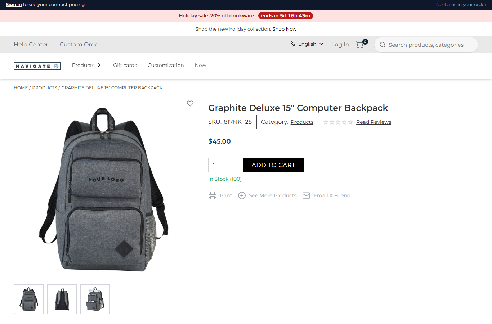
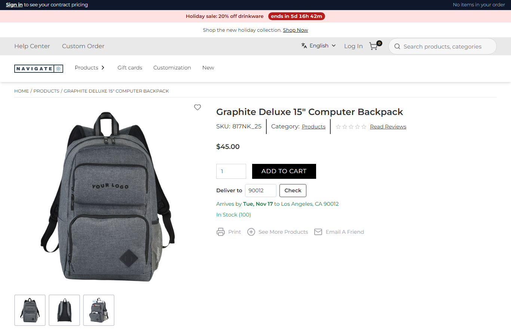

# 093: Can I add a new BFF layer or call any new API?

**Listed:** Yes. **Result here:** Yes, confirmed. A package's route is a BFF endpoint on the store's own server:
`/api/extensions/plugins/<package>/<route>`. Its browser part calls it, and the route calls whatever it needs: another
system's API (here a public ZIP API), Znode (`context.znode`, row 095) or both. It answers only what the page needs.
The browser never talks to the other system, so its address, keys and shape stay on the server.

| Before: the product page, no delivery date | After: "Deliver to 53202" → "Arrives by Wed, Nov 11 to Milwaukee, WI 53202" |
| --- | --- |
|  |  |

Further away:  (Los Angeles 90012: 5 business days, Tue, Nov 17)

Store: POCSppDemo (`sppdemo.localhost:3000`), its own theme, Graphite Deluxe 15" Computer Backpack (`/product/103809`),
ZIP typed and "Check" pressed.

## The example: "Deliver to [ZIP]" on the product page

Shoppers ordering for an event ask "will it arrive in time?" before adding to the cart. The new path is
**browser → BFF route → outside API**:

1. **Browser** (`src/commerce/slots/DeliveryEstimate.tsx`, slot `product.addToCart`): a ZIP field and "Check" under
   the store's own add-to-cart, which is kept as it is. It calls `GET /api/extensions/plugins/spp-commerce/delivery-estimate?zip=53202`.
   It remembers the ZIP in this browser, so the next product page shows the date at once.
2. **BFF route** (`deliveryEstimate` in `src/commerce/server.ts`):
   - validates the ZIP (400)
   - looks it up with **zippopotam.us** on the server, with a 5 s timeout and each ZIP cached for a day: 404 for an
     unknown ZIP, 502 when the API is down
   - works out the date (`src/commerce/delivery.ts`): ground days by distance from the Milwaukee warehouse, counted in
     business days from the ship day (today before the 2pm Central cutoff, setting `shipCutoffHour`)
3. **Answer:** `{"zip":"53202","city":"Milwaukee","state":"WI","transitDays":1,"shipsOn":"2026-11-10","arrivesBy":"2026-11-11"}`

Only the ZIP leaves the store. Calling outside the store needs the **`externalNetwork`** permission: `znode check`
finds the `fetch(` in the server part and requires it (row 096). The date logic runs with node alone
([output.txt](output.txt)).

## How it renders

**In the webstore (base):** the product page renders the store's `AddToCart` inside the `product.addToCart` slot
([§5 A](../../RENDER-FLOW.md#5-product-details-page)).

**How this customization joins it:**

- spp-commerce fills `product.addToCart` after any theme (`RuntimeAddToCart`, [§5 B](../../RENDER-FLOW.md#5-product-details-page)).
- Its fetch goes through the proxy to `apps/webstore/src/app/api/extensions/plugins/[plugin]/[route]/route.ts`. There
  `runPluginRoute` checks that the plugin is enabled for the store, applies the rate limit and the 15 s timeout, and
  calls the plugin's route with the store's context ([§7 B.5](../../RENDER-FLOW.md#7-cart-checkout-place-order)).
- The route's outbound `fetch` runs in the store's Node process. In a sandboxed package it would run in the sandbox
  child; network access is a declared permission, not a sandbox one.

End-to-end flow, with file and line references in the webstore: [docs/RENDER-FLOW.md](../../RENDER-FLOW.md).

## Where

- `src/commerce/delivery.ts` (new): `lookupZip`, `transitDays`, `arrivalDate`
- `src/commerce/server.ts`: route `delivery-estimate`
- `src/commerce/slots/DeliveryEstimate.tsx` (new), registered in `src/commerce/browser.tsx` (`product.addToCart`)
- `src/commerce/i18n/labels.json`: `deliverTo`, `checkDelivery`, `arrivesBy`, …; `src/commerce/styles/commerce.css`
- `spp-commerce.znode-package.json`: permission `externalNetwork`, setting `shipCutoffHour`
- `scripts/shot.mjs`: `--type "<selector>=<text>"` types into a field before `--click`

## How a client does this

Put the integration in a package route: validate the input, call the API with a timeout, cache what can be cached,
and answer a small JSON the page needs. Declare `externalNetwork` and call the route from the browser part.
