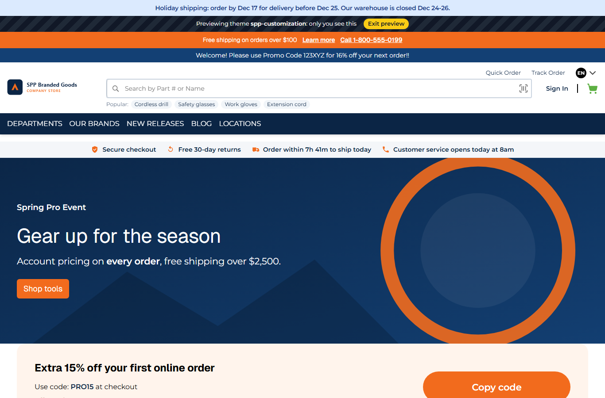

# 094: Can I create a new BFF API?

**Listed:** Yes. **Result here:** Yes, confirmed, in a theme as well as a plugin. Any package with the `routes`
permission adds endpoints at `/api/extensions/plugins/<package>/<route>`, served by the store's own server for the
stores the package runs on. A route answers JSON, or a `Response` when it needs its own status or headers (here a
one-minute public cache).

| Before: the trust strip's fixed items and the ship cutoff | After: one call to the new `store-status` API also tells whether customer service is open |
| --- | --- |
|  |  |

The page: 

Store: MaxwellsHardware (`localhost:3000`), home with spp-customization previewed. The pictures were taken at about
7:20am Eastern, before customer service opens: "opens today at 8am". From 8am to 6pm on weekdays it says "Customer
service open until 6pm · 1-800-555-0199", with a green icon and a call link ([output.txt](output.txt)).

## The example: `store-status`, one answer about the store right now

The header needs several facts that depend on the warehouse's clock: is customer service open, how long until
today's ship cutoff, which dated notice applies. Each of these was its own concern, and the browser would otherwise do
time-zone math with the shopper's clock. The theme now has one endpoint for it:

```
GET /api/extensions/plugins/spp-customization/store-status
Cache-Control: public, max-age=60
{"support":{"open":false,"label":"Customer service opens today at 8am","phone":"1-800-555-0199"},
 "shipping":{"shipsToday":true,"minutesLeft":461,"shipDay":"today","label":"Order within 7h 41m to ship today"},
 "notice":"Holiday shipping: order by Dec 17 ...","date":"2026-11-10","timeZone":"America/New_York"}
```

- `storeStatus` (`src/server/status.ts`) puts together the support hours, the ship cutoff (`shippingCutoffAt`, row 039)
  and the dated notice (`datedNotice`, row 052), all on the warehouse's clock (`shipTimezone`).
- Support hours come from new settings, `supportOpenHour` (8) and `supportCloseHour` (18), on weekdays.
  `supportStatusAt` names the next opening ("today", "tomorrow", or "Mon" over a weekend).
- The trust strip (`src/slots/TrustStrip.tsx`) now makes this one call instead of `shipping-cutoff`. `shipping-cutoff`
  stays for anything else that calls it.
- The answer has no shopper data, so it is cacheable: `Cache-Control: public, max-age=60` instead of the store's default
  `no-store` for routes.

## How it renders

**In the webstore (base):** no store-status endpoint. The header has no live store information.

**How this customization joins it:** the trust strip is part of the theme's `layout.header` slot
([§8 B](../../RENDER-FLOW.md#8-header-footer-search)). After the page loads it fetches
`/api/extensions/plugins/spp-customization/store-status`, and `runPluginRoute` serves it: the theme is enabled for
the store (here by preview), the rate limit applies, the theme's `routes["store-status"]` runs with the store's
settings, and the returned `Response` keeps its own `Cache-Control`
([§7 B.5](../../RENDER-FLOW.md#7-cart-checkout-place-order)).

End-to-end flow, with file and line references in the webstore: [docs/RENDER-FLOW.md](../../RENDER-FLOW.md).

## Where

- `src/server/status.ts` (new): `supportStatusAt`, `storeStatus`
- `src/server.tsx`: route `store-status`
- `src/slots/TrustStrip.tsx`: one call to `store-status`, the support item with a call link
- `src/styles/trust-strip.css`: the open state
- `znode-package.json`: settings `supportOpenHour`, `supportCloseHour`

## How a client does this

Add `routes: { "<name>": async (request, context) => data }` to the package's server part (permission `routes`). Keep
one endpoint per page need, so the browser makes one call. Return a `Response` to set the status code or caching.
