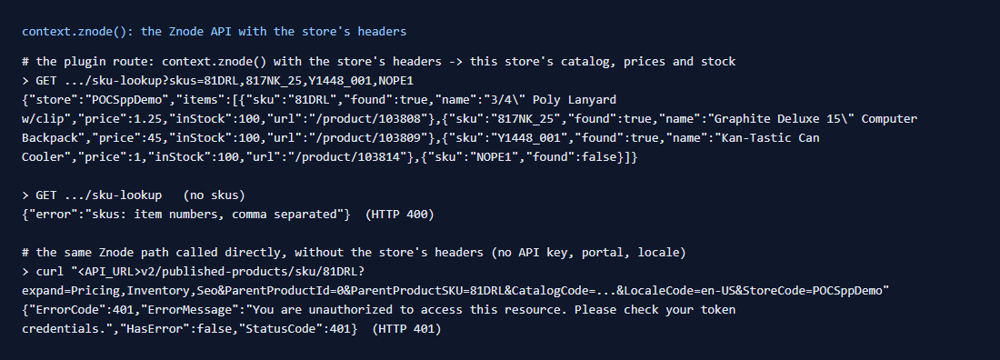

# 095: Can a plugin call the Znode API with the store's headers?

**Listed:** Yes. **Result here:** Yes, confirmed. A route's `context.znode(path, { method, body })` fetches
`{API_URL}<path>` with the headers the store's own agents send: its API key, portal, locale and the shopper's profile.
The answer is therefore this store's catalog and prices, as on its pages. The plugin never holds the API key, and the
path must be relative to the API root: an absolute URL or `//host` throws, so `znode()` cannot be turned against
another host. Declare the `znodeApi` permission.



| Before: the same Znode path called without the store's headers | After: through the plugin route, with them |
| --- | --- |
| `401 You are unauthorized to access this resource` | `{"sku":"81DRL","found":true,"name":"3/4\" Poly Lanyard w/clip","price":1.25,"inStock":100,"url":"/product/103808"}` |

Full output: [output.txt](output.txt).

## The example: look up item numbers in this store's catalog

B2B buyers order by item number (from a quote, a catalog, last year's PO). spp-commerce gets a lookup that row 121's
quick order builds on:

```
GET /api/extensions/plugins/spp-commerce/sku-lookup?skus=81DRL,817NK_25,Y1448_001,NOPE1
{"store":"POCSppDemo","items":[
  {"sku":"81DRL","found":true,"name":"3/4\" Poly Lanyard w/clip","price":1.25,"inStock":100,"url":"/product/103808"},
  {"sku":"817NK_25","found":true,"name":"Graphite Deluxe 15\" Computer Backpack","price":45,"inStock":100,"url":"/product/103809"},
  {"sku":"Y1448_001","found":true,"name":"Kan-Tastic Can Cooler","price":1,"inStock":100,"url":"/product/103814"},
  {"sku":"NOPE1","found":false}]}
```

- `skuLookup` (`src/commerce/server.ts`) takes up to 20 item numbers, de-duplicated and pattern-checked, and looks
  them up in parallel. With none it answers 400.
- `lookupSku` calls the path the store's own agent uses for a SKU (`PublishProducts_skuByProductSKU`):
  `v2/published-products/sku/<sku>?expand=Pricing,Inventory,Seo&CatalogCode=…&LocaleCode=…&StoreCode=…`.
- **Found on the way:** that call requires `CatalogCode` and `LocaleCode`, which the route context does not carry
  (it has `store.code`, `portalId`, `localeId`). Without them Znode answers `400: The LocaleCode field is required`.
  `storeCodes` reads them once per store with `context.znode("v2/portals/<store>/application/2")`, the portal call the
  store's `getPortalDetails` makes.

## How it renders

**In the webstore (base):** agents call the Znode API through the generated clients. `getHeaders()` / `getApiHeaders()`
add the store's credentials and context headers (`packages/clients`).

**How this customization joins it:** `runPluginRoute` builds the route context with `znode(path, init)`
(`routes.server.ts`). It rejects absolute URLs, fetches `${process.env.API_URL}${path}` with
`getApiHeaders(method)` and `cache: "no-store"`, and returns `{ status, data }` with the JSON parsed. In a sandboxed
package the webstore makes that call on the child's behalf, so the key never enters the sandbox
([§7 B.5](../../RENDER-FLOW.md#7-cart-checkout-place-order)).

End-to-end flow, with file and line references in the webstore: [docs/RENDER-FLOW.md](../../RENDER-FLOW.md).

## Where

- `src/commerce/server.ts`: `storeCodes`, `lookupSku`, `skuLookup` (route `sku-lookup`)
- `spp-commerce.znode-package.json`: permission `znodeApi` (declared since row 085)

## How a client does this

Call `context.znode("<path under the API root>")` from a route. Use the path and query the store's own client uses (see
`packages/clients`). Read `status` before `data`. Cache per store what does not change per request, such as the
portal's codes.
