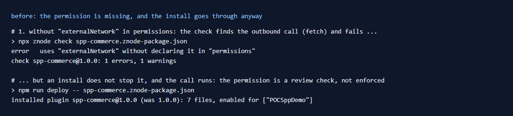
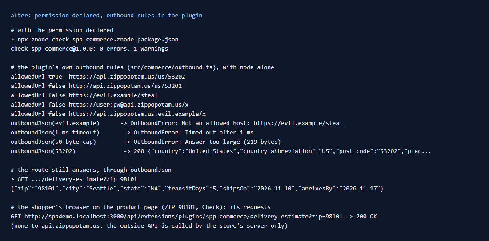
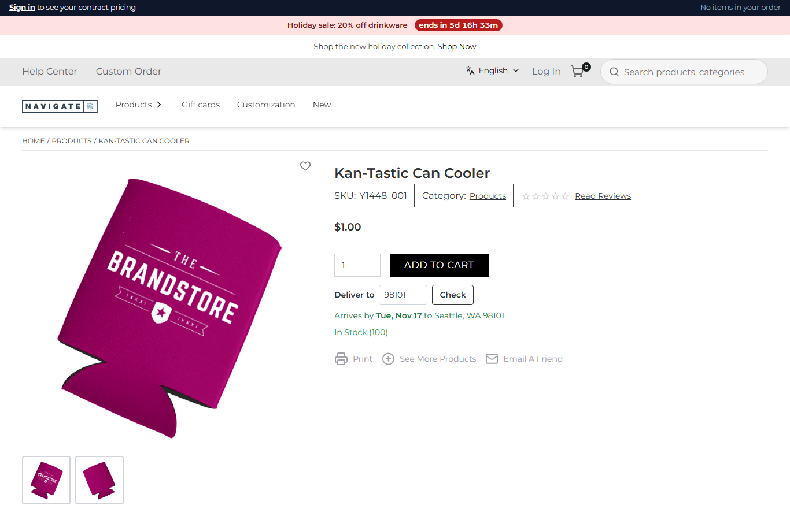

# 096: Can a plugin call an external API from the server?

**Listed:** Yes. **Result here:** Yes, confirmed, with one finding. A package's server part (routes, hooks, server
pages) can `fetch` any host. The package must declare **`externalNetwork`**: `znode check` finds the `fetch(` and
fails without it. But **the store does not enforce it**. An install without the permission goes through, and the call
still runs; even the sandbox limits files and processes, not the network. So the permission is a review check, and a
plugin should keep its own rules for outbound calls, as spp-commerce now does.

| Before: the permission removed: `check` fails, the install still goes through | After: declared, and every outside call goes through the plugin's rules |
| --- | --- |
|  |  |

On the store: 
(Kan-Tastic Can Cooler, ZIP 98101: "Arrives by Tue, Nov 17 to Seattle, WA 98101". The browser's only request was to
the store's route.)

Store: POCSppDemo (`sppdemo.localhost:3000`), its own theme.

## The example: outbound rules for the plugin's integrations

Row 093's delivery estimate calls zippopotam.us. Every outside call of spp-commerce now goes through `outboundJson`
(`src/commerce/outbound.ts`):

| Rule | Why | Shown |
| --- | --- | --- |
| Only hosts in `OUTBOUND_HOSTS`, over https, no credentials in the URL | a URL built from shopper input cannot reach another host, and no plain http | `evil.example`, `http://…`, `user:pw@…`, `api.zippopotam.us.evil.example` refused |
| Timeout, 5 s by default | a slow API cannot hold the route (the store's own limit is 15 s) | `Timed out after 1 ms` |
| Answer at most 64 KB | a huge answer cannot fill the store's memory | `Answer too large (219 bytes)` with a 50-byte cap |
| No redirects, no cookies, no store headers | nothing of the store or the shopper goes along | – |

`lookupZip` (`src/commerce/delivery.ts`) uses it. The route answers as before
(`{"zip":"98101","city":"Seattle","state":"WA","transitDays":5,…}`), and a failure of the outside API becomes the
route's `502 "Delivery dates are not available right now"`. The shopper's browser never contacts the outside API: on
the product page its only request is `GET /api/extensions/plugins/spp-commerce/delivery-estimate?zip=98101`
([output.txt](output.txt)).

## How it renders

**In the webstore (base):** agents call Znode only. No outside API is called on the shopper's behalf.

**How this customization joins it:** the route runs in the store's Node process (`runPluginRoute`,
[§7 B.5](../../RENDER-FLOW.md#7-cart-checkout-place-order)), or in the sandbox child for a `"sandbox": true` package.
There the Node permission model limits files, child processes and workers, but not the network
(`sandbox.server.ts`). `fetch` is Node's own. The manifest's `"permissions"` are read by `znode check`
(`znode-package.mjs`: `fetch(` or `https.request(` means `externalNetwork`), not by the store at install or run time.

End-to-end flow, with file and line references in the webstore: [docs/RENDER-FLOW.md](../../RENDER-FLOW.md).

## Where

- `src/commerce/outbound.ts` (new): `OUTBOUND_HOSTS`, `allowedUrl`, `outboundJson`, `OutboundError`
- `src/commerce/delivery.ts`: `lookupZip` through `outboundJson`
- `spp-commerce.znode-package.json`: `"externalNetwork"` (declared since row 093)

## How a client does this

Declare `externalNetwork`, call outside APIs only from the server part, and route every call through one helper with a
host allow-list, a timeout and a size cap. Keep API keys in server-only settings (not `browser: true`). For a store
that must refuse undeclared network use, this needs a store change: enforcing the permission at install time, or an
egress policy around the process.
