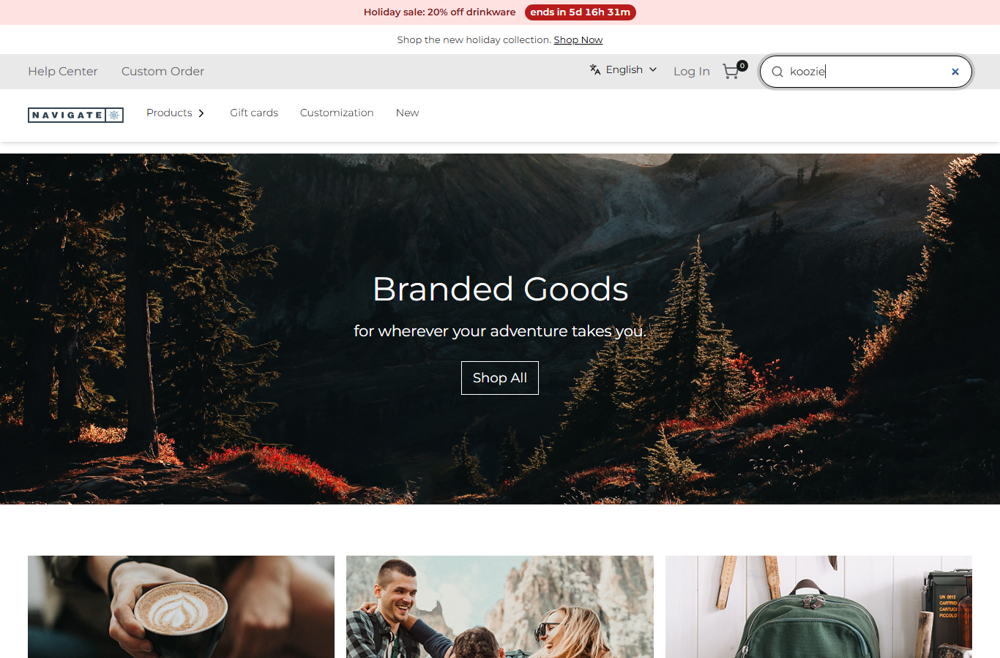
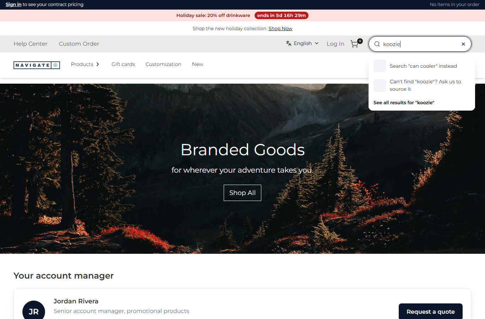
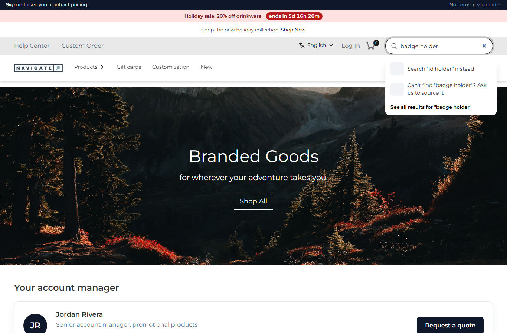

# 098: Can I wrap an existing store API route (change its input or output)?

**Listed:** Yes. **Result here:** Yes, confirmed for the output; the input only partly. A plugin names a store route
in its manifest's `"overrides"`. For the stores it runs on, the proxy sends that request to the plugin's route.
`context.original()` calls the store's own route with the same request (method, path, query, the shopper's cookies),
and the plugin changes the answer.

Changing the **input** is limited: `original({ body })` can send another body, but the query string is always the one
the browser sent. A GET route such as this one cannot be asked about another search term through `original()`. A
plugin would have to call Znode itself (`context.znode`, row 095).

| Before: "koozie" in the header search → no suggestions | After: "Search "can cooler" instead" and "Can't find "koozie"? Ask us to source it" |
| --- | --- |
|  |  |

Another trade word, "badge holder": 

Store: POCSppDemo (`sppdemo.localhost:3000`), its own theme (redpanda on spp-base), home, typing in the header search.
Before: spp-commerce switched off (`registry.mjs enable false`).

## The example: no dead ends in search

Promotional-products buyers search with trade words the catalog does not use ("koozie" for a can cooler, "badge
holder" for an ID holder), and an empty typeahead loses them. spp-commerce wraps the typeahead route the header
search calls:

```json
"overrides": { "/api/search/search-hydrated-typeahead": "search-typeahead" },
"permissions": [..., "overrides"]
```

`searchTypeahead` (`src/commerce/server.ts`):

1. Calls `context.original()`. If the store's route fails, its answer goes back as it is.
2. Works out the extra entries (`typeaheadExtras`):
   - a word in the `searchSynonyms` setting gets **Search "can cooler" instead**, a link to that search
   - a search with no product and no category gets **Can't find "…"? Ask us to source it** (setting `sourcingLink`,
     `/contact-us`)
3. Puts them first in **both** lists, and leaves everything else in the store's envelope unchanged. A search with
   results and no synonym ("cup") goes back untouched ([output.txt](output.txt)).

**Found on the way:** the store's search on this theme is spp-base's own component. It shows only
`hydratedSearchProductList` and links each entry to `/<seoUrl>`, so entries added only to the category list never
appear. The extras therefore also go in as product entries with `seoUrl` set to the link. A wrapper must match what the
store's UI on that theme actually reads.

## How it renders

**In the webstore (base):** the header search fetches `/api/search/search-hydrated-typeahead?searchTerm=…` →
`apps/webstore/src/app/api/search/search-hydrated-typeahead/route.ts` → agent → Znode search
([§8 A](../../RENDER-FLOW.md#8-header-footer-search)).

**How this customization joins it:**

- `proxy.ts` asks `findRouteOverride(store, path)` (`route-overrides.server.ts`). For a store with an enabled plugin
  (never a theme) whose `overrides` name this path, it rewrites the request to
  `/api/extensions/plugins/spp-commerce/search-typeahead`.
- `runPluginRoute` runs it.
- `context.original()` calls the store's route on the same server with the shopper's Host and cookies, plus a token
  header that makes the proxy let it through instead of overriding it again
  ([§7 B.4-B.5](../../RENDER-FLOW.md#7-cart-checkout-place-order)).

End-to-end flow, with file and line references in the webstore: [docs/RENDER-FLOW.md](../../RENDER-FLOW.md).

## Where

- `src/commerce/server.ts`: `typeaheadExtras`, `searchTypeahead` (route `search-typeahead`)
- `spp-commerce.znode-package.json`: `"overrides"`, permission `overrides`, settings `searchSynonyms`, `sourcingLink`
- `scripts/shot.mjs`: `--type` splits at the last `=` (selectors such as `[placeholder='…']` hold one)

## How a client does this

Add `"overrides": { "<store route>": "<your route>" }` and the `overrides` permission, call `context.original()`, and
return the store's answer changed, in the same envelope. Check which fields the store's UI on your theme reads.
