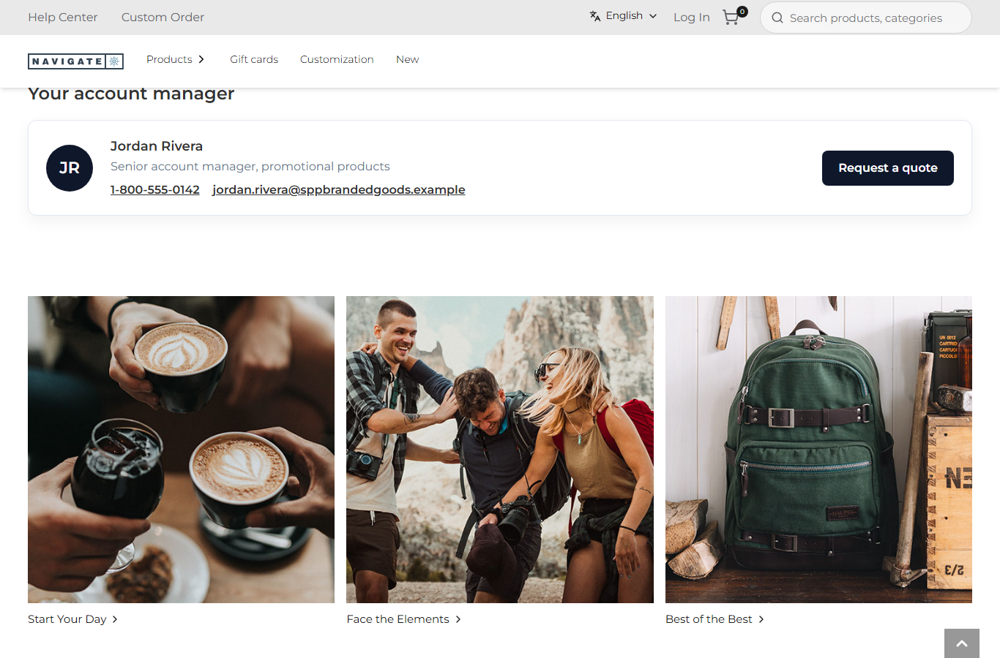
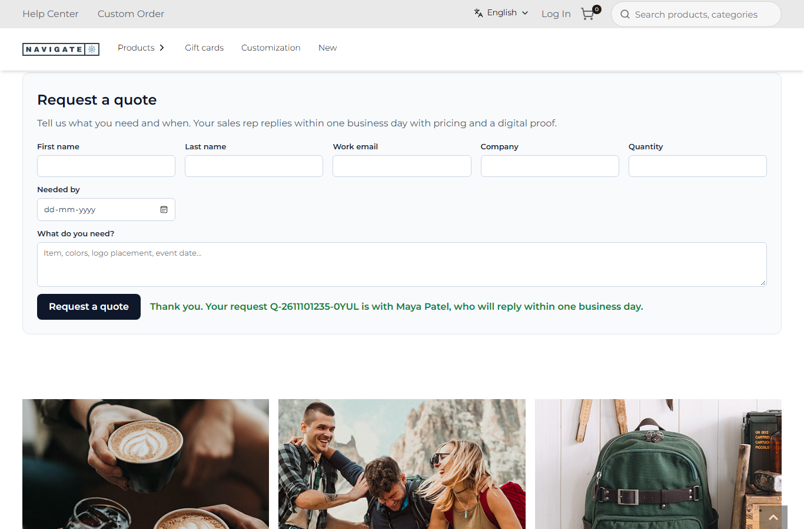

# 099: Can I replace an existing store API route completely?

**Listed:** Yes. **Result here:** Yes, confirmed. With `"overrides": { "/api/contact-us": "quote-request" }` the proxy
sends the store's own route to the plugin for the stores it runs on. The plugin's route never calls
`context.original()`, so the store's route, and Znode's customer-feedback call behind it, do not run. Any form on the
store that posts to `/api/contact-us` now gets the plugin's behavior. The answer keeps the store's envelope, so those
forms still read it.

| Before: the home page, no way to ask for a quote | After: "Request a quote" sent → reference Q-…-0YUL, routed to Maya Patel |
| --- | --- |
|  |  |

Store: POCSppDemo (`sppdemo.localhost:3000`), its own theme. For the after picture the browser came in through Maya
Patel's rep link (`/api/extensions/plugins/spp-commerce/rep?code=MP&to=/`, row 086), filled the form with test data
(Test Buyer, test.buyer@example.com, 250 tumblers) and pressed "Request a quote".

## The example: contact requests become quote requests for the shopper's rep

A promotional-products store sells through reps. A generic "contact us" that lands in a shared feedback inbox loses
the lead. spp-commerce takes over the store's contact route:

- **`quoteRequest`** (route `quote-request`, `src/commerce/server.ts`) takes the store's contact form fields
  (`firstName`, `lastName`, `emailId`, `companyName`, `phoneNumber`, `comments`) plus the quote's fields (`quantity`,
  `neededBy`, `repCode`).
  - `readQuoteRequest` (`src/commerce/quotes.ts`) validates them. A failure is answered as the store does:
    `{"data":{"hasError":true,"errorMessage":"Please enter a valid email address."}}`.
  - It gives the request a reference and the shopper's rep: the rep cookie's code (row 086), else the store's first
    rep. It keeps the request for staff.
  - It answers `{"status":"success","data":{"hasError":false,"reference":"Q-…","rep":"Maya Patel"}}`.
- **`SppQuoteRequest`** (`src/commerce/widgets/QuoteRequest.tsx`) is a "Request a quote" widget, in the page builder
  under "SPP commerce" and placed on the plugin's home page. It posts to `/api/contact-us`, as the store's own contact
  form does.
- **`GET .../quote-requests`** is for staff only: `X-Staff-Key` must equal the server-only `staffKey` setting (a
  generated local value, not in the repo). Without it the answer is 401, since the requests hold shoppers' names and
  emails.

Requests are kept in the plugin's memory (no plugin database, row 087). A production version would pass them on to a
CRM or a rep's inbox from this route: an outside call, with row 096's rules.

**Fixed here (row 098):** the default `sourcingLink` was `/contact-us`, which is a 404 on this store. It is now
`/specialorder`, the store's own Custom Orders page.

Full output: [output.txt](output.txt).

## How it renders

**In the webstore (base):** `POST /api/contact-us` → `apps/webstore/src/app/api/contact-us/route.ts` → agent
`submitContactUs` → Znode customer feedback; the base ContactUs widget reads `hasError` / `errorMessage`.

**How this customization joins it:** `proxy.ts` → `findRouteOverride` finds spp-commerce's `overrides["/api/contact-us"]`
for POCSppDemo and rewrites the request to `/api/extensions/plugins/spp-commerce/quote-request`. `runPluginRoute` runs
it with the body parsed. Since `original()` is never called, the store's route does not run
([§7 B.4-B.5](../../RENDER-FLOW.md#7-cart-checkout-place-order)). The widget renders through `RuntimeWidget` from the
plugin's page content ([§9 B](../../RENDER-FLOW.md#9-home-content-and-package-pages-widgets)).

End-to-end flow, with file and line references in the webstore: [docs/RENDER-FLOW.md](../../RENDER-FLOW.md).

## Where

- `src/commerce/quotes.ts` (new): `readQuoteRequest`, `envelope`
- `src/commerce/server.ts`: `quoteRequest` (route `quote-request`), `quoteRequestList` (route `quote-requests`), `sameSecret`
- `src/commerce/widgets/QuoteRequest.tsx` (new), `src/commerce/browser.tsx`, `src/commerce/pages/home.json`,
  `src/commerce/styles/commerce.css`
- `spp-commerce.znode-package.json`:
  - `overrides["/api/contact-us"]`
  - widget `SppQuoteRequest`
  - setting `staffKey` (server only)
  - `sourcingLink` default `/specialorder`
- `scripts/shot.mjs`: `--type` can be repeated to fill a form

## How a client does this

Name the store route in `"overrides"`, don't call `context.original()`, and answer in the store's envelope (look at
the store's route for its shape). Keep anything holding shopper data behind a server-only key.
