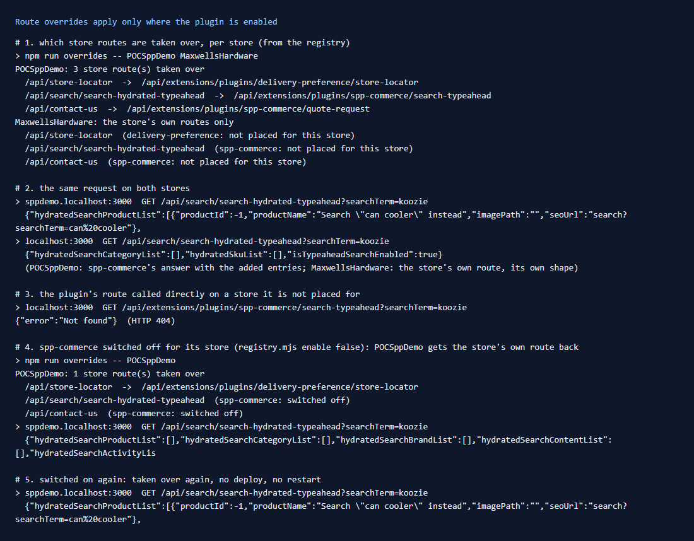

# 100: Is a route override applied only for the stores the plugin is enabled for?

**Listed:** Yes. **Result here:** Yes, confirmed, and it can be switched without a deploy. The proxy takes a store
route over only when a plugin that names it in `"overrides"` is **enabled** and **placed** for the requesting store,
never for a theme. The plugin's own route also answers only there: anywhere else it is a 404. Switching the plugin off
in the registry gives the store's own route back on the next request, and switching it on takes the route over again.



Full output: [output.txt](output.txt).

## What was checked

| # | Check | Result |
| --- | --- | --- |
| 1 | `npm run overrides -- POCSppDemo MaxwellsHardware` (new) | POCSppDemo: 3 store routes taken over; MaxwellsHardware: the store's own routes only |
| 2 | `GET /api/search/search-hydrated-typeahead?searchTerm=koozie` on both stores | POCSppDemo: spp-commerce's answer ("Search "can cooler" instead", row 098); MaxwellsHardware: the store's own route, its own shape |
| 3 | The plugin's route called directly on MaxwellsHardware | `404 Not found`: the route handler checks the plugin is enabled for the store |
| 4 | `registry.mjs enable false --package spp-commerce` | POCSppDemo: the store's own typeahead again (empty for "koozie"); the report says "switched off" |
| 5 | `enable true` | taken over again; no deploy, no restart |

**Found on the way:** the report shows POCSppDemo's store-locator route is also taken over, by
**`delivery-preference`**, a package from outside this repository. One store can carry several plugins' overrides.
For the same path, the first plugin in registry order wins and later ones are shadowed. `npm run overrides` lists both
cases, so a team can see who answers a store route before adding its own override.

## The example: `npm run overrides`

`scripts/overrides.mjs` reads the store's `plugins.json` and applies the proxy's rule. It skips themes, needs the
entry `enabled` and placed for the store (or `"*"`), and takes the first entry per path in registry order. For each
store it prints which routes are taken over and by which plugin route, and why other overrides do not apply there: not
placed, switched off, or shadowed.

```
POCSppDemo: 3 store route(s) taken over
  /api/store-locator  ->  /api/extensions/plugins/delivery-preference/store-locator
  /api/search/search-hydrated-typeahead  ->  /api/extensions/plugins/spp-commerce/search-typeahead
  /api/contact-us  ->  /api/extensions/plugins/spp-commerce/quote-request
MaxwellsHardware: the store's own routes only
  /api/search/search-hydrated-typeahead  (spp-commerce: not placed for this store)
```

## How it renders

**In the webstore (base):** each `/api/...` request goes to the store's route.

**How this customization joins it:**

- `proxy.ts` calls `findRouteOverride(storeCode, pathname, headers)` (`route-overrides.server.ts`) for every API
  request.
- That function reads the registry index for this store (`resolveStoreEntries`: the store's placements plus the
  every-store ones, enabled only), skips `kind: "theme"`, and returns the first entry's `overrides[pathname]`.
- With none, the store's route answers.
- The plugin route handler (`runPluginRoute`) separately answers 404 for a plugin not enabled for the store
  ([§2 B](../../RENDER-FLOW.md#2-which-store-which-packages-every-request),
  [§7 B.4-B.5](../../RENDER-FLOW.md#7-cart-checkout-place-order)).
- The registry index is cached by file time, so a registry change applies on the next request.

End-to-end flow, with file and line references in the webstore: [docs/RENDER-FLOW.md](../../RENDER-FLOW.md).

## Where

- `scripts/overrides.mjs` (new), `package.json` script `overrides`

## How a client does this

Place the plugin only for the stores that should get the override (`registry.mjs stores …`). Check with
`npm run overrides` before release, and switch it off (`registry.mjs enable false`) to roll the override back at once.
