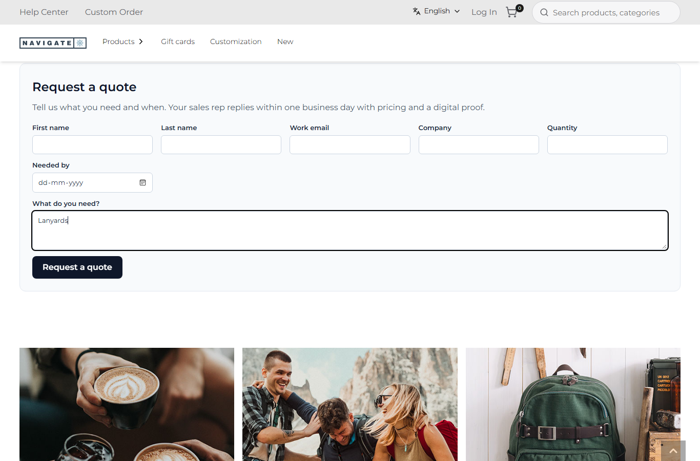
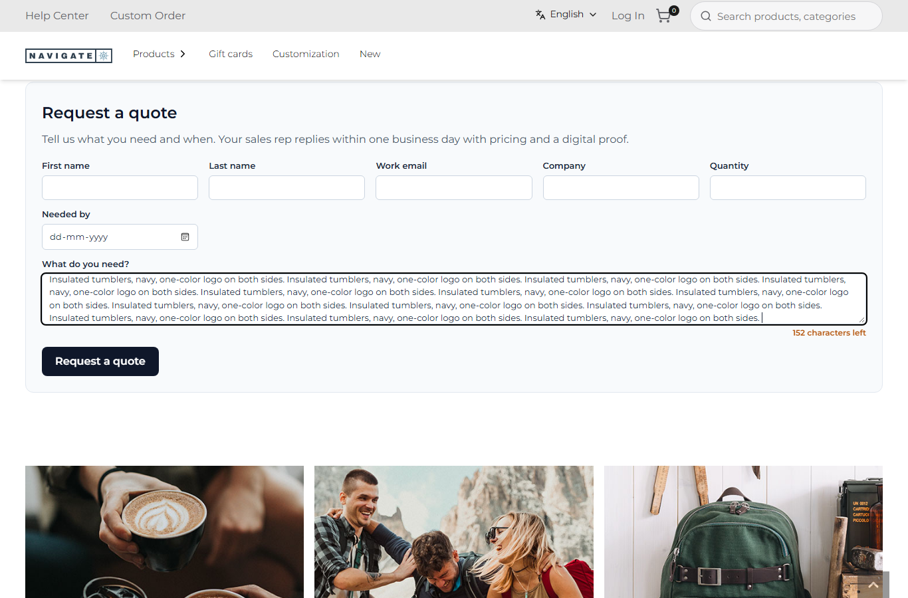

# 101: Are request bodies to plugin routes size-limited?

**Listed:** Yes. **Result here:** Yes, confirmed to the byte. A plugin route's body may be at most **64 KB (65,536
bytes)**. The store reads it as a stream and stops at the first byte over: **`413 {"error":"Request body too
large"}`**, in about 40 ms, before the plugin's code runs, whether the body is 1 byte over or 5 MB. The limit also
covers a store route taken over by a plugin (row 099) and webhooks (row 091). Multipart uploads have their own limit
(5 MB by default, `RUNTIME_PLUGIN_UPLOAD_BYTES`), only for a package that declares `uploads`.

| Body (JSON) | POST to | Answer |
| --- | --- | --- |
| 1,500 bytes | `/api/contact-us` (taken over by spp-commerce) | 200, quote request taken |
| 61,440 bytes | `/api/contact-us` | 200, the route runs (see below) |
| **65,536 bytes** | `/api/contact-us` | **200**, the route runs |
| **65,537 bytes** | `/api/contact-us` | **413 Request body too large** |
| 65,537 bytes | `/api/extensions/plugins/spp-commerce/quote-request` (direct) | 413 |
| 204,800 bytes | `.../erp-stock` (webhook) | 413 |
| 5,242,880 bytes | `.../quote-request` | 413 (in 59 ms: never read whole) |

Full output: [output.txt](output.txt).

| Before: the form has no limit; the route silently cut long text to 2,000 characters | After: the form stops at 2,000 and counts down; the route refuses a longer text and says why |
| --- | --- |
|  |  |

Store: POCSppDemo (`sppdemo.localhost:3000`), home, the "Request a quote" widget of row 099.

## The example: limits the shopper can see

The store's 64 KB limit protects the server, but a shopper never meets it: a quote form's text is a few KB at most.
The limit that matters to the shopper is the plugin's own. Before this row it was silent: the quote route kept the
first 2,000 characters of "What do you need?" and dropped the rest, and the 60 KB and 64 KB test bodies were "taken"
truncated. Now:

- `readQuoteRequest` (`src/commerce/quotes.ts`) refuses a text over `MAX_COMMENTS` (2,000) with
  `Please keep "What do you need?" under 2,000 characters.`, in the store's envelope (`hasError`), instead of cutting
  it.
- The widget (`src/commerce/widgets/QuoteRequest.tsx`) sets `maxLength={2000}` on the field and shows "152 characters
  left". The counter is amber in the last 10% and announced with `aria-describedby`.
- Layers, smallest first: the form (2,000 characters) → the route's check (2,000) → the store's body limit (64 KB, a
  413 before any plugin code).

## How it renders

**In the webstore (base):** the store's own routes read their bodies with `request.json()`, with no limit of the
store's own beyond the server's.

**How this customization joins it:** for a plugin route, `runPluginRoute` → `readBody(request, uploads)` →
`readLimited(request.body, MAX_BODY_BYTES)` (`webhook.ts`). The stream reader adds up the chunks, and over the limit it
cancels the stream and throws `BodyTooLarge`, which the handler answers with 413 before `routeContext` or the plugin's
handler run. A store route taken over by a plugin goes through the same handler, since the proxy rewrote it
([§7 B.4-B.5](../../RENDER-FLOW.md#7-cart-checkout-place-order)).

End-to-end flow, with file and line references in the webstore: [docs/RENDER-FLOW.md](../../RENDER-FLOW.md).

## Where

- `src/commerce/quotes.ts`: `MAX_COMMENTS`, the refusal instead of the cut
- `src/commerce/widgets/QuoteRequest.tsx`: `maxLength`, the counter; `src/commerce/styles/commerce.css`: `.spp-commerce-quote__count`

## How a client does this

Nothing to do for the 64 KB limit: the store applies it to every plugin route. Keep your own limits well below it,
tell the shopper about them in the form, and refuse rather than silently cut in the route. For files, declare
`uploads` and use multipart (5 MB).
