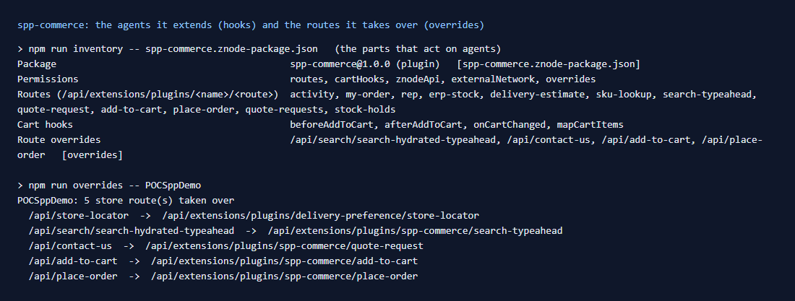

# 102: Can I extend or update existing agent logic?

**Listed:** Partial. **Result here:** Yes, around the agents, at four points. The agents themselves (`@znode/agents`)
are store code that no package can edit. A package can change what goes **into** an agent, what comes **out** of it,
**whether** it runs, or **replace** the route that calls it. That covers every agent behind a store API route. It does
not cover agents called while a page renders on the server (row 105, blocked) or Znode's own pricing, tax and promotion
logic (row 108, blocked).

## How spp-commerce extends the store's agents

| Point | Mechanism | Agent | What spp-commerce does | Row |
| --- | --- | --- | --- | --- |
| **Input** | `beforeAddToCart` (hook) | `addToCartProduct` | superseded item numbers → the current item; quantities to whole case packs | 106, 080 |
| **Output** | `afterAddToCart` (hook) | `addToCartProduct` | the activity log from Znode's answer | 080 |
| **Output** | `mapCartItems` (hook) | `getCartItems` | case-pack / minimum / limit notes on the lines | 082 |
| **State** | `onCartChanged` + `actions` (hook) | `getCartItems`, `removeItemFromCart`, `addToCartProduct` | limits, minimums, companion items, before the cart is read | 081, 113, 114 |
| **Output** | `overrides` + `original()` | the search typeahead agent | "Search "can cooler" instead", "Ask us to source it" | 098 |
| **Whether it runs** | `overrides` + refusal or `original({ body })` | `addToCartProduct`, `placeOrder` | refuse items on an ERP hold; refuse orders under the $25 minimum | 109, 107 |
| **Replaced** | `overrides`, no `original()` | `submitContactUs` | contact requests become quote requests for the shopper's rep | 099 |
| **Alongside** | `context.znode()` in a route | (the agents' own Znode calls) | SKU lookup, cart totals, portal codes with the store's headers | 095, 085, 107 |

All of it is enabled for POCSppDemo only, with its rules in settings. The store's code and the agents are untouched.
`git status` in the store repository lists only the local environment files: `apps/webstore/.env`,
`apps/page-builder/.env` and the generated `next-env.d.ts`. No source file is changed.

## Rules found on the way

- A hook can change its input or output but **cannot refuse**: a throw is logged and skipped (106). To stop an agent
  from running, take over its route (109, 107).
- `original()` with no argument sends **no body**. A POST override must pass `original({ body: request.body })` (109).
- `original()` keeps the browser's query string, so a GET route's input cannot be changed through it (098).
- Answer in the store's own envelope and fields (`addToCartStatus`, `isSuccess` / `hasError`), because the store's UI
  reads them (099, 107, 109).
- Order matters within a plugin (replacement before case packs, 106) and between plugins: hooks run in registry order,
  and the first override of a path wins (100).

## How it renders

**In the webstore (base):** page or component → BFF route (`apps/webstore/src/app/api/...`) → agent
(`packages/agents`) → Znode API client → Znode ([§6 A](../../RENDER-FLOW.md#6-add-to-cart),
[§7 A](../../RENDER-FLOW.md#7-cart-checkout-place-order)).

**How this customization joins it:**

- **Hooks:** the routes call them around their agents (`runBeforeAddToCart` / `runAfterAddToCart` / `runMapCartItems`
  in `request-hooks.server.ts`, `runCartHooks` in `cart-hooks.server.ts`) ([§6 B](../../RENDER-FLOW.md#6-add-to-cart),
  [§7 B.1](../../RENDER-FLOW.md#7-cart-checkout-place-order)).
- **Overrides:** the proxy sends the route to the plugin before it is reached (`findRouteOverride`), and `original()`
  runs it ([§7 B.4-B.5](../../RENDER-FLOW.md#7-cart-checkout-place-order)).

End-to-end flow, with file and line references in the webstore: [docs/RENDER-FLOW.md](../../RENDER-FLOW.md).

## Where

No new code: this row maps rows 080-082, 085, 095, 098, 099, 106, 107, 109, 113 and 114. Evidence:
[output.txt](output.txt) (`npm run inventory`, `npm run overrides`).

## How a client does this

Pick the narrowest point: a hook to change input or output, an override with `original()` to decide whether the agent
runs, and a full override only to replace it. Keep the rules in plain functions and check the result with
`npm run inventory` and `npm run overrides`.
