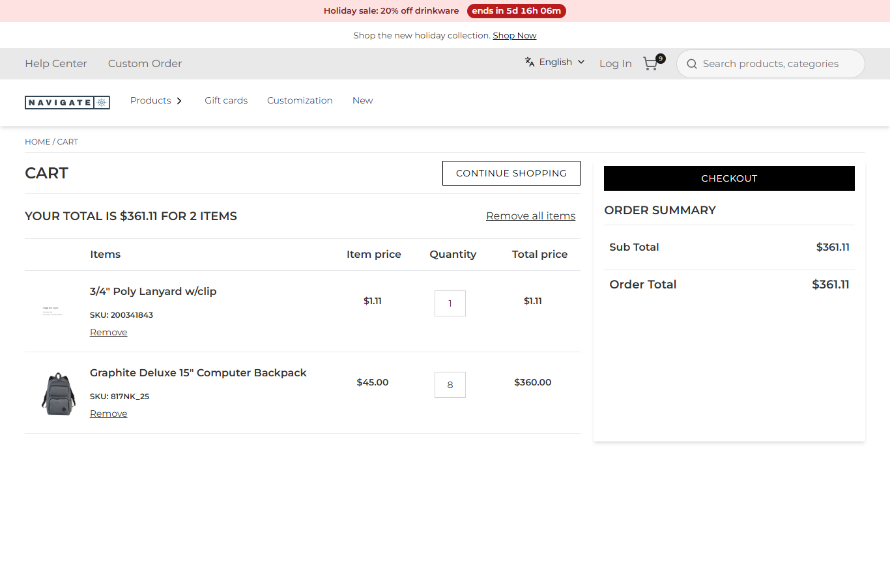
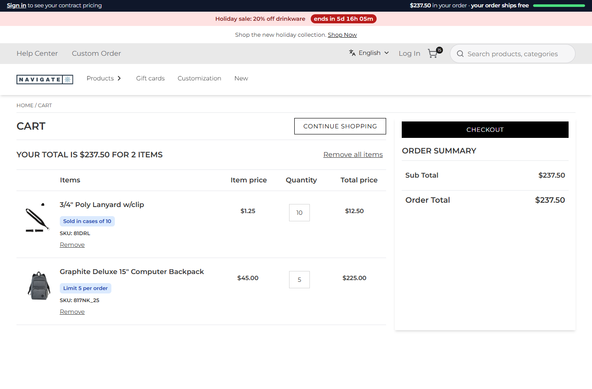

# 103: Can I update an agent with a runtime package?

**Listed:** Partial. **Result here:** Yes, at the points row 102 maps (hooks and overrides), with what "runtime" adds:
no store build, no store deploy, no restart. The package is installed into the store's plugin folder, and the next
request uses it. Switching it off in the registry gives the store's own behavior back on the next request, which is a
rollback in one command.

| Before: spp-commerce switched off: 1 old-number lanyard stays 1, 8 backpacks stay 8 | After: switched on, nothing rebuilt: the lanyard becomes the current item, a case of 10; the backpacks drop to the limit of 5 |
| --- | --- |
|  |  |

Store: POCSppDemo (`sppdemo.localhost:3000`), its own theme. The same adds both times, in a new cart: 1 ×
`/product/105666` (old item number 200341843) and 8 × the Graphite backpack. Between them, only:

```
node scripts/registry.mjs enable false --package spp-commerce      # before
node scripts/registry.mjs enable true  --package spp-commerce      # after
```

## What changed in the agent's behavior, live

From the activity log after the switch-on ([output.txt](output.txt)):

```json
{"sku":"81DRL","asked":1,"added":10,"rule":"replaces 200341843, case pack of 10","ok":true}
{"sku":"817NK_25","asked":8,"added":5,"rule":"limit 5 per order","ok":true}
```

- `addToCartProduct` got a different SKU and quantity: `beforeAddToCart` (rows 106 and 080).
- The cart was brought to the per-order limit before the page read it: `onCartChanged` with the cart actions, which
  call the agents `removeItemFromCart` and `addToCartProduct` (row 081).

How a change reaches the store, with no store rebuild, deploy or restart at any step:

| Step | Command | Store rebuild | Store restart |
| --- | --- | --- | --- |
| Ship new logic | `npm run deploy -- spp-commerce.znode-package.json` (build, pack, install into the plugin folder) | no | no |
| Change a rule | `node scripts/registry.mjs set 'orderLimits={"817NK_25":5}' --package spp-commerce` | no | no |
| Turn off / on | `registry.mjs enable false / true` | no | no |
| Go back a version | `npm run rollback` (row 010) | no | no |

**What a runtime package cannot do:** replace an agent's code or change agents called while a page renders on the
server (row 105). Those need the store's own code: a build-time change in the store repository (row 104, outside this
repo).

## How it renders

**In the webstore (base):** the agents are compiled into the store. Changing one means a store build and deploy.

**How this customization joins it:**

- The registry (`plugins.json`) is read per request through an index cached by file time. A package's server bundle is
  loaded from the plugin folder per store and settings (`registry.server.ts`).
- The hooks and the proxy's overrides consult that on every call, so an install, a setting or a switch applies to the
  next request ([§1 B](../../RENDER-FLOW.md#1-from-this-repository-to-the-store-install-registry),
  [§2 B](../../RENDER-FLOW.md#2-which-store-which-packages-every-request),
  [§6 B](../../RENDER-FLOW.md#6-add-to-cart), [§7 B](../../RENDER-FLOW.md#7-cart-checkout-place-order)).

End-to-end flow, with file and line references in the webstore: [docs/RENDER-FLOW.md](../../RENDER-FLOW.md).

## Where

No new code: the same adds with the package off and on.

## How a client does this

Put the agent change in a plugin's hooks or overrides, deploy the package to the store's plugin folder, and control it
per store from the registry: placement, settings, on and off.
