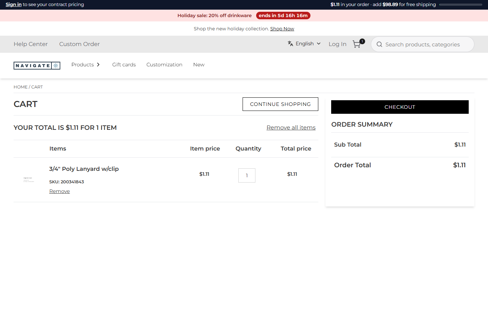
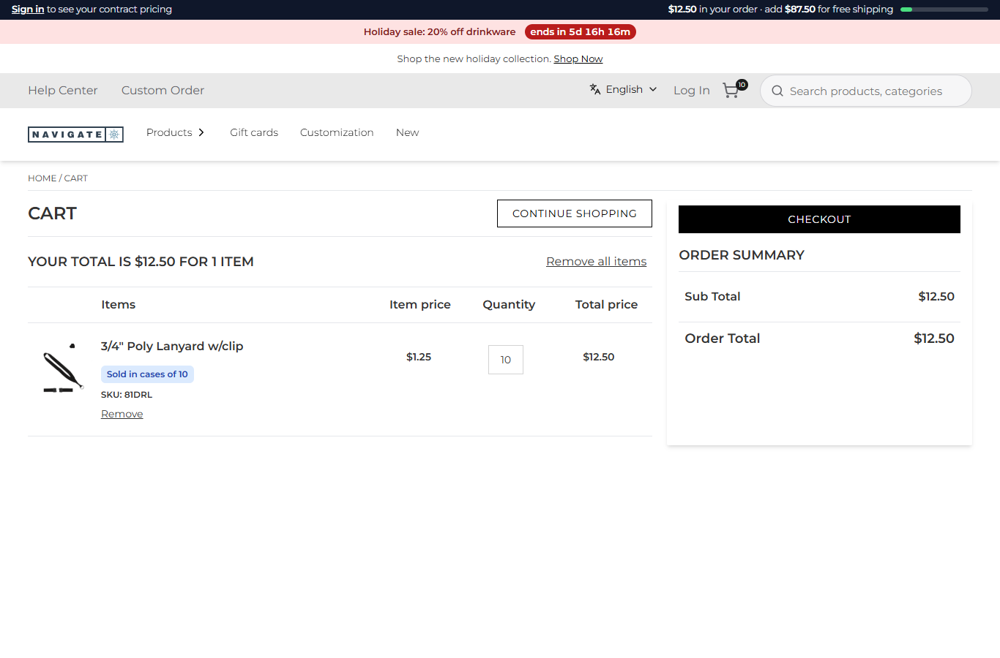

# 106: Can I change add-to-cart logic?

**Listed:** Yes. **Result here:** Yes, confirmed. `beforeAddToCart` receives the add-to-cart request after the store
has filled in the user and locale, and before the agent sends it to Znode. It can change anything in it: SKUs,
quantities, personalization, custom data. What it returns is what Znode gets. It cannot refuse an add, though: a hook
that throws is logged and skipped, and the request goes on. Refusing needs a route override (row 109).

| Before: an add of old item # 200341843 → that line, 1 at $1.11 | After: the same add → the current item 81DRL, a case of 10 |
| --- | --- |
|  |  |

Store: POCSppDemo (`sppdemo.localhost:3000`), its own theme. "Add to cart" with quantity 1 on `/product/105666`, then
the cart (a new test cart each time).

## The example: superseded item numbers

The same 3/4" Poly Lanyard is listed twice on this store: `/product/105666` under an old supplier item number
(`200341843`, $1.11) and `/product/103808` as the current item `81DRL` ($1.25, sold in cases of 10). Buyers reach
old numbers from saved lists, old quotes and search engines. Orders for a discontinued number then fail later at the
supplier, or ship from a stale record. The store wants every add of the old number to become the current item:

- **Setting `replacedSkus`**: `{ "200341843": "81DRL" }`, set per store, no deploy.
- **`replacedBy`** (`src/commerce/rules.ts`) finds the current number. It follows a chain (A → B → C), stops on a loop,
  and returns nothing for a current SKU. Checked with node in [output.txt](output.txt).
- **`beforeAddToCart`** (`src/commerce/server.ts`) swaps the SKU on each line, variants included, *before* the
  case-pack rule. The current item's rules then apply: 1 becomes a case of 10. It records both rules in the activity
  log:

  ```json
  {"sku":"81DRL","asked":1,"added":10,"rule":"replaces 200341843, case pack of 10","cartNumber":"C-10112026-1122","ok":true}
  ```

The cart, the price ($1.25 each) and the order are the current item's. A product-page notice ("This item is now
81DRL") is easy to add from the same browser setting, and stores usually also redirect the old page.

## How it renders

**In the webstore (base):** "Add to cart" → `useAddToCart` → `POST /api/add-to-cart` → `addToCartProduct` (agent) →
Znode `commerceapi/v1/carts/add-to-cart` ([§6 A](../../RENDER-FLOW.md#6-add-to-cart)).

**How this customization joins it:** the route calls `runBeforeAddToCart(request)` (`request-hooks.server.ts`) between
reading the request and calling the agent. Each enabled plugin's hook gets the request, as the previous one left it,
with `{ store, settings, cookies }`, and a returned object replaces it ([§6 B](../../RENDER-FLOW.md#6-add-to-cart)).
The agent itself is unchanged: only its input is.

End-to-end flow, with file and line references in the webstore: [docs/RENDER-FLOW.md](../../RENDER-FLOW.md).

## Where

- `src/commerce/rules.ts`: `replacedBy`
- `src/commerce/server.ts`: `beforeAddToCart` swaps superseded SKUs before the case-pack rule
- `spp-commerce.znode-package.json`: setting `replacedSkus` (object, browser)

## How a client does this

Change the request in `hooks.beforeAddToCart` and return it. Keep the rules in plain functions and order them
deliberately: here the replacement runs before the case packs. To refuse an add instead, take over `/api/add-to-cart`
(row 109).
