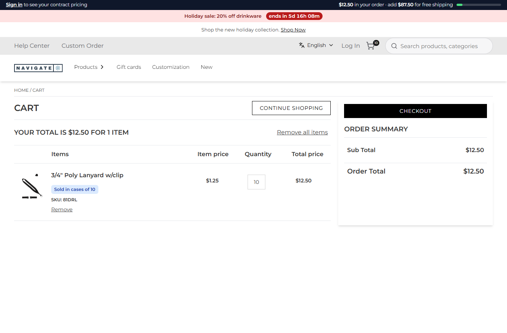
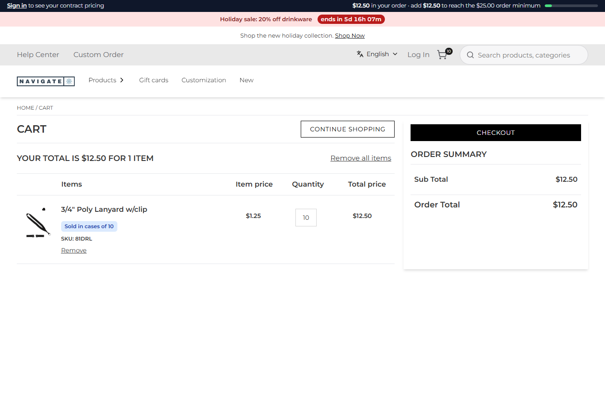

# 107: Can I change place-order logic?

**Listed:** Partial. **Result here:** Yes, around the store's agent, not inside it. A plugin takes over
`/api/place-order` (`"overrides"`). It can refuse an order with its own rule, change the request it passes on, or
replace the route. The store's `placeOrder` agent and Znode's order logic (pricing, tax, payment) are not changed.
Rows 108 and 119 cover those; they are blocked.

| Before: a $12.50 cart, the bar shows only the free-shipping gap | After: the bar leads with the $25 minimum, and a place-order request is refused before the store's route |
| --- | --- |
|  |  |

Store: POCSppDemo (`sppdemo.localhost:3000`), its own theme. A new cart with 1 lanyard (a case of 10, $12.50).

## The example: a minimum order value

Decorated orders have a setup cost, so the store does not take orders under $25. The rule lives in two places, from
one setting, `minOrderValue` (25):

- **At checkout** (`placeOrderGuard`, route `place-order`, taking over `/api/place-order`, `src/commerce/server.ts`):
  - For an order (`orderType: "Order"`; quotes are not affected), it reads the cart's subtotal **from Znode**
    (`cartTotals`, the cart page agent's call), not from the request, so a changed request cannot get round it.
  - Under the minimum it answers in the store's shape, `{"isSuccess":false,"hasError":true,"errorMessage":"Orders
    start at $25.00. Your order is $12.50: add $12.50 to check out."}`. The checkout shows its "failed to create"
    message and stays on the page. It also logs the refusal.
  - Otherwise it calls the store's own route with the request's body (`context.original({ body: request.body })`, the
    lesson of row 109).
- **Before checkout** (the account bar, row 085): `my-order` now also returns `minOrderValue` and `toMinimum`. The bar
  says "add $12.50 to reach the $25.00 order minimum" before the free-shipping gap, so the shopper does not first meet
  the rule at checkout.

The request in the after run was the shopper's browser posting to the store's own `/api/place-order` with its cart
number ([output.txt](output.txt)). **Only the refusal was exercised:** a cart over the minimum goes on to the store's
route, which places a real order in the shared Znode, so it was not run here. That path is the store's own route,
unchanged.

## How it renders

**In the webstore (base):** "Place order" → `placeOrder()` in `CheckoutSubmitOrderActions` → `POST /api/place-order` →
`placeOrder` (agent) → Znode `commerceapi/v1/{classType}/place-order/{classNumber}`. `isSuccess` goes to the receipt;
anything else shows "failed to create" ([§7 A](../../RENDER-FLOW.md#7-cart-checkout-place-order)).

**How this customization joins it:** `proxy.ts` → `findRouteOverride` → `/api/extensions/plugins/spp-commerce/place-order`.
The plugin answers a refusal itself, or calls `original({ body })`, which runs the store's route and agent as before
([§7 B.4-B.5](../../RENDER-FLOW.md#7-cart-checkout-place-order)). The bar is the `layout.header` slot
([§8 B](../../RENDER-FLOW.md#8-header-footer-search)).

End-to-end flow, with file and line references in the webstore: [docs/RENDER-FLOW.md](../../RENDER-FLOW.md).

## Where

- `src/commerce/server.ts`: `cartTotals` (shared with `my-order`), `belowMinimumOrder`, `placeOrderGuard` (route
  `place-order`); `my-order` returns `minOrderValue`, `toMinimum`
- `src/commerce/slots/AccountBar.tsx`, `src/commerce/i18n/labels.json` (`addForMinimum`): the bar's minimum message
- `spp-commerce.znode-package.json`: `overrides["/api/place-order"]`; setting `minOrderValue` (number, browser, 25)

## How a client does this

Take over `/api/place-order`, check what must hold against Znode's data (not the request), refuse in the store's shape
(`isSuccess: false, hasError: true`), and pass anything else on with `original({ body: request.body })`. Show the rule
before checkout as well.
