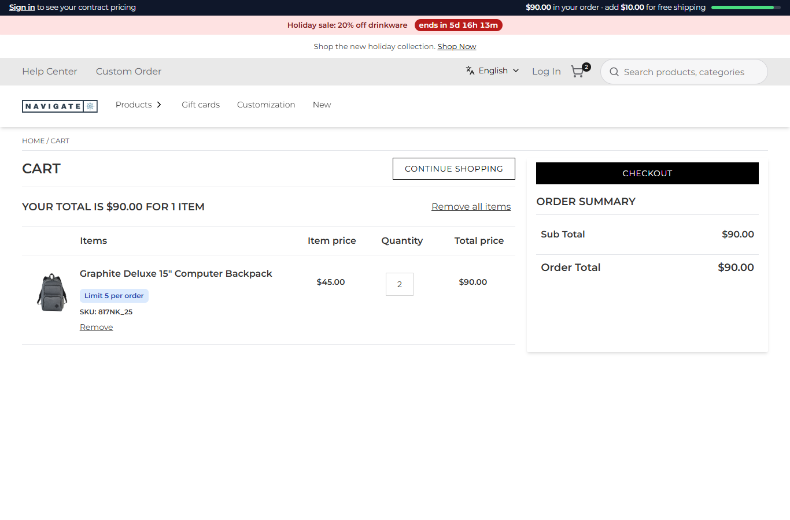
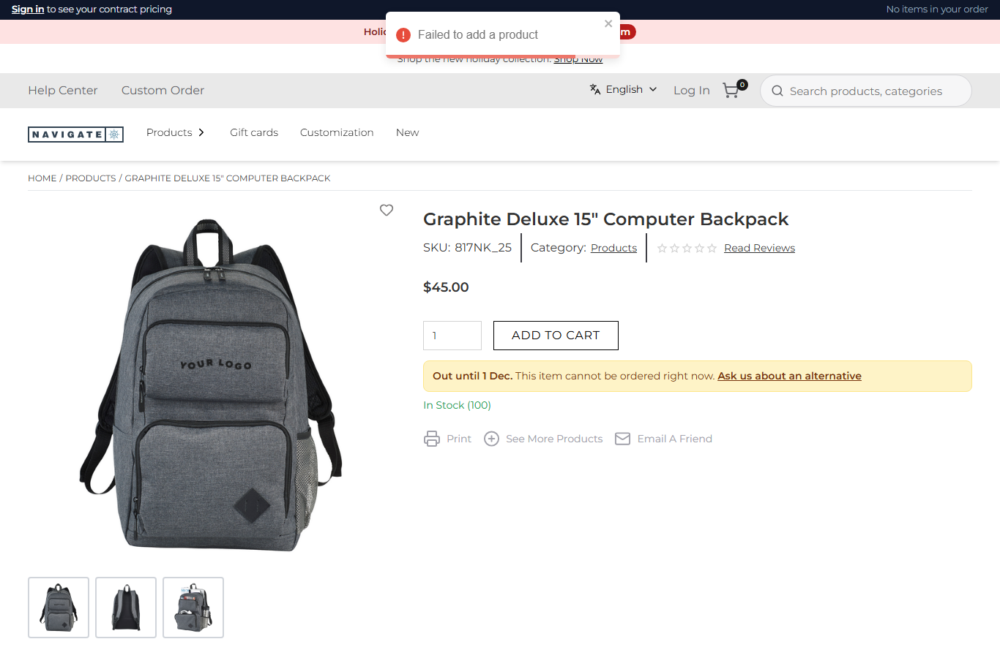
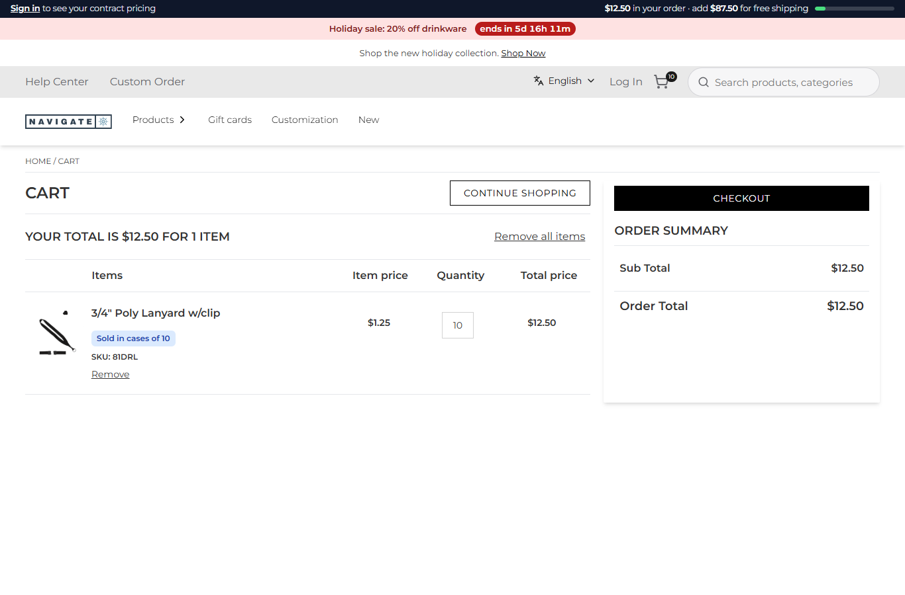

# 109: Can I change inventory checks?

**Listed:** Partial. **Result here:** Yes, as a check of the plugin's own before the store's. Znode's inventory and
its add-to-cart check are the store's, and a plugin does not change them. What a plugin can do is refuse an add with
its own rule before the store's agent runs. A hook cannot refuse (a throw is logged and skipped, row 106), so
spp-commerce **takes over `/api/add-to-cart`**: it refuses items on an ERP stock hold and passes everything else to the
store's own route.

| Before: the backpack is on an ERP hold, yet 2 are added | After: refused; the store's toast "Failed to add a product" plus the plugin's notice "Out until 1 Dec." |
| --- | --- |
|  |  |

A cart run afterwards: the held backpack is refused and the lanyard goes through (a case of 10): 

Store: POCSppDemo (`sppdemo.localhost:3000`), its own theme. The hold was sent with the signed webhook of row 091
(`817NK_25`, back on 2026-12-01) and lifted again after the pictures.

## The example: the ERP's holds stop orders

Znode still says "In Stock (100)", because the inventory sync is nightly. The ERP knows now that the backpack cannot
ship until December. With this change:

- **`addToCartGuard`** (route `add-to-cart`, taking over `/api/add-to-cart`, `src/commerce/server.ts`):
  - `heldLines` lists the request's lines that are on hold. It covers variants, and resolves superseded numbers first
    (row 106), so an old number cannot get round a hold.
  - A held line → refused in the store's envelope, `{"data":{"addToCartStatus":false,"isSuccess":false,"cartCount":0,
    "errorMessage":"Item # 817NK_25 is on hold until 2026-12-01 ...","onHold":[…]}}`, and recorded in the activity log.
  - Anything else → `context.original({ body: request.body })`: the store's route with the shopper's cookies, so its
    hooks (case packs, rep credit) and its agent run as always.
- **The product page** (`DeliveryEstimate`, slot `product.addToCart`) shows "**Out until 1 Dec.** This item cannot be
  ordered right now. Ask us about an alternative" in place of the delivery date. The store's own message on a failed
  add is generic, so the page says why before the shopper tries. The holds are read once per page
  (`src/commerce/holds.ts`, shared with the card tags of row 091).

**Found on the way:** `context.original()` with no argument sends **no body**. The first try reached the store's
add-to-cart route empty, and every add failed (`Unexpected end of JSON input`, 500), including items not on hold. A POST
override must pass the body itself: `original({ body: request.body })`. The SDK's comment ("as the browser called it")
covers the method and cookies, not the body.

Full output: [output.txt](output.txt).

## How it renders

**In the webstore (base):** `useAddToCart` → `POST /api/add-to-cart` → `runBeforeAddToCart` → `addToCartProduct`
(agent; Znode checks its own inventory) → `runAfterAddToCart`. On `addToCartStatus: false` the UI shows "Failed to add a
product" ([§6 A](../../RENDER-FLOW.md#6-add-to-cart)).

**How this customization joins it:**

- The proxy's `findRouteOverride` sends `/api/add-to-cart` to `/api/extensions/plugins/spp-commerce/add-to-cart`.
- The plugin route answers a refusal itself, or calls `original({ body })`. The store's route then runs in full, hooks
  included ([§7 B.4-B.5](../../RENDER-FLOW.md#7-cart-checkout-place-order), [§6 B](../../RENDER-FLOW.md#6-add-to-cart)).
- The notice is the `product.addToCart` slot ([§5 B](../../RENDER-FLOW.md#5-product-details-page)).

End-to-end flow, with file and line references in the webstore: [docs/RENDER-FLOW.md](../../RENDER-FLOW.md).

## Where

- `src/commerce/server.ts`: `heldLines`, `addToCartGuard` (route `add-to-cart`)
- `src/commerce/holds.ts` (new): `loadHolds`, `useHold`, `shortDate`, shared by `RuleTags` and `DeliveryEstimate`
- `src/commerce/slots/DeliveryEstimate.tsx`: the hold notice; `src/commerce/i18n/labels.json`: `holdNotice`,
  `holdNoticeNoDate`, `askAlternatives`; `src/commerce/styles/commerce.css`: `.spp-commerce-hold`
- `spp-commerce.znode-package.json`: `overrides["/api/add-to-cart"]`; `sourcingLink` is now a browser setting (the
  notice's link)

## How a client does this

Take over the store route (`"overrides"`), refuse in the store's envelope, and pass everything else to
`context.original({ body: request.body })`. Tell the shopper why in a slot, because the store's own failure message is
generic.
