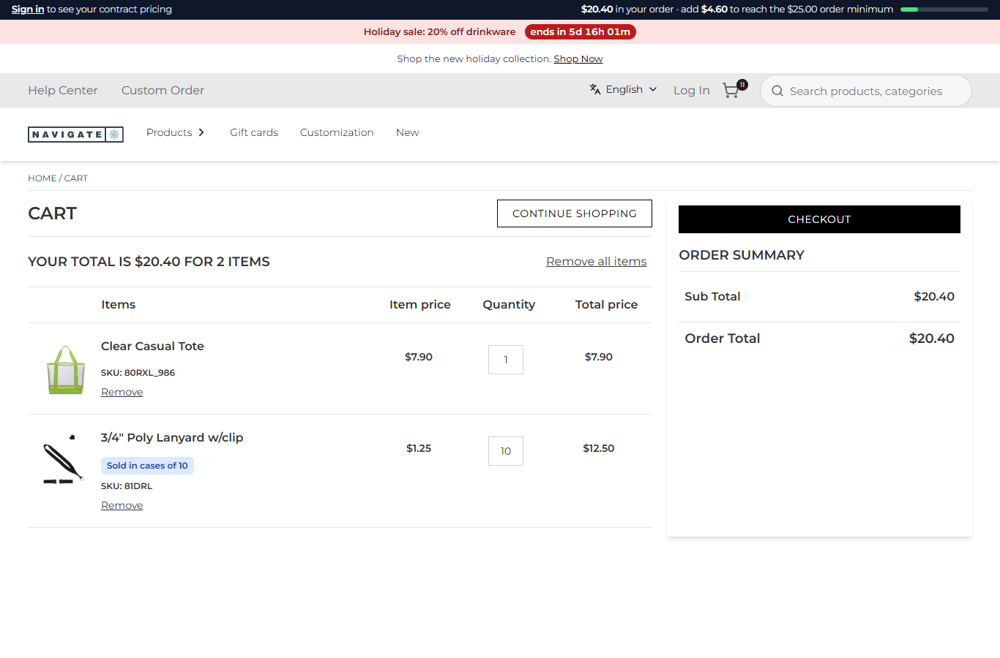
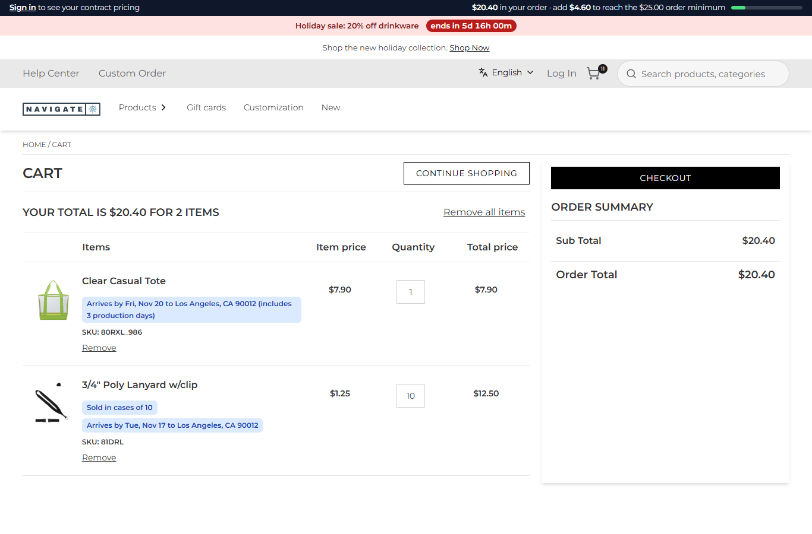

# 112: Can I change the cart page?

**Listed:** Partial. **Result here:** Yes, its content and look, not its structure. The cart page has no slot of its own,
so there is no place for a new section. A plugin changes what the lines say (`mapCartItems`: name, description, image),
the cart's contents (`onCartChanged`, rows 081/113/114), the page's look (CSS, row 056), and everything around it (the
header slot's bar, rows 085/107). A new block on the cart page itself (a "you may also need" row, an order-notes field)
would need a cart slot in the store.

| Before: the lines as the store shows them | After: each line says when it arrives; the decorated tote includes its 3 production days |
| --- | --- |
|  |  |

The same cart shipping to Los Angeles (90012): 

Store: POCSppDemo (`sppdemo.localhost:3000`), its own theme. A new cart with a Clear Casual Tote (decorated item
`80RXL_986`) and a lanyard (a case of 10). The shopper had given ZIP 53202 on a product page: the `spp_zip` cookie,
which `cart-shot.mjs --cookie` sets as the product page's box does.

## The example: when each line arrives

A buyer planning an event needs to know which items arrive in time, and decorated items take longer. With this
change:

- **The product page's "Deliver to" box** (row 093) also keeps the ZIP in a cookie, `spp_zip` (30 days, `SameSite=Lax`).
  Cart hooks can read cookies; routes cannot (row 086).
- **`mapCartItems`** (`src/commerce/server.ts`): when the cookie holds a ZIP, `deliveryNotes` looks it up (row 093's ZIP
  API, through row 096's outbound rules, cached). Each line gets "Arrives by Mon, Nov 16 to Milwaukee, WI 53202": ground
  days from the warehouse plus the item's **production days** (new setting `productionDays`, `{ "80RXL_986": 3 }`),
  counted in business days from the ship day.
- The dates sit next to the line's other notes (case pack, minimum, limit; row 082) and use their style.
- Without a ZIP, or when the ZIP API is down, the lines have no date: the cart works as before.

## How it renders

**In the webstore (base):** the cart page → `GET /api/cart/get-cart-items` → `getCartItems` (agent) → `CartItems.tsx`,
which renders `productDescription` as HTML ([§7 A](../../RENDER-FLOW.md#7-cart-checkout-place-order)). There is no
runtime slot on the cart page.

**How this customization joins it:** the route passes the agent's answer to `runMapCartItems`. Each plugin's
`mapCartItems` gets `{ store, settings, cookies }`; this one reads `spp_zip` and returns the lines with the notes added
to their descriptions ([§7 B.1](../../RENDER-FLOW.md#7-cart-checkout-place-order)).

End-to-end flow, with file and line references in the webstore: [docs/RENDER-FLOW.md](../../RENDER-FLOW.md).

## Where

- `src/commerce/server.ts`: `deliveryNotes`, `mapCartItems` (now async with the context), `ZIP_COOKIE`, `shortDay`
- `src/commerce/slots/DeliveryEstimate.tsx`: the ZIP also saved as the `spp_zip` cookie
- `spp-commerce.znode-package.json`: setting `productionDays`
- `scripts/cart-shot.mjs`: `--cookie <name>=<value>`

## How a client does this

Change the lines in `mapCartItems` (any field the cart renders), restyle the page with CSS, and use the header slot for
cart-wide messages. Read what the shopper chose elsewhere from a cookie, because hooks get the cookies. For a new
section on the cart page, the store needs a cart slot.
