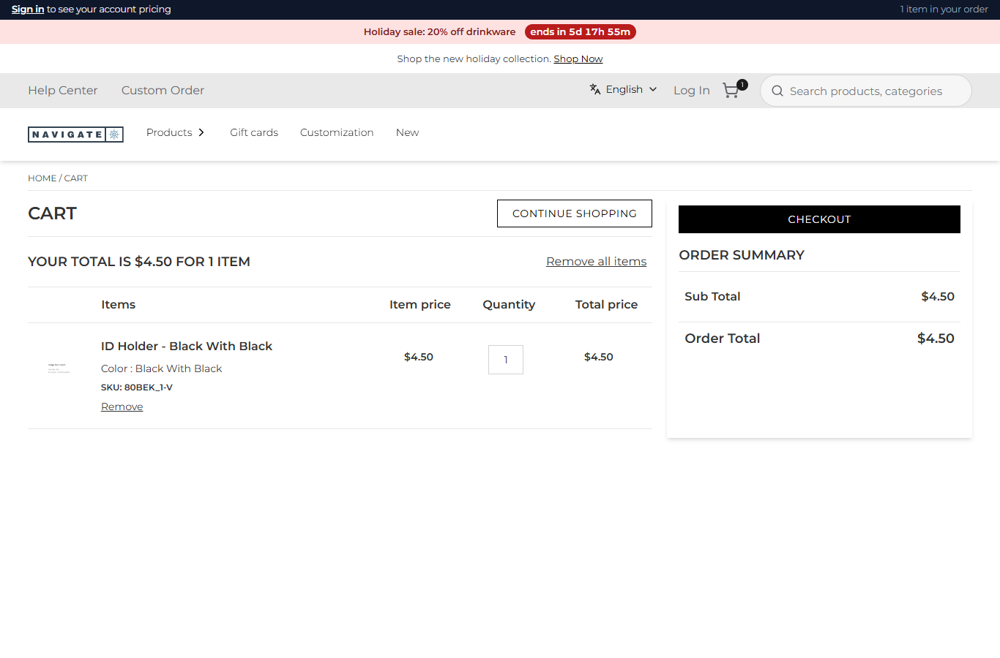
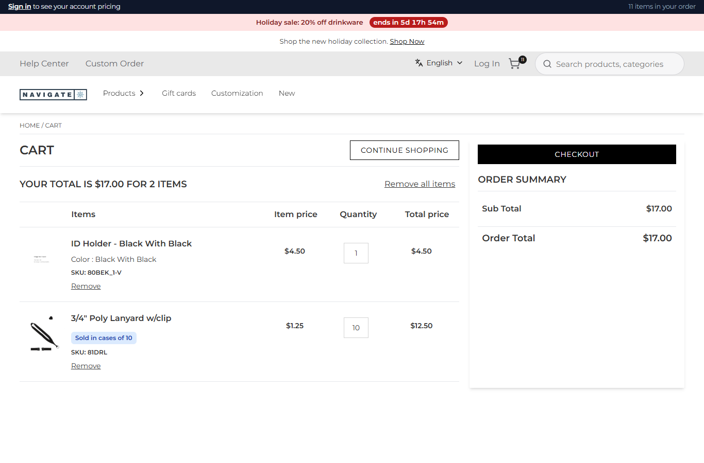
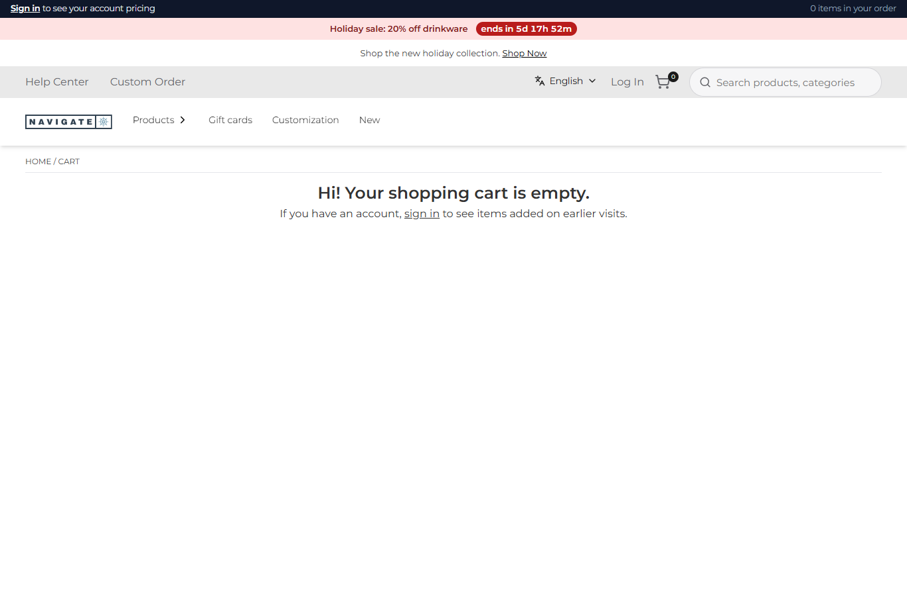

# 113: Can a plugin add or remove cart items automatically?

**Listed:** Yes. **Result here:** Yes, confirmed: `onCartChanged` adds an item with `actions.addItem` and removes it with
`actions.removeLine` on its own, with no click from the shopper. A **free** item is a different matter: a plugin
cannot set a price, so a gift at $0 needs a Znode promotion; the rule here adds a priced companion item instead.

| Before: ID holder added → only the ID holder | After: ID holder added → its lanyard is added too (10, one case) | After: ID holder removed → the lanyard goes with it |
| --- | --- | --- |
|  |  |  |

Store: POCSppDemo (`sppdemo.localhost:3000`), the spp-commerce plugin placed for the store. "Add to cart" on ID Holder -
Black With Black (product 103946, variant SKU `80BEK_1-V`), then the cart; for the third picture, "Remove" on the ID
holder's line. Before: setting `companions` `{}`; after: `{ "80BEK_1-V": "81DRL" }` (the default).

## The example: an item that needs another item

An ID badge holder is no use without a lanyard, so the store adds one: when the holder is in the cart and the lanyard
is not, the lanyard is added; when the holder leaves the cart, the lanyard **this rule added** goes with it. The
lanyard's quantity is the holder's, rounded up to its case pack (`casePacks`, scenario 080): 1 holder → 10 lanyards.

- `companionChanges` in `src/commerce/rules.ts`: from the cart's lines, the `companions` setting and what the rule added
  to this cart before, the adds and removes to make; nothing when the cart already follows the rule, so reading the
  cart again changes nothing.
- `onCartChanged` in `src/commerce/server.ts` makes them and remembers, per cart, the companions it added: a lanyard
  the shopper added is never removed.
- Every change is in the activity route:

  ```json
  {"sku":"81DRL","asked":0,"added":10,"rule":"companion of 80BEK_1-V","cartNumber":"C-10112026-1107","ok":true}
  {"sku":"81DRL","asked":0,"added":0,"rule":"companion removed with 80BEK_1-V","cartNumber":"C-10112026-1107","ok":true}
  ```

Found on the way: a variant is added as its parent product with the variant (and its quantity) in
`skuDetails[].addToCartChildItems`, and the cart line carries the variant's SKU (`80BEK_1-V`, not `80BEK_1`).
`beforeAddToCart` (080) now reads the variants too, so case packs also apply to them. Full output:
[output.txt](output.txt).

## How it renders

**In the webstore (base):** the cart page asks `GET /api/cart/get-cart-items` and `GET /api/cart/cart-summary` → agent
`getCartItems` → Znode `commerceapi/v1/{classType}/item-list/{classNumber}` → `CartItems.tsx`; "Remove" calls the
remove route and the page reads the cart again ([§7 A](../../RENDER-FLOW.md#7-cart-checkout-place-order)).

**How this customization joins it:** both routes call `runCartHooks(cartNumber)` first (`cart-hooks.server.ts`), under a
per-cart lock: `actions.addItem` builds an add-to-cart request for the same cart (the cart id from the cart cookie) and
calls the agent `addToCartProduct`; `actions.removeLine` calls `removeItemFromCart`. The route reads the cart after the
hooks, so the page shows the lanyard on the same load ([§7 B.1](../../RENDER-FLOW.md#7-cart-checkout-place-order)).

End-to-end flow, with file and line references in the webstore: [docs/RENDER-FLOW.md](../../RENDER-FLOW.md).

## Where

- `src/commerce/rules.ts`: `companionChanges`
- `src/commerce/server.ts`: the companion part of `onCartChanged`; `beforeAddToCart` reads `addToCartChildItems`
- `spp-commerce.znode-package.json`: setting `companions` (default `{ "80BEK_1-V": "81DRL" }`)
- `scripts/cart-shot.mjs`: a variant's page has its parent's add button (`btnAddToCart103941`); `--remove` lists the
  line ids it can find when the one asked for is not there

## How a client does this

In `onCartChanged`, compare `cart.lines` with the rule and call `actions.addItem({ sku, quantity })` /
`actions.removeLine(line.id)`. Keep track of what the rule added, so it only ever takes back its own items, and make
the rule a no-op on a cart that already follows it: it runs on every cart read.
