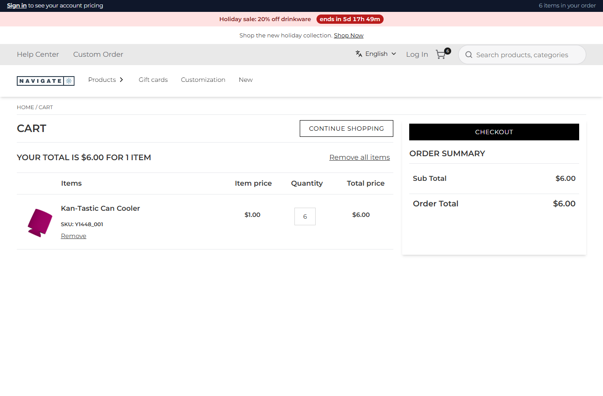
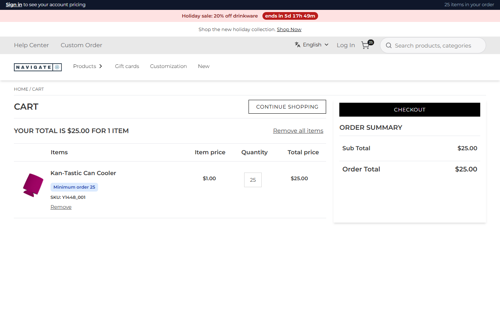

# 114: Can a plugin enforce cart rules (minimums, bundles)?

**Listed:** Yes. **Result here:** Yes, confirmed. The spp-commerce plugin enforces four rules with the cart hooks, all
set per store in its settings:

| Rule | Setting | Hook | Scenario |
| --- | --- | --- | --- |
| Case packs: quantities rounded up to whole cases | `casePacks` `{ "81DRL": 10 }` | `beforeAddToCart` | 080 |
| Per-order limit | `orderLimits` `{ "817NK_25": 5 }` | `onCartChanged` | 081 |
| Bundle: an item brings its companion, which leaves with it | `companions` `{ "80BEK_1-V": "81DRL" }` | `onCartChanged` | 113 |
| **Minimum order quantity** | **`minimums` `{ "Y1448_001": 25 }`** | **`onCartChanged`** | **114 (this one)** |

Each rule is also explained on the cart line by `mapCartItems` (082).

| Before: 6 can coolers added → the cart keeps 6 ($6) | After: 6 can coolers added → raised to the minimum of 25 ($25), with a "Minimum order 25" note |
| --- | --- |
|  |  |

Store: POCSppDemo (`sppdemo.localhost:3000`), the spp-commerce plugin placed for the store. Quantity 6 on the Kan-Tastic
Can Cooler (`Y1448_001`, $1), "Add to cart", then the cart. Before: setting `minimums` `{}`; after:
`{ "Y1448_001": 25 }` (the default).

## The example: a decoration minimum

Imprinted promotional products have a minimum run (a can cooler is printed in 25s at least). Znode has a minimum
quantity per product, but it is part of the catalog, the same for every store; a store's own minimum is a setting of
the plugin, changed without a catalog change or a deploy:

```
node scripts/registry.mjs set 'minimums={"Y1448_001":25}' --package spp-commerce
```

- `quantityRule` in `src/commerce/rules.ts`: the quantity a line must have, a minimum first and then a limit, with the
  rule's name; `null` when the line already follows both (so a second cart read changes nothing).
- `onCartChanged` replaces a line that breaks a rule (remove, then add again at the right quantity, personalization
  kept) and records it: `{"sku":"Y1448_001","asked":6,"added":25,"rule":"minimum 25",...}`.
- `lineNotes` adds "Minimum order 25" to the line, so the shopper sees why.

The rule functions run with node alone (no webstore): see [output.txt](output.txt).

## How it renders

**In the webstore (base):** the cart page asks `GET /api/cart/get-cart-items` and `GET /api/cart/cart-summary` → agent
`getCartItems` → Znode `commerceapi/v1/{classType}/item-list/{classNumber}` → `CartItems.tsx`
([§7 A](../../RENDER-FLOW.md#7-cart-checkout-place-order)).

**How this customization joins it:** `runCartHooks(cartNumber)` runs `onCartChanged` before the cart is read (per-cart
lock; `actions.removeLine` / `actions.addItem` call the cart agents), then `runMapCartItems` passes the lines through
`mapCartItems` for the note ([§7 B.1](../../RENDER-FLOW.md#7-cart-checkout-place-order)). Checkout reads the cart through
the same routes, so the rule holds there too.

End-to-end flow, with file and line references in the webstore: [docs/RENDER-FLOW.md](../../RENDER-FLOW.md).

## Where

- `src/commerce/rules.ts`: `belowMinimum`, `quantityRule`; `lineNotes` takes the minimums
- `src/commerce/server.ts`: `onCartChanged` applies `quantityRule` (minimum and limit); `mapCartItems` passes the
  minimums
- `spp-commerce.znode-package.json`: setting `minimums` (default `{ "Y1448_001": 25 }`)

## How a client does this

Write the rule as a function of the cart line and the settings (`quantityRule`), and let `onCartChanged` apply it with
the cart actions. A rule that blocks instead of fixing (a checkout that refuses an order under the minimum) is a
`checkout` slot or a route override (rows 115-117, 98-99).
