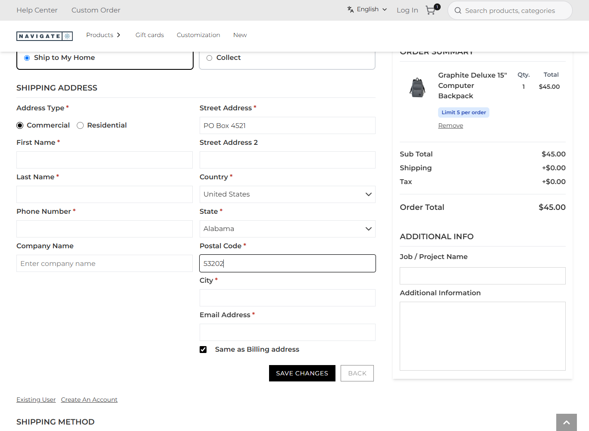
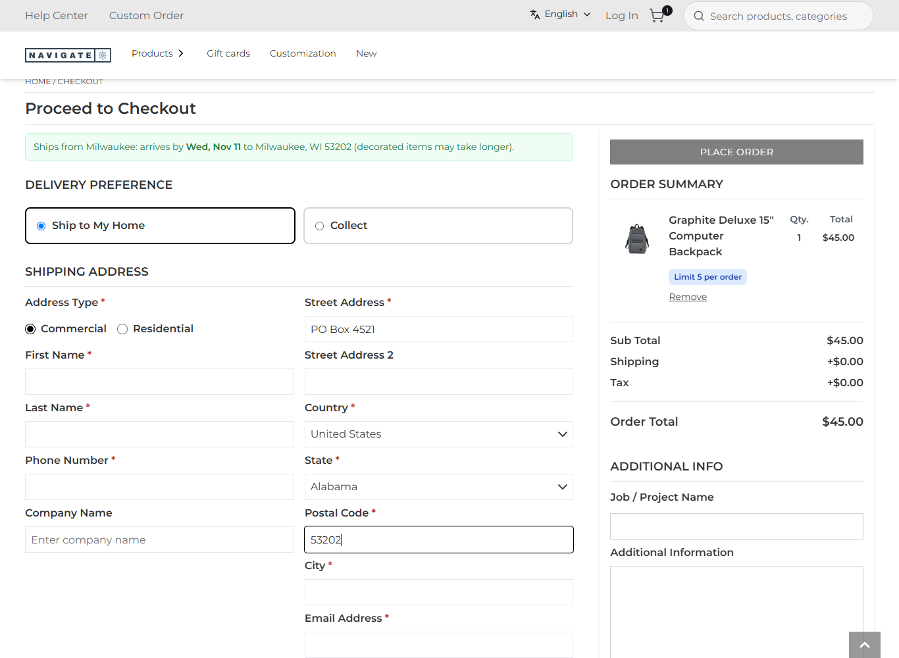
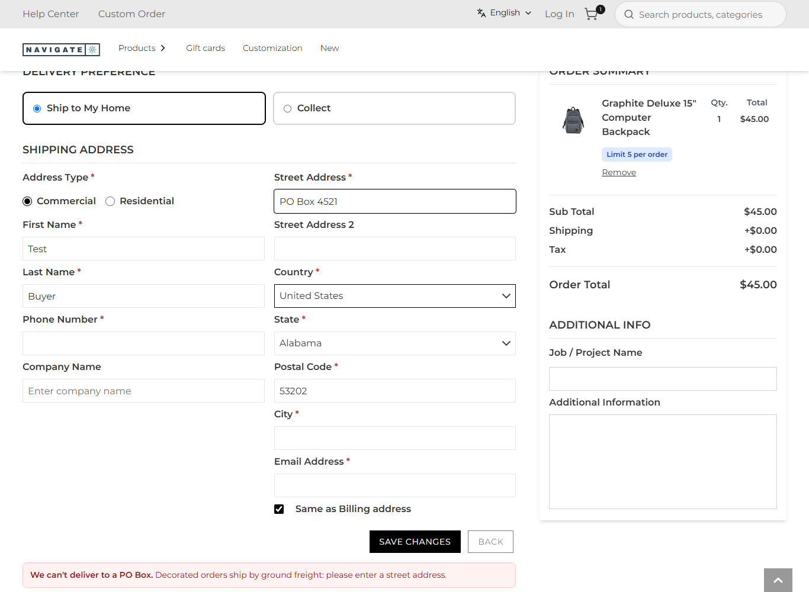

# 116: Can I change the checkout address step?

**Listed:** Yes. **Result here:** Yes, confirmed. The `checkout.address` slot wraps the store's whole address section.
A plugin keeps it (its `children`), adds around it, or replaces it. It gets the section's props and `checkout`, the
store's own calls for saving an address (`saveAddress`, `createGuestAccount`, `updateAddressIds`, …). Because it wraps
the store's form, it can also follow what the shopper types and stop a save, without touching the store's code.

| Before: a PO Box typed as the street address, nothing said | After: the delivery date for the ZIP above the section; a warning under it |
| --- | --- |
|  |  |

"Save changes" pressed with the PO Box: the save is stopped, and nothing is sent: 

Store: POCSppDemo (`sppdemo.localhost:3000`), its own theme, `/checkout` as a guest with a backpack in the cart. Test
input only: "PO Box 4521", ZIP 53202, "Test Buyer". **No address was saved:** the guard stops the store's save, and the
run recorded no POST request after the form was reached ([output.txt](output.txt)).

## The example: no PO boxes for freight, and the date up front

Decorated orders ship by ground freight, which cannot deliver to a PO Box. The store's form accepts one, and the order
then bounces at the carrier. `CheckoutAddress` (`src/commerce/slots/CheckoutAddress.tsx`):

- **Follows the store's fields**: input events from `address1` / `address2` / `postalCode` bubble up to the slot's
  wrapper. The store's form keeps its own state and validation.
- **PO Box guard**: as soon as either street line looks like a PO Box ("PO Box", "P.O. Box", "Post Office Box"), a
  warning appears under the section. A `submit` handler in the **capture** phase on the wrapper runs before the store's
  form handler. While the PO Box is there it stops the event, so the store's save (and its validation) never runs, and
  it puts the focus back on the street field. Setting `noPoBoxes` (browser, default on) turns the guard off.
- **Delivery date**: for the ZIP being typed, or the one given on a product page, it shows "Ships from Milwaukee:
  arrives by **Wed, Nov 11** to Milwaukee, WI 53202" from the `delivery-estimate` route (row 093).

The section also holds another package's addition: **`delivery-preference`** ("Ship to My Home / Collect"), a plugin
from outside this repository. Slots chain, so spp-commerce's wrapper sits around it as well. Each package keeps what
the earlier ones rendered.

## How it renders

**In the webstore (base):** `Checkout.tsx` → `AddressWrapper` (`withRuntimeWrapper`) → `AddEditAddress`
(react-hook-form, fields `address1`, `postalCode`, …; "Save changes" `btnSaveChanges`) → `saveCheckoutAddressForUser`
([§7 A.3](../../RENDER-FLOW.md#7-cart-checkout-place-order)).

**How this customization joins it:** `RuntimeCheckoutAddress` (`RuntimeCheckoutSlots.tsx`) renders
`RuntimeSlot name="checkout.address"` with the section's props and the `checkout` API. The store's packages reduce
over it in registry order: `delivery-preference`, then spp-commerce ([§7 B.2](../../RENDER-FLOW.md#7-cart-checkout-place-order)).

End-to-end flow, with file and line references in the webstore: [docs/RENDER-FLOW.md](../../RENDER-FLOW.md).

## Where

- `src/commerce/slots/CheckoutAddress.tsx` (new), registered in `src/commerce/browser.tsx` (`checkout.address`)
- `src/commerce/i18n/labels.json`: `checkoutArrives`, `noPoBox`; `src/commerce/styles/commerce.css`
- `spp-commerce.znode-package.json`: setting `noPoBoxes`

## How a client does this

Fill `checkout.address` and render `props.children` to keep the store's form. Listen on a wrapper for its fields
(`onInput`), and use a capture-phase `onSubmitCapture` to stop a save. To save an address yourself, use
`props.checkout.saveAddress(...)` rather than calling the store's endpoints.
