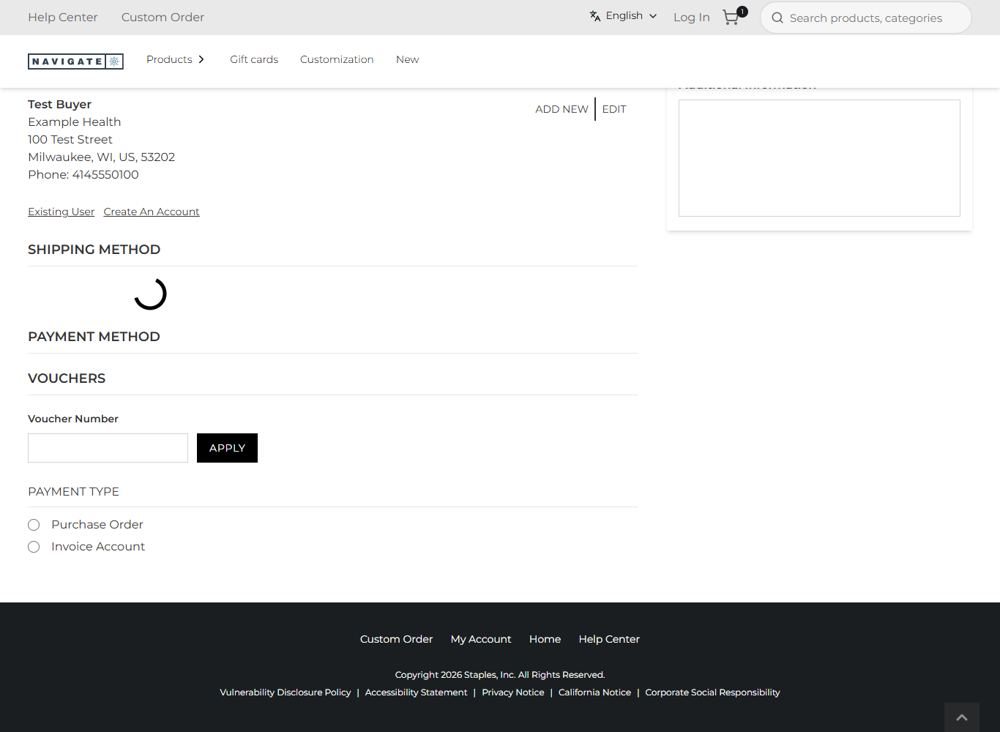

# 117: Can I filter or change shipping methods?

**Listed:** Yes. **Result here:** Implemented and deployed, with the rule tested with node and the cart data checked
live. **The live check on the checkout page is still open**: on this environment the store's guest checkout stops
before it ever asks for shipping methods. That is a store/Znode behaviour, not this plugin's, and needs a signed-in
buyer or a working guest flow to see the list. Row status: 🟡 in progress until then.

| Guest checkout after the address is saved: SHIPPING METHOD stays empty | The same, scrolled: the saved test address, then the empty section |
| --- | --- |
|  |  |

Store: POCSppDemo (`sppdemo.localhost:3000`), `/checkout` as a guest with a backpack in the cart. **A test address was
saved in Znode, with the user's approval**: Test Buyer, Example Health, 100 Test Street, Milwaukee WI 53202,
test.buyer@example.com (4 test runs).

## The example: no rush shipping for decorated items

A decorated item needs production days before it ships (setting `productionDays`, row 112: the tote +3), so "Next Day
Air" cannot keep its promise. The store would still offer it. With this change:

- **`shippingChoices`** (`src/commerce/rules.ts`): for a cart with a decorated item, it removes the methods whose
  name, code or description holds a rush word. The words are in the setting `rushShipping`: overnight, next day, 2nd
  day, 2 day, express. Free shipping is never removed, and a cart without decorated items keeps every method. Tested
  with node ([output.txt](output.txt)):

  ```
  cart: tote (3 production days)  kept: Ground (3-5 business days) | Free shipping   removed: Next Day Air | 2nd Day Air
  cart: lanyard only              kept: all four                                        removed: -
  ```
- **`CheckoutShipping`** (`src/commerce/slots/CheckoutShipping.tsx`, slot `checkout.shippingOptions`) renders the
  store's own list again with `cloneElement(children, { shippingOptions: kept })`. The list keeps its behavior
  (selection, saving the method, free-shipping handling); only its options change. It adds a note: "Not available for
  decorated items, which need production days first: Next Day Air, 2nd Day Air."
- **`my-order`** now also returns the cart's SKUs (`"skus":["80RXL_986","81DRL"]`, checked live), which the slot reads.

## Why the list does not appear here

After "Save changes" the store saves the address (`200`), then creates the guest account:
`POST /api/create-anonymous-user-account` answers `{"data":{"email":"test.buyer@example.com"}}`, **without a user id**
from Znode's Users API. `AddressWrapper` then cannot create the guest's address ids, so
`Checkout.updateShippingOptions` finds no address and never calls `/api/shipping-options`. The route is not
overridden (`npm run overrides`). The cause is likely Znode refusing a second guest with the same email, or this
portal's guest settings. Either way, verifying needs a buyer login (as rows 058 and 126-129 do) or a working guest
flow.

## How it renders

**In the webstore (base):** `Checkout.tsx` → `updateShippingOptions` → `POST /api/shipping-options` →
`ShippingOptions` (`withRuntimeWrapper`) renders the methods ([§7 A.3](../../RENDER-FLOW.md#7-cart-checkout-place-order)).

**How this customization joins it:** `RuntimeShippingOptions` renders `RuntimeSlot name="checkout.shippingOptions"`
with the list's props (`shippingOptions`, …) and the `checkout` API. spp-commerce's slot gets the store's element as
`children` and re-renders it with fewer options ([§7 B.2](../../RENDER-FLOW.md#7-cart-checkout-place-order)).

End-to-end flow, with file and line references in the webstore: [docs/RENDER-FLOW.md](../../RENDER-FLOW.md).

## Where

- `src/commerce/rules.ts`: `shippingChoices`
- `src/commerce/slots/CheckoutShipping.tsx` (new), registered in `src/commerce/browser.tsx`
- `src/commerce/server.ts`: `cartTotals` / `my-order` return `skus`
- `spp-commerce.znode-package.json`: setting `rushShipping`; `productionDays` is now a browser setting
- `src/commerce/i18n/labels.json` (`rushUnavailable`), `src/commerce/styles/commerce.css`

## How a client does this

Fill `checkout.shippingOptions`, and to filter or rename methods, render `cloneElement(props.children,
{ shippingOptions })` so the store's list keeps its behavior. Keep the rule in a plain function.
