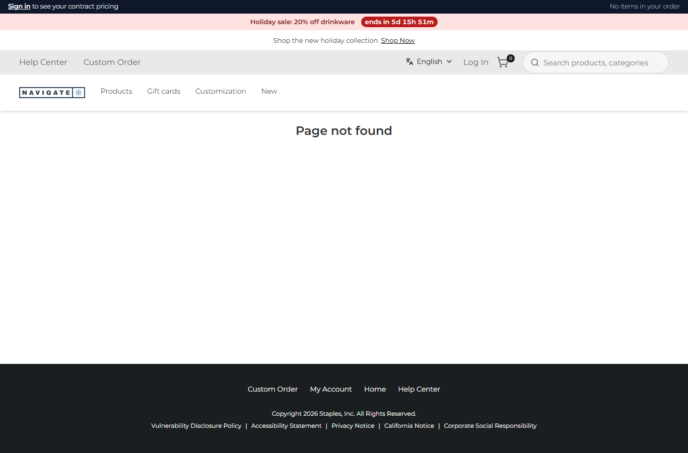
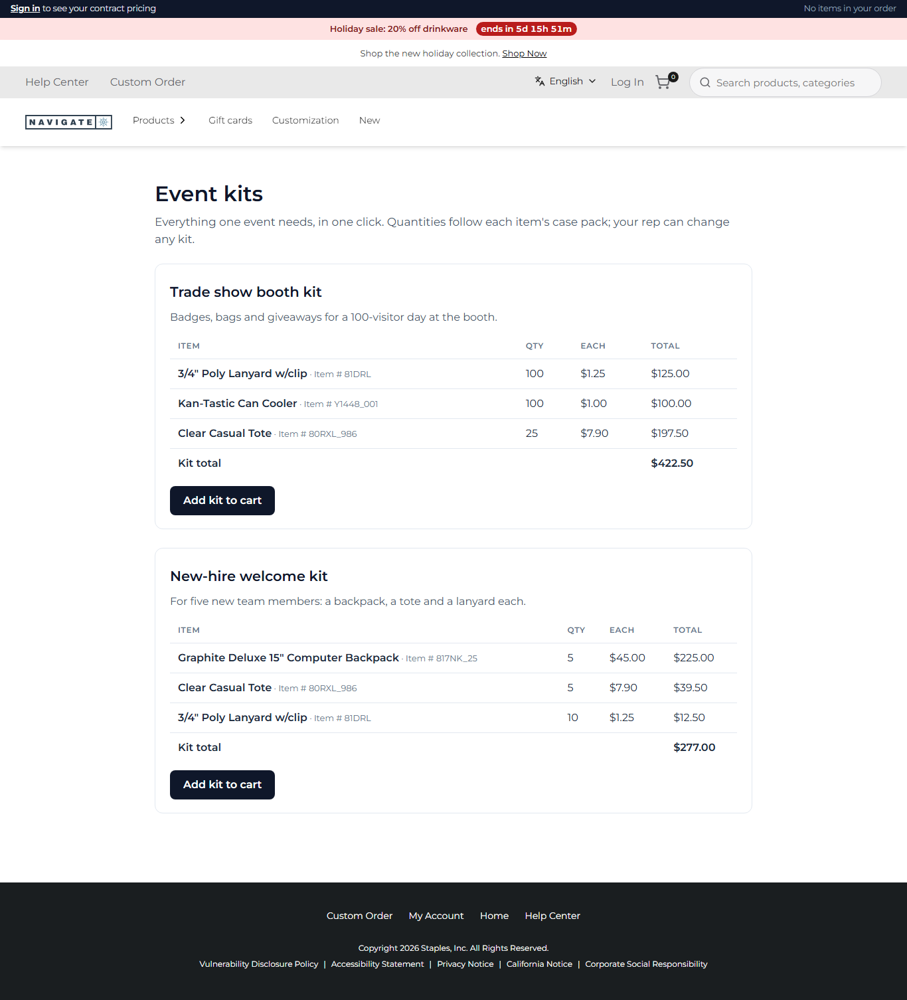
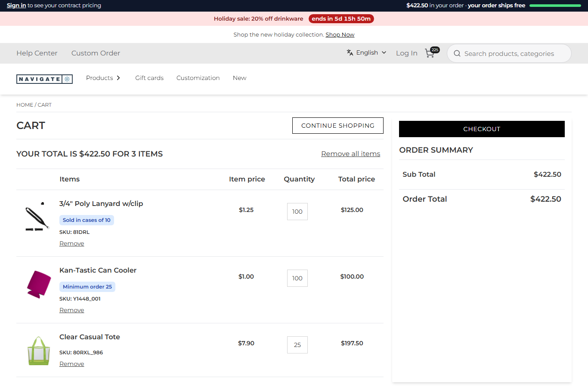

# 121: Can I add a complete new module (e.g. quick checkout) without touching base?

**Listed:** Partial. **Result here:** Yes, with one design constraint found here. A plugin brings a whole feature: its
own URL (server page), its own API (routes), its own data (settings, Znode through `context.znode`) and its own
behavior in the browser. Nothing in the store changes. The constraint is that a server page renders **on the server
only**: it cannot carry interactive parts of its own. Those come from the plugin's browser part, here through its
`layout.header` slot, which runs on every page and acts on this page only. A plugin's page-builder content (`pages`)
cannot claim a new URL either: it only replaces a page the CMS already has, and the new path redirected to `/404`.

The store already has a Quick Order pad (`/quick-order`), so the module built here is one it does not have.

| Before: `/event-kits` → the store's 404 | After: the Event kits page, live prices and kit totals |
| --- | --- |
|  |  |

"Add kit to cart" on the trade-show kit → the cart, $422.50, the same total as the page: 

Store: POCSppDemo (`sppdemo.localhost:3000`), its own theme.

## The example: Event kits

Promo buyers order *for an event*, not item by item. The module:

| Part | What | Where |
| --- | --- | --- |
| URL | `/event-kits`, rendered on the server: the kits, their contents and quantities, an "Add kit to cart" per kit; title and description | `EventKitsPage.tsx`, `serverPages` |
| Data | The kits: setting `eventKits` (JSON, set per store, no deploy): a trade-show booth kit (100 lanyards, 100 can coolers, 25 totes) and a new-hire kit | `spp-commerce.znode-package.json`, `readKits` |
| Live prices | Names, prices each, line and kit totals from this store's catalog | route `sku-lookup` (row 095, `context.znode`) |
| Behavior | The page's buttons, enabled once every line has a price; each line goes to the store's own `POST /api/add-to-cart` as the product page sends it, the cart cookies are set as the store's add-to-cart sets them, then the cart | `slots/EventKits.tsx` in `layout.header` |

Because the lines go through the store's own add-to-cart, everything else in this repository applies to a kit as to
any add: case packs, companions, limits and minimums (080-114), ERP holds (109), the activity log, the line notes and
the free-shipping meter. Without JavaScript the page still lists the kits.

## How it renders

**In the webstore (base):** no such page. An unknown path is the store's 404.

**How this customization joins it:**

- The proxy's `findRuntimePage` sees `/event-kits` in spp-commerce's `serverPages` for this store and rewrites the
  request to `apps/webstore/src/app/[locale]/runtime-page/[...path]/page.tsx`. `RuntimeServerPage` calls the plugin's
  `render` inside the store's layout, and `metadata` gives the `<title>`
  ([§9 B.1](../../RENDER-FLOW.md#9-home-content-and-package-pages-widgets)).
- In the browser, `layout.header` renders `EventKits`, which on this path calls the plugin's route
  ([§7 B.5](../../RENDER-FLOW.md#7-cart-checkout-place-order)) and the store's add-to-cart route
  ([§6](../../RENDER-FLOW.md#6-add-to-cart)).

End-to-end flow, with file and line references in the webstore: [docs/RENDER-FLOW.md](../../RENDER-FLOW.md).

## Where

- `src/commerce/EventKitsPage.tsx` (new): `readKits`, `EventKitsPage`
- `src/commerce/slots/EventKits.tsx` (new): live prices, "Add kit to cart"
- `src/commerce/browser.tsx`: `layout.header` renders `EventKits` and the account bar
- `src/commerce/server.ts`: `serverPages["/event-kits"]`
- `spp-commerce.znode-package.json`: `"serverPages"` adds `/event-kits`; setting `eventKits`
- `src/commerce/styles/commerce.css`: `.spp-commerce-kits`

## How a client does this

Give the module a server page for its URL and content, routes for its data, and settings for what merchants change.
Put its interactive part in the browser part, keyed to the page's path, and send writes through the store's own
routes so every rule applies.
