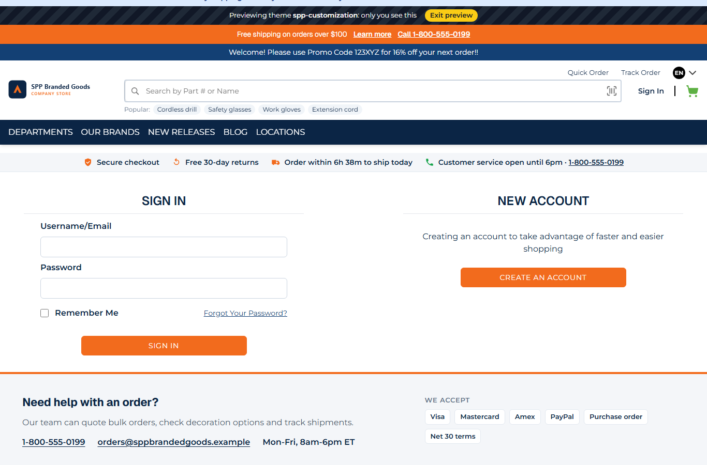
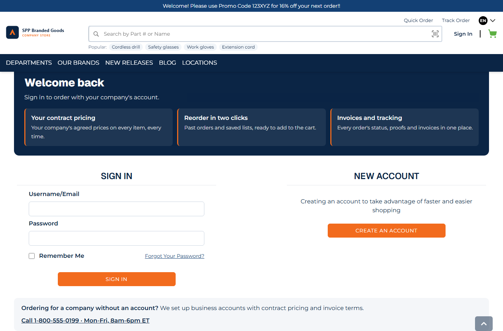
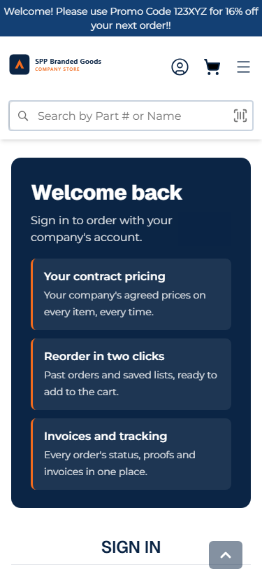

# 130: Can I change the login and registration pages?

**Listed:** Partial. **Result here:** The sign-in page yes, fully; the registration page only by CSS.

| Page | Slots | What a package can do |
| --- | --- | --- |
| `/login` | `login.layout` (server, around the page), `login.page` (server, around the content), `login.form` (browser, around the form) | wrap, add to or replace any part |
| `/signup` (create an account) | none | restyle it with the theme's CSS; no new content, no other fields |

| Before: the store's sign-in and new-account blocks | After: the theme's B2B frame around them |
| --- | --- |
|  |  |

Phone: 

Store: MaxwellsHardware (`localhost:3000`), `/login` with spp-customization previewed.

## The example: a B2B sign-in page

A business buyer signs in for their company's account, not for "faster and easier shopping". The theme's `login.page`
server slot (`src/server/LoginPage.tsx`) keeps the store's sign-in and new-account blocks (`children`, unchanged:
fields, validation, reCAPTCHA, MFA and redirects are the store's) and frames them:

- **Above**: "Welcome back · Sign in to order with your company's account", and three benefits: your contract
  pricing, reorder in two clicks, invoices and tracking.
- **Below**: "Ordering for a company without an account? We set up business accounts with contract pricing and
  invoice terms", with a call link built from the theme's settings (`supportPhone`, `supportHours`).

It is a server component, so it is in the page's HTML, with no flicker and no browser code. Checked:

```
> curl -H "Host: localhost:3000" -b runtimeThemePreview=spp-customization http://127.0.0.1:3000/login | grep ...
divThemeLogin · Welcome back · Reorder in two clicks · Ordering for a company
```

## How it renders

**In the webstore (base):** `apps/webstore/src/app/[locale]/login/page.tsx` renders the store's `Login` component
(sign in and new account) inside `NextIntlClientProvider`.

**How this customization joins it:** the page wraps `Login` in
`<RuntimeServerSlot name="login.page"><RuntimeSlot name="login.form">…`, and `login/layout.tsx` adds
`RuntimeServerSlot name="login.layout"`. A server slot runs each package's server component on the server, with the
store's output as `children` and `{ React, store, settings }` ([§3 B](../../RENDER-FLOW.md#3-the-page-shell-root-layout-head-styles-labels-server-layout)).
`/signup` has no such wrapper, so only the theme's CSS reaches it.

End-to-end flow, with file and line references in the webstore: [docs/RENDER-FLOW.md](../../RENDER-FLOW.md).

## Where

- `src/server/LoginPage.tsx` (new), registered in `src/server.tsx` (`serverSlots["login.page"]`)
- `src/styles/theme.css`: `.spp-customization-login`

## How a client does this

Fill `login.page` (server, for content around the page) or `login.form` (browser, to add to or replace the form) and
render `children` to keep the store's sign-in. For the registration page, use CSS; new content there needs a slot in
the store.
