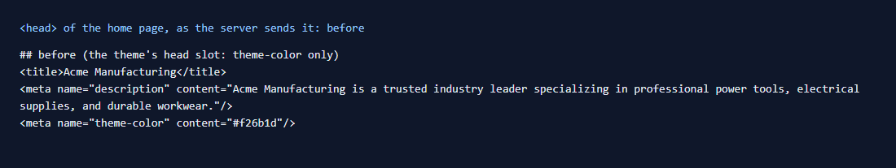
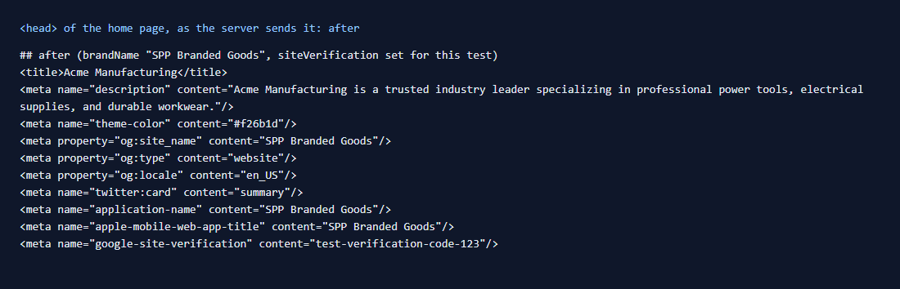

# 133: Can I change SEO and meta tags per theme?

**Listed:** No (blocked). **Re-checked:** Partly yes. A theme can **add** tags to every page's `<head>`, and they are
in the HTML the server sends, which search engines and link previews read. A theme cannot **replace** a page's
`<title>` and meta description: those come from each page's SEO fields in Znode, through Next.js metadata
(`generateMetadata`). A second description tag from a theme would only duplicate them. Row status: done, with that
limit.

| Before: the theme's head slot adds only theme-color | After: the brand's social and app tags, and the site verification |
| --- | --- |
|  |  |

Store: MaxwellsHardware (`localhost:3000`), spp-customization previewed, the `<head>` read with curl from the server
HTML ([output.txt](output.txt)).

## The example: the brand's link previews and app name

Shared links (chat, email, social) and phones' home screens show the site's name. Without tags, they guess. The theme's
`layout.head` slot (`src/slots/HeadTags.tsx`, which already sets theme-color, the favicon and analytics in row 053) now
adds, for every page of the stores the theme runs on:

```html
<meta property="og:site_name" content="SPP Branded Goods"/>
<meta property="og:type" content="website"/>
<meta property="og:locale" content="en_US"/>
<meta name="twitter:card" content="summary"/>
<meta name="application-name" content="SPP Branded Goods"/>
<meta name="apple-mobile-web-app-title" content="SPP Branded Goods"/>
<meta name="google-site-verification" content="…"/>
```

- `brandName` (setting, "SPP Branded Goods") sets the names. Empty turns the brand tags off.
- `siteVerification` (setting, empty by default) is the search console's verification code. It is **per store**: each
  store's registry entry sets its own. It was set to a test value for the picture, then cleared again.
- The page's own `<title>` ("Acme Manufacturing") and description stay as the CMS sets them.
- On the store's own theme (no preview) none of these tags appear: they come with the theme.

## How it renders

**In the webstore (base):** each page's `generateMetadata` (product, category, content pages) returns its title and
description from Znode's SEO fields, and Next.js writes them into `<head>`.

**How this customization joins it:** `RuntimeRoot` renders `RuntimeSlot name="layout.head"` on every page, on the
server too. React 19 moves `<meta>` and `<link>` rendered anywhere into the document `<head>`, so the theme's tags are
in the server HTML ([§3 B](../../RENDER-FLOW.md#3-the-page-shell-root-layout-head-styles-labels-server-layout)).

End-to-end flow, with file and line references in the webstore: [docs/RENDER-FLOW.md](../../RENDER-FLOW.md).

## Where

- `src/slots/HeadTags.tsx`: the brand and verification tags
- `znode-package.json`: settings `brandName`, `siteVerification` (browser)

## How a client does this

Add tags in the theme's `layout.head` slot. Make per-store values settings, and keep page titles and descriptions in
the CMS's SEO fields.
