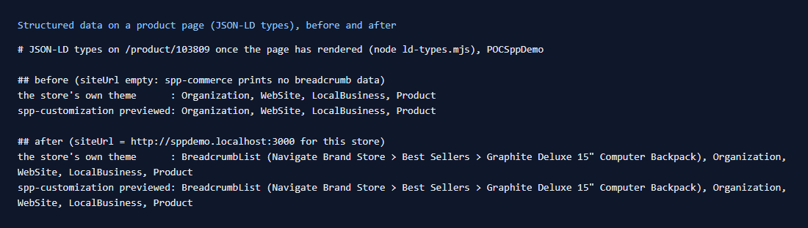

# 134: Can I add structured data (JSON-LD) per store?

**Listed:** No (blocked). **Re-checked:** Yes. A plugin prints JSON-LD from a slot that renders on the server (here
`product.addToCart` on product pages), from its own settings, for the stores it runs on. The one thing a package cannot
do is change the store's own blocks (Organization, WebSite, LocalBusiness, Product): it can only add next to them. Row
status: done.



| Product page | JSON-LD types once rendered |
| --- | --- |
| Before (no `siteUrl`) | Organization, WebSite, LocalBusiness, Product |
| After (`siteUrl` set for POCSppDemo) | **BreadcrumbList** (Navigate Brand Store › Best Sellers › Graphite Deluxe 15" Computer Backpack), Organization, WebSite, LocalBusiness, Product |

Store: POCSppDemo (`sppdemo.localhost:3000`), `/product/103809`, the same with the store's own theme and with
spp-customization previewed ([output.txt](output.txt)).

## The example: breadcrumbs in search results

Search results show a page's place in the store ("Navigate Brand Store › Best Sellers › …") from `BreadcrumbList`
data, which the store does not print. `ProductJsonLd` (`src/commerce/slots/ProductJsonLd.tsx`), rendered with
spp-commerce's `product.addToCart` slot, prints it from the product's category and the store's address:

```json
{"@context":"https://schema.org","@type":"BreadcrumbList","itemListElement":[
 {"@type":"ListItem","position":1,"name":"Navigate Brand Store","item":"http://sppdemo.localhost:3000/"},
 {"@type":"ListItem","position":2,"name":"Best Sellers","item":"http://sppdemo.localhost:3000/category/1674"},
 {"@type":"ListItem","position":3,"name":"Graphite Deluxe 15\" Computer Backpack","item":"http://sppdemo.localhost:3000/product/103809"}]}
```

- **Per store**: settings `siteUrl` (the store's address, for absolute URLs; empty means no data) and `storeName`
  (the first crumb) are set in each store's registry entry.
- `breadcrumbJsonLd` builds it only when it has the address, the product and its category. The JSON is escaped (`<`
  as `<`), so no value can end the `<script>`. Nothing is printed in the quick view.

**Found on the way:**

- **The store's own blocks** are not in the HTML as `<script>` tags. They travel in the page's React data stream and
  appear once the page has rendered. Search engines that run JavaScript see them; crawlers that don't, do not. The
  plugin's block is a plain `<script>` in the server HTML, readable either way.
- **The store's blocks have gaps** (empty `url`, empty product `image`, a relative logo path, and a search action using
  `SearchTerm` where the store's search reads `searchTerm`). A package cannot fix those: they need the store's code or
  its SEO settings.

## How it renders

**In the webstore (base):** the root layout prints Organization, WebSite and LocalBusiness (`<JsonLd …/>` in
`[locale]/layout.tsx`); the product page prints Product.

**How this customization joins it:** spp-commerce's `product.addToCart` slot renders on the server with the page
(`RuntimeAddToCart`, [§5 B](../../RENDER-FLOW.md#5-product-details-page)), so its `<script type="application/ld+json">`
is in the HTML the server sends.

End-to-end flow, with file and line references in the webstore: [docs/RENDER-FLOW.md](../../RENDER-FLOW.md).

## Where

- `src/commerce/slots/ProductJsonLd.tsx` (new): `breadcrumbJsonLd`, `ProductJsonLd`
- `src/commerce/browser.tsx`: `product.addToCart` renders `ProductJsonLd` and `DeliveryEstimate`
- `spp-commerce.znode-package.json`: settings `siteUrl`, `storeName` (browser)

## How a client does this

Print JSON-LD from a slot that renders on the server, with values from settings set per store. Add types the store
lacks, and don't repeat the store's own types: two Product blocks for one page would be read as two products.
