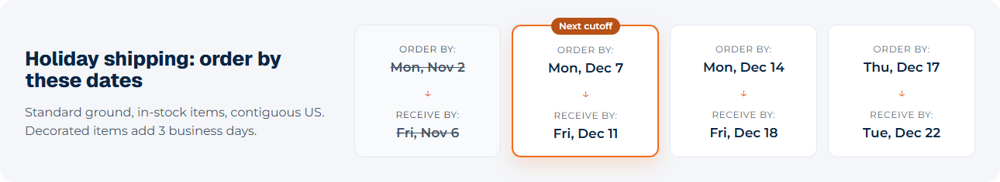
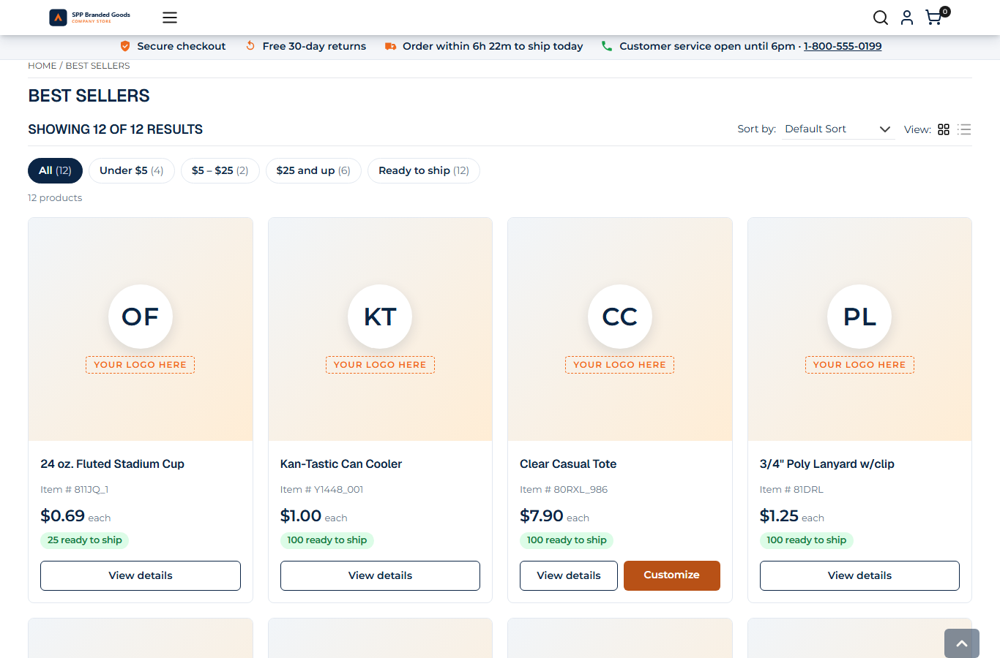

# 138: Do package widgets work with the keyboard and screen readers?

**Listed:** Partial. **Result here:** Yes for this repository's widgets and slots, now checked by a tool and fixed. A
package's markup is its own responsibility: the store neither checks nor fixes it. The new `npm run a11y` runs
**axe-core** (WCAG 2.1 A/AA) on this repository's parts only and **walks the page with the Tab key**. It found color
contrast failures in the theme, which are fixed. After the fixes there are no violations on four pages, and all 60 keyboard
stops show focus.

| Before: the announcement bar, white on the bright accent (3.04:1) | After: the accent darkened for text (4.8:1) |
| --- | --- |
|  |  |

| After: the delivery timeline, past dates readable (were 1.99:1) | After: product cards, "Customize" at 4.8:1 (was 3.04:1) |
| --- | --- |
|  |  |

Pages: MaxwellsHardware home with spp-customization previewed; POCSppDemo home (spp-commerce: account bar, account
manager, quote form); POCSppDemo Best Sellers with the theme; a product page (delivery box).

## What was found and fixed

| Where | Problem (axe) | Fix |
| --- | --- | --- |
| Announcement bar | white on `#f26b1d`: 3.04:1, needs 4.5:1 | background `--spp-accent-strong` (the accent darkened by a quarter): 4.8:1 |
| Timeline "Next cutoff" badge, product card "Customize" | white on the accent: 3.04:1 | the same token |
| Highlight card numbers | accent on white: 3.04:1 | the same token as text color |
| Delivery timeline, past dates | faded with `opacity: 0.5`: 1.99:1 | muted gray `rgb(71,85,105)`, still struck through |
| Promo strip terms, footer help labels | gray on tint: 4.39:1 | darker gray: 7.3:1 |

`--spp-accent-strong` (`src/styles/tokens.css`) is the store's accent mixed with 24% black. It is defined on `:root`
and on the theme's layout wrapper, where each store's own accent is set, so it follows every store's color. Browsers
without `color-mix` fall back to the accent. The brand orange stays for large shapes and borders.

**Already right, and confirmed by the check:**

- The FAQ uses native `
`/`
`, so it works with the keyboard and screen readers without script.
- The star ratings are `role="img"` with "4 out of 5 stars".
- The copy-code button has an `aria-label` and a live "Copied!".
- The form fields have labels, and their status messages are `role="status"`.
- Decorative icons are `aria-hidden`.
- The skip link goes to the main content.
- Every focusable element shows a focus indicator.

**What the tool cannot judge:** whether the text and alternatives make sense to a listener, and full screen-reader
behavior. Those need a manual pass with a screen reader, and a store-wide audit is row 137 (outside this repository).

Full output: [output.txt](output.txt).

## How it renders

**In the webstore (base):** the store's components carry their own ARIA. The store does not check a package's markup.

**How this customization joins it:** widgets render through `RuntimeWidget`, and slots through `RuntimeSlot`, as the
package wrote them ([§9 B.2](../../RENDER-FLOW.md#9-home-content-and-package-pages-widgets),
[§4 B](../../RENDER-FLOW.md#4-worked-example-the-product-card-on-a-category-page)). Their accessibility is the
package's, so this repository checks it itself.

End-to-end flow, with file and line references in the webstore: [docs/RENDER-FLOW.md](../../RENDER-FLOW.md).

## Where

- `scripts/a11y.mjs` (new), `package.json` script `a11y`, README.md commands table
- `src/styles/tokens.css`: `--spp-accent-strong`
- `src/styles/theme.css` (announcement bar), `src/styles/widgets.css` (timeline badge and past steps, highlight
  numbers, strip terms), `src/styles/product-card.css` (Customize), `src/styles/footer.css` (help labels)

## How a client does this

Run `npm run a11y -- --path <page>` on each page your package changes (`--theme none` for a plugin on the store's own
theme), and fix what it reports before a release. Use native elements first (`
`, `<button>`, `<label>`), and
keep a darker variant of the brand color for text.
