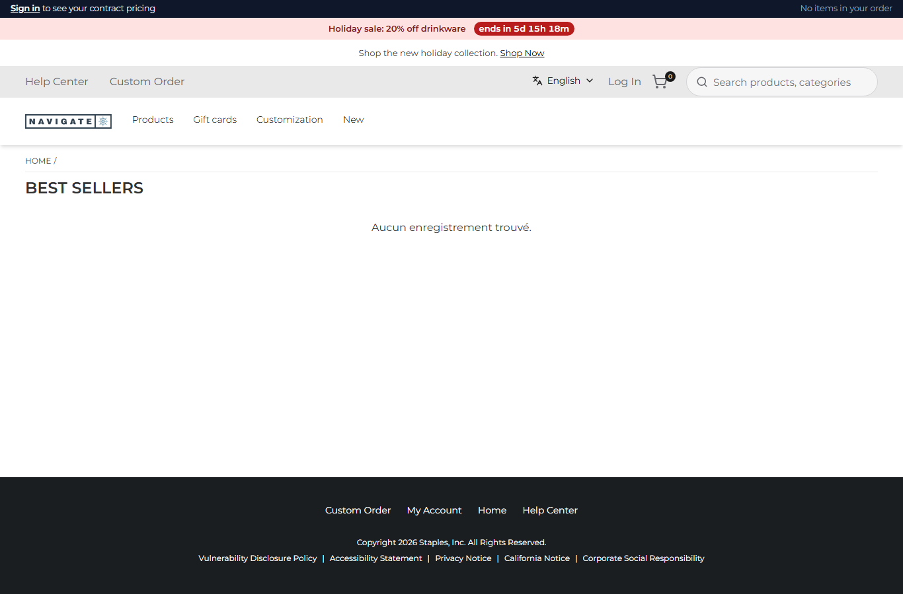
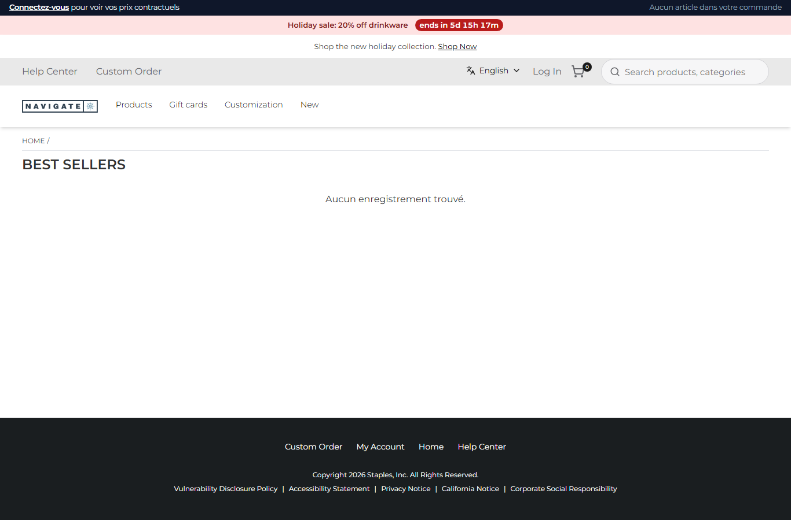
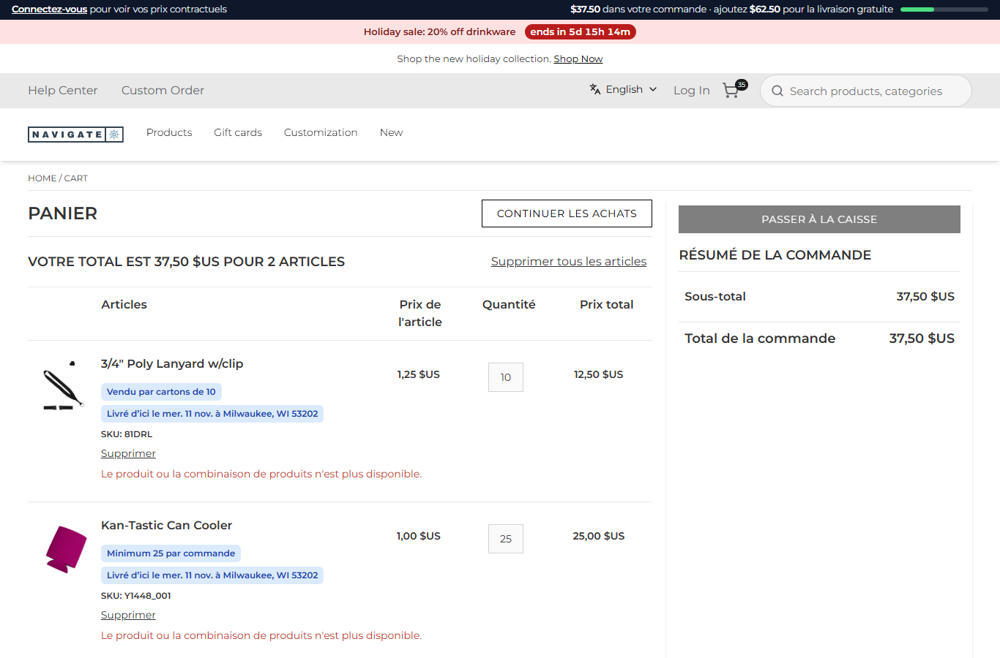
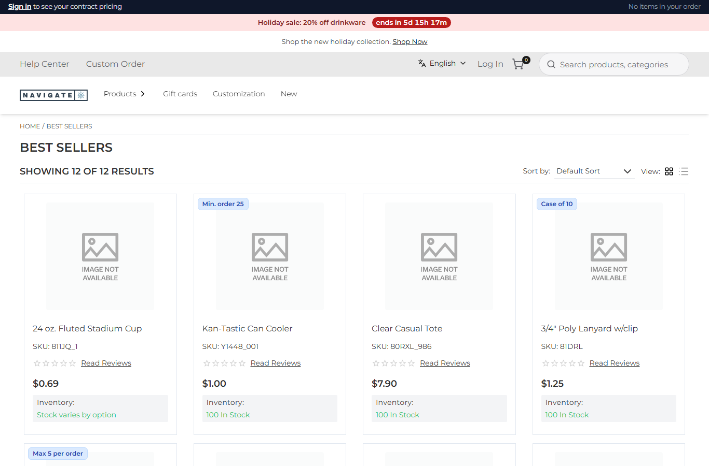

# 139: Can labels be translated per language?

**Listed:** Yes. **Result here:** Yes, with one constraint found here. A package has **one** `"messages"` file, and
the store merges it into its messages for **every** language: `withRuntimeMessages` is not told the locale. So a
package's English labels showed on French pages. A package handles languages itself:

- **Browser parts:** each language's labels sit in the same file under their own key (`Common.sppCommerce.fr`), and are
  picked from the page's URL. The store prefixes every language but the default (`/fr-FR/…`), and `usePathname` gives
  the same path on the server and in the browser.
- **Server hooks** (cart-line notes): they read the store's `NEXT_LOCALE` cookie (`fr-FR` on French pages).

| Before: `/fr-FR/…`, the store's French, spp-commerce's English ("Sign in to see your contract pricing") | After: spp-commerce in French ("Connectez-vous pour voir vos prix contractuels", "Aucun article dans votre commande") |
| --- | --- |
|  |  |

The French cart, every plugin text in French (bar, line notes, delivery dates): 

The English page, unchanged: 

Store: POCSppDemo (`sppdemo.localhost:3000`), its own theme. The store's French catalog has no products ("Aucun
enregistrement trouvé", and the cart lines say "n'est plus disponible"); that is the store's data, not the plugin.

## The example: spp-commerce speaks French

- **`src/commerce/i18n/labels.json`**: all 28 browser labels in English at `Common.sppCommerce`, and in French at
  `Common.sppCommerce.fr`, including the ICU plural ("Aucun article / # article / # articles dans votre commande") and
  the `<b>` rich text. Apostrophes are typographic (’), so ICU never reads them as escapes.
- **`useSppTranslations()`** (`src/commerce/i18n.ts`) replaces `useTranslations("Common.sppCommerce")` in the five
  slots: account bar, card tags, delivery box, checkout address, checkout shipping. It picks the language from the
  path; a language without labels gets English.
- **Cart-line notes** (`mapCartItems`, server side): `lineNotes` and the delivery dates take a language from
  `NEXT_LOCALE`: "Vendu par cartons de 10", "Minimum 25 par commande", "Livré d’ici le mer. 11 nov. à Milwaukee, WI 53202".

**Found and fixed on the way:** on the French cart, the minimum rule (row 114) removed the line and added it back at 25.
The add failed, because the French catalog doesn't have the item. The line only survived because the removal had failed
too. The rule is now safe:

- **A minimum** only adds the missing quantity (19 more), which Znode merges into the line: one line of 25, in English
  and in French.
- **A limit**, which must remove and re-add, puts the line back as it was if the re-add fails.

**Not changed:** money in the bar is formatted `$37.50` in both languages. The store's own figures show `37,50 $US` on
French pages. Formatting amounts per locale is a follow-up.

## How it renders

**In the webstore (base):** `i18n/request.ts` loads `messages/<locale>.json` (en-US, fr-FR) for the request's locale
and merges every package's `"messages"` file into it with `withRuntimeMessages` (the same file whatever the locale).
The proxy sets `NEXT_LOCALE` ([§3 A/B.7](../../RENDER-FLOW.md#3-the-page-shell-root-layout-head-styles-labels-server-layout)).

**How this customization joins it:** the slots read `usePathname()` (from `next/navigation`, which the store gives
packages) and choose their namespace. The hooks get `cookies.get("NEXT_LOCALE")` in their context
([§7 B.1](../../RENDER-FLOW.md#7-cart-checkout-place-order)).

End-to-end flow, with file and line references in the webstore: [docs/RENDER-FLOW.md](../../RENDER-FLOW.md).

## Where

- `src/commerce/i18n.ts` (new): `pageLanguage`, `useSppTranslations`
- `src/commerce/i18n/labels.json`: `Common.sppCommerce.fr`
- `src/commerce/slots/AccountBar.tsx`, `RuleTags.tsx`, `DeliveryEstimate.tsx`, `CheckoutAddress.tsx`, `CheckoutShipping.tsx`
- `src/commerce/rules.ts`: `NOTE_WORDS`, `noteLanguage`, `lineNotes(…, language)`
- `src/commerce/server.ts`: `mapCartItems` and `deliveryNotes` in the page's language; the safer minimum and limit rule
- `scripts/cart-shot.mjs`: `--cart <path>` (`/fr-FR/cart`)

## How a client does this

Put each language under its own key in the package's one labels file, pick it in the browser from the URL's locale
prefix, and on the server from `NEXT_LOCALE`. Write cart rules that never remove before they can add back.
