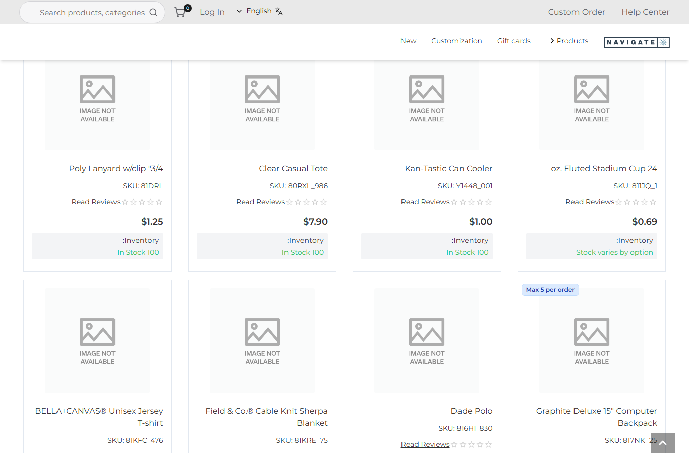
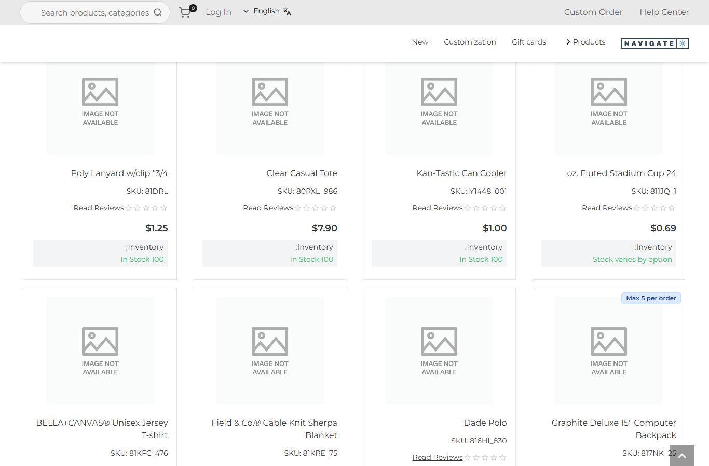
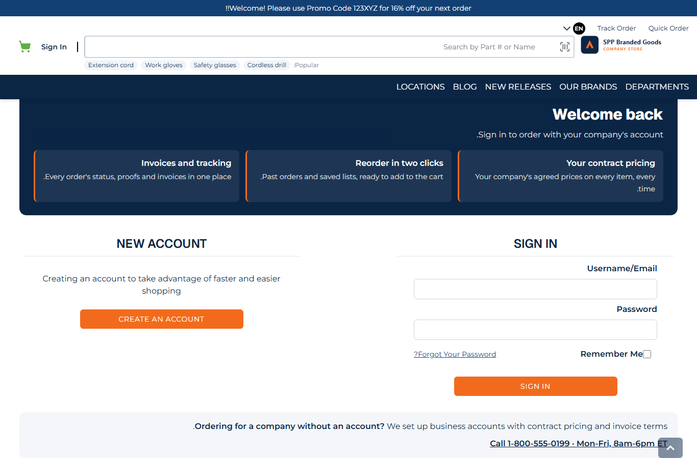
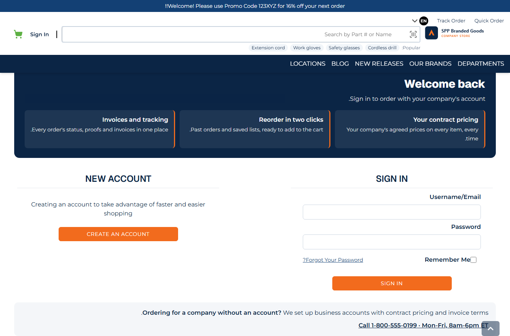
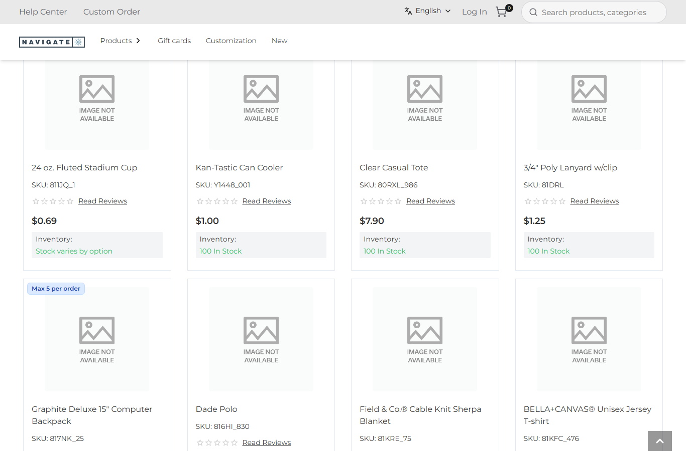

# 140: Do right-to-left languages work?

**Listed:** Not tested. **Result here:** Yes for this repository's parts, after a fix. The store ships no right-to-left
language (it has en-US and fr-FR), so the pages were switched to `dir="rtl"` as an Arabic or Hebrew store would render
them (`shot.mjs --dir rtl`). The store's own layout mirrors. This repository's parts used 23 physical `left`/`right`
declarations, so they stayed pinned to the left. All of them are now CSS **logical properties**, which follow the
page's direction. Left-to-right pages are unchanged.

| Before, `dir="rtl"`: the store mirrors, the plugin's "Max 5 per order" tag stays top-left | After: the tag follows to top-right |
| --- | --- |
|  |  |

| Login page before, RTL (benefits with a left border) | Login page after, RTL (border on the reading side) |
| --- | --- |
|  |  |

The same listing, normal left-to-right after the change (unchanged): 

Stores: POCSppDemo Best Sellers (its own theme, spp-commerce's card tags); MaxwellsHardware `/login` (spp-customization
previewed).

## The example: direction-proof CSS

| Physical (before) | Logical (after) | Used for |
| --- | --- | --- |
| `left: 8px` / `right: 16px` | `inset-inline-start` / `inset-inline-end` | card badges and rule tags, the skip link, the added-to-cart popup, the popular-searches row, the card-grid overlay |
| `margin-left` / `margin-right` | `margin-inline-start` / `-end` | the popup's close button, the account bar's rep, the showroom links, product facts |
| `padding-left` / `padding-right` | `padding-inline-start` / `-end` | trust strip, ordering-information lists, account bar |
| `border-left` | `border-inline-start` | login benefits, account bar's rep divider |
| `text-align: left` | `text-align: start` | testimonials, product-facts and showroom tables, ordering-information table |

That's 23 declarations in 8 files, across all three packages (theme, spp-commerce, spp-widgets). A check after the
change finds no physical side left in the repository's CSS:

```
grep -E "(margin|padding|border)-(left|right)|[^-](left|right):|text-align: (left|right)" src/**/*.css   -> none
```

**What the store has to provide for a real RTL language:** a locale with right-to-left text, and `dir="rtl"` on
`<html>`. The root layout writes `lang="en"` today, with no `dir`. The packages are ready for it; that part is the
store's.

## How it renders

**In the webstore (base):** the root layout renders `<html lang="en">`; the store's Tailwind layout (flex and grid)
mirrors when `dir="rtl"` is set.

**How this customization joins it:** the packages' CSS is linked on every page
([§3 B.1](../../RENDER-FLOW.md#3-the-page-shell-root-layout-head-styles-labels-server-layout)). Logical properties
resolve against the element's direction, so the same CSS serves both directions.

End-to-end flow, with file and line references in the webstore: [docs/RENDER-FLOW.md](../../RENDER-FLOW.md).

## Where

- `src/styles/card-grid.css`, `pdp.css`, `product-card.css`, `theme.css`, `trust-strip.css`, `widgets.css`
- `src/commerce/styles/commerce.css`, `src/shared-widgets/shared-widgets.css`
- `scripts/shot.mjs`: `--dir rtl`

## How a client does this

Write package CSS with logical properties (`inset-inline-*`, `margin-inline-*`, `padding-inline-*`,
`border-inline-*`, `text-align: start`), and check pages with `--dir rtl`.
