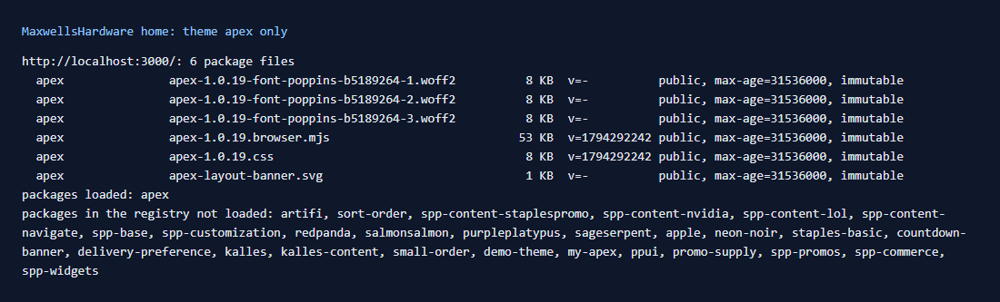
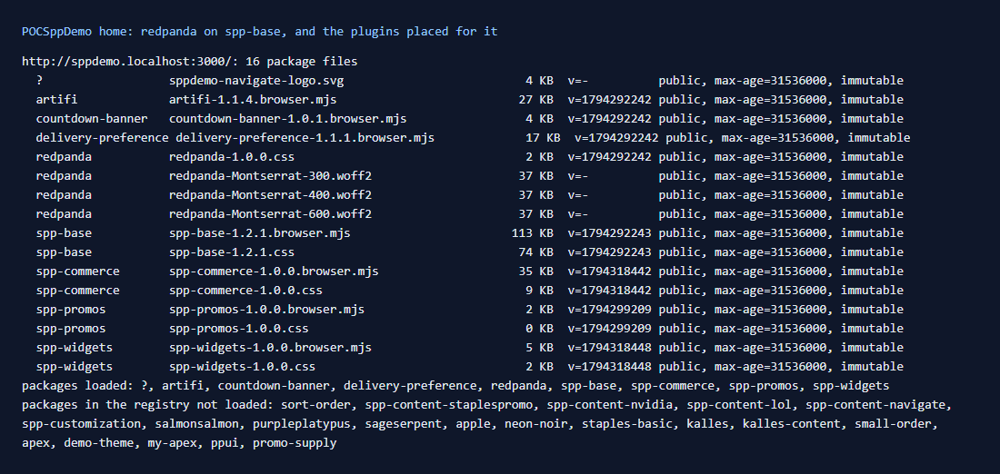

# 143: Does only the active theme load on a page?

**Listed:** Yes. **Result here:** Yes, confirmed. A page loads the files of its store's **theme chain** (the active
theme and its parents) and of the **plugins and widget packages placed for that store**. Nothing else in the registry
loads: the registry holds 28 packages, and other stores' themes (kalles, apple, demo-theme, apex on POCSppDemo, …)
never load.

| MaxwellsHardware home: 6 files, all from its theme **apex** | POCSppDemo home: its theme **redpanda** on **spp-base**, plus its plugins |
| --- | --- |
|  |  |

| Page | Theme chain loaded | Plugins / widgets loaded | Package files |
| --- | --- | --- | --- |
| MaxwellsHardware `/` | apex | none | 6 (53 KB script, 8 KB CSS, 3 fonts, an SVG) |
| POCSppDemo `/` | redpanda → spp-base | artifi, countdown-banner, delivery-preference, spp-commerce, spp-promos, spp-widgets | 16 |
| POCSppDemo `/`, spp-customization previewed | spp-customization → redpanda → spp-base | the same | 22 |

Full output: [output.txt](output.txt).

## The example: `npm run page-files`

`scripts/page-files.mjs` opens a page and records every request to the store's package-file route
(`/api/extensions/files/…`). For each file it shows the package it belongs to (read from the registry), its size, its
`?v=` version and its `Cache-Control`, then lists the registry's packages that did **not** load. It is how this
repository checks what a theme or plugin adds to a page's weight, and that nothing stray loads:

```
http://localhost:3000/: 6 package files
  apex   apex-1.0.19.browser.mjs   53 KB  v=1794292242 public, max-age=31536000, immutable
  apex   apex-1.0.19.css            8 KB  v=1794292242 public, max-age=31536000, immutable
  ...
packages loaded: apex
```

What it showed beyond the question:

- **A preview adds the previewed chain.** spp-customization, its CSS, script, font, favicon and analytics come in on
  top of redpanda's and spp-base's files, because they are its parents.
- **The heaviest file** on POCSppDemo is spp-base's script (113 KB), then its CSS (74 KB). This repository's packages
  are 35 KB (spp-commerce) + 50 KB (the theme, when active) of script.
- **One asset shows as `?`** (`sppdemo-navigate-logo.svg`): an asset whose name doesn't start with its package's name.
  It belongs to a content package, which the tool cannot name from the registry.

## How it renders

**In the webstore (base):** the store's own CSS and scripts are in its build.

**How this customization joins it:** `resolveStoreEntries` (`registry-index.ts`) gives each request its store's
entries: the store's placements, the every-store ones, and the theme chain root first. Only those entries' styles
(`RuntimeStyles`) and browser bundles (the manifest that `RuntimeRoot` loads) are linked, each from
`/api/extensions/files/<file>?v=<version>` ([§2 B](../../RENDER-FLOW.md#2-which-store-which-packages-every-request),
[§3 B.1](../../RENDER-FLOW.md#3-the-page-shell-root-layout-head-styles-labels-server-layout)).

End-to-end flow, with file and line references in the webstore: [docs/RENDER-FLOW.md](../../RENDER-FLOW.md).

## Where

- `scripts/page-files.mjs` (new), `package.json` script `page-files`, README.md commands table

## How a client does this

Run `npm run page-files -- --path <page> --store <store>` (and `--theme <name>` while previewing) before a release:
it shows each package's weight on the page and confirms nothing stray loads.
