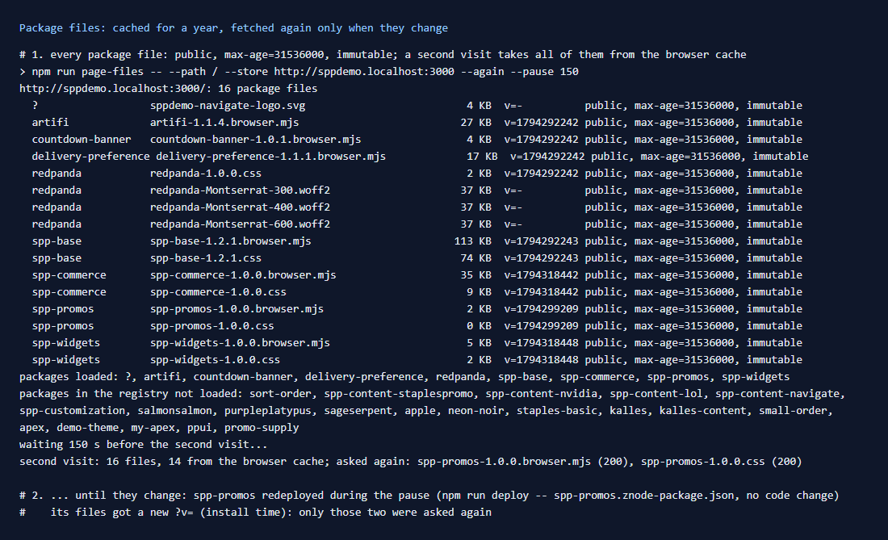
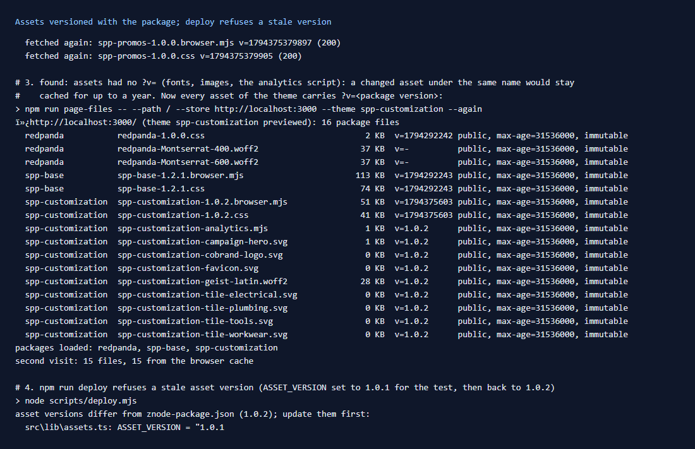
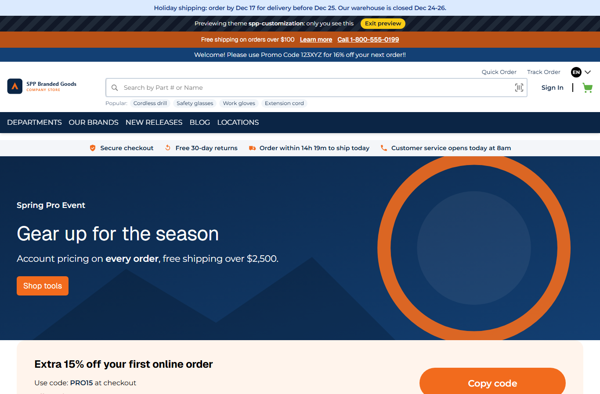

# 145: Are package files cached in the browser until they change?

**Listed:** Yes. **Result here:** Yes for bundles and stylesheets, confirmed. Assets needed a fix, now made for this
theme. Every package file is served `Cache-Control: public, max-age=31536000, immutable`, so the browser keeps it for a
year without asking. Bundles and stylesheets carry `?v=<install time>`, so a redeploy gives them a new URL and browsers
fetch them once. **Assets** (fonts, images, scripts referenced by name) are linked with no version, so a changed asset
would have stayed cached under its old URL for up to a year. Every asset of this theme now carries
`?v=<package version>`, and `npm run deploy` refuses a stale one.





The theme's home after the change, every asset loaded through its versioned URL: 

## What was checked

1. **Cached:** POCSppDemo's home loads 16 package files, all `immutable` for a year. A second visit in the same browser
   takes all 16 from the browser cache, with no request.
2. **Until they change:** between two visits in one browser, `spp-promos` was redeployed with no code change. Its two
   files got a new `?v=` (the install time), and only those two were asked again. The other 14 stayed cached.
3. **Assets:** on the theme's home, the font, favicon, analytics script, hero and tiles had `v=-` (none).

## The fix: versioned asset URLs

- **`src/lib/assets.ts`** (new): `ASSET_VERSION = "1.0.2"` and `asset(name)` →
  `/api/extensions/files/<name>?v=1.0.2`. The store ignores the query when it serves the file.
- It is used by the favicon and analytics script (`HeadTags.tsx`), the welcome page hero (`WelcomePage.tsx`) and the
  hero widget's default image (`Hero.tsx`). The CSS font is `url("spp-customization-geist-latin.woff2?v=1.0.2")`, and
  the theme's page content images (`src/pages/home.json`) are versioned too.
- **The guard:** the SDK's bundler cannot import `znode-package.json`, so the version is written in the sources.
  `scripts/deploy.mjs` checks every `?v=x.y.z` and `ASSET_VERSION` in `src/` against the manifest's version, and stops
  with the file names if one differs. Tested with a stale `1.0.1`:

  ```
  asset versions differ from znode-package.json (1.0.2); update them first:
    src\lib\assets.ts: ASSET_VERSION = "1.0.1
  ```
- **Settings that hold asset URLs** belong to the merchant. This store's `logoUrl` was set to
  `…/spp-customization-cobrand-logo.svg?v=1.0.2` in the registry, and the version is theirs to bump.

Result: every file of the theme's home now has a version, and a second visit takes all 15 from the cache. A release
(new version number) changes every asset URL at once.

Full output: [output.txt](output.txt).

## How it renders

**In the webstore (base):** the store's own build files are hashed by Next.js.

**How this customization joins it:** packages' files are served by `apps/webstore/src/app/api/extensions/files/[file]/route.ts`
with the year-long `immutable` cache. The store adds `?v=` to the bundles and stylesheets it links (`RuntimeStyles`,
the manifest's bundle URLs), but not to URLs inside a package's own CSS, code or content
([§3 B.1](../../RENDER-FLOW.md#3-the-page-shell-root-layout-head-styles-labels-server-layout)).

End-to-end flow, with file and line references in the webstore: [docs/RENDER-FLOW.md](../../RENDER-FLOW.md).

## Where

- `src/lib/assets.ts` (new); `src/slots/HeadTags.tsx`, `src/server/WelcomePage.tsx`, `src/widgets/Hero.tsx`,
  `src/styles/fonts.css`, `src/pages/home.json`
- `scripts/deploy.mjs`: the asset-version check
- `scripts/page-files.mjs`: `--again`, `--pause <seconds>` (a second visit, after a redeploy)

## How a client does this

Link every asset of a package through one helper that appends the package's version, version the URLs in CSS and
content the same way, and bump the version for each release. Check a release with
`npm run page-files -- --again`.
