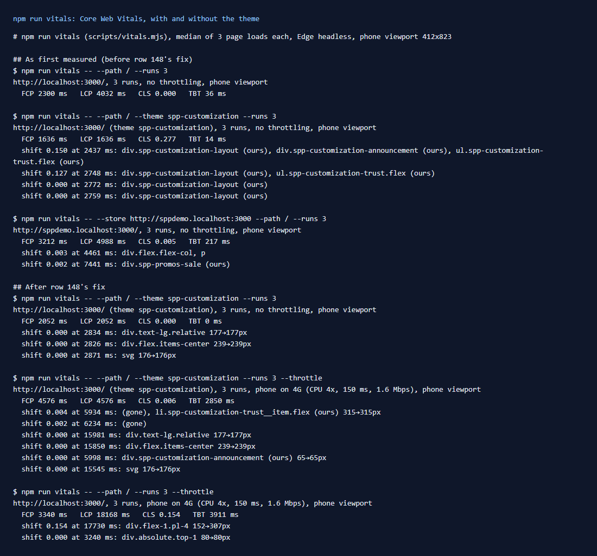

# 147: Has a Lighthouse or Core Web Vitals score been measured?

**Listed:** Not tested. **Result here:** Measured, with a repeatable command. `npm run vitals` loads a page in Edge
and reads the four lab metrics that Lighthouse's performance score is built from: **FCP, LCP, CLS and TBT**. It uses the
browser's own performance APIs, with Lighthouse's mobile settings (412 px phone screen; with `--throttle`, CPU 4x slower,
150 ms round trip, 1.6 Mbps). Each figure is the median of 3 loads, each in a fresh browser.

The first run found a real problem. The theme's home had a **layout shift of 0.277 on a phone**, which counts as poor
(good is under 0.1). The cause and the fix are row [148](../148-layout-shift/README.md). After the fix:

| Phone, home page | FCP | LCP | CLS | TBT |
|---|---|---|---|---|
| **This theme**, no throttling | 2.1 s | 2.1 s | **0.000** (was 0.277) | 0 ms |
| **This theme**, throttled phone on 4G | 4.6 s | 4.6 s | **0.006** | 2.9 s |
| The store's own theme (apex), throttled | 3.3 s | 18.2 s | 0.154 | 3.9 s |
| POCSppDemo (redpanda + 6 plugins), no throttling | 3.2 s | 5.0 s | 0.005 | 0.2 s |



## Reading the numbers

- **CLS is the one to compare with field targets.** It does not depend on server speed. After row 148, this theme
  is at 0.000 to 0.006, inside "good" (under 0.1). The store's own theme is at 0.154 throttled: its header switches to
  the phone layout late, which moves the page down. On this theme the switch no longer moves anything.
- **Times are from a store in development mode** (`next dev`, code compiled on request, no minification). They are far
  slower than a production build, so compare them only with each other. Throttled, the theme's LCP (the hero heading,
  server-rendered) comes at first paint. The store's own theme waits 18 s for its largest element.
- **TBT** (main thread blocked after first paint) is mostly the store's development bundle being parsed. The theme adds
  little: on the unthrottled run, apex is at 36 ms and this theme at 0 to 14 ms.
- **Lighthouse itself** is not installed here (it is not a dependency of the store or this repo). The script measures the
  same metrics through the same browser APIs Lighthouse uses (`largest-contentful-paint`, `layout-shift` without recent
  input, `longtask` after FCP). It does not compute Lighthouse's weighted 0-100 score.

Full output: [output.txt](output.txt).

## The tool

`scripts/vitals.mjs` (new), `npm run vitals`:

```
npm run vitals -- --path / --theme spp-customization --runs 3 [--throttle] [--film out.png]
```

- A `PerformanceObserver` is installed before any page script runs (`evaluateOnNewDocument`), so nothing is missed.
- For each layout shift, it prints **what moved and by how much**. That is the nearest element of a package (a
  `spp-customization-`, `spp-commerce-`, `spp-widgets-` or `spp-promos` class) or the store's own element, with its
  position before and after. That is how row 148's cause was found: `ul.spp-customization-trust 353→205px` (the
  theme's trust strip) and `div.flex-1 386→238px` (the page under it).
- `--film out.png` adds one load screenshotted every 250 ms and laid out as a strip, to show a shift as it happens.
- `--store` measures another store (POCSppDemo: `--store http://sppdemo.localhost:3000`).

## How it renders

**In the webstore (base):** the store's root layout renders the page on the server. React then hydrates it in the
browser, and client components (the header among them) can change what was painted first.

**How this customization joins it:** the theme's CSS and bundles load with the page shell
([§3 B.1](../../RENDER-FLOW.md#3-the-page-shell-root-layout-head-styles-labels-server-layout)). Its server slot
(`layout.root`) is in the first HTML. Its browser slots render again after hydration. Whatever they add or resize then
is what CLS counts.

End-to-end flow, with file and line references in the webstore: [docs/RENDER-FLOW.md](../../RENDER-FLOW.md).

## Where

- `scripts/vitals.mjs` (new), `package.json` (`npm run vitals`), README commands table

## How a client does this

Run `npm run vitals -- --path <page> --theme <theme> --throttle` before and after a release, and on the pages that
matter (home, a category, a product). Keep CLS under 0.1. Check the "shift" lines for any element of your own package.
For scores in the field, use the store's production build and real-user data (Chrome UX Report or a RUM tool).
