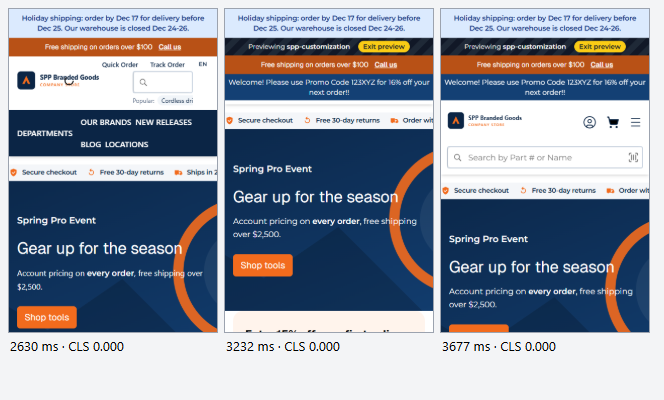
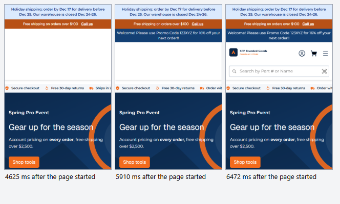
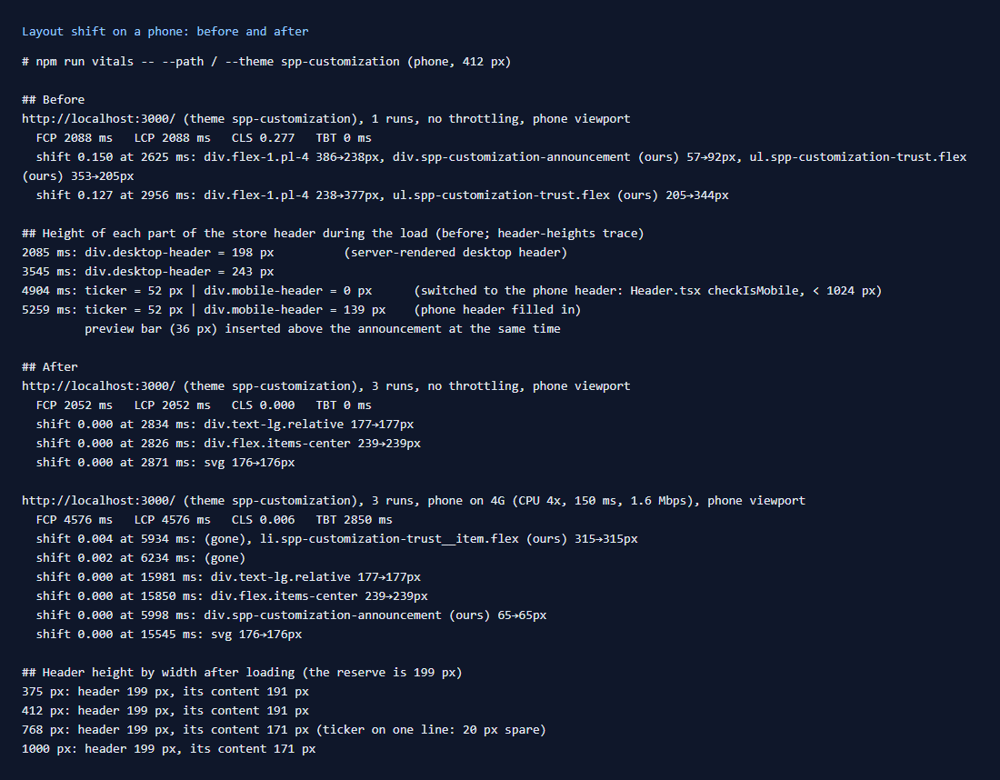
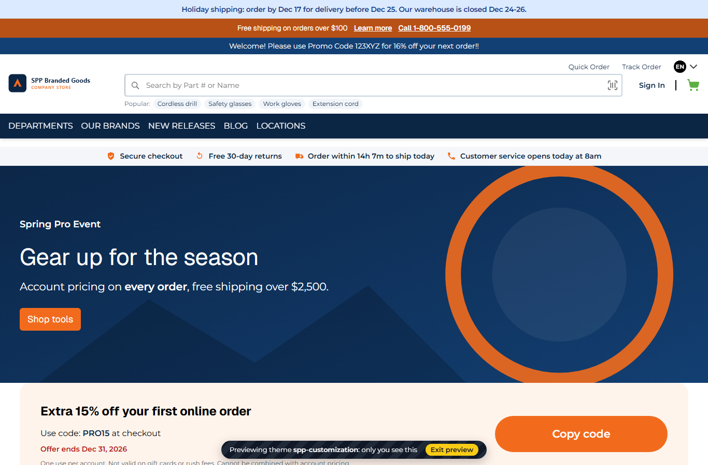

# 148: Is layout shift from late-loading package UI measured?

**Listed:** Not tested. **Result here:** Measured, and fixed. `npm run vitals` (row [147](../147-web-vitals/README.md))
reports CLS and what each shift moved. On a phone, the theme's home scored **CLS 0.277** (poor; good is under 0.1).
After the fix it scores **0.000**, or **0.006** on a throttled phone.

**Before:** the page jumps twice while loading. First the desktop header is replaced, then the phone header fills in
and the preview bar appears above the announcement:

**After:** the header's space is held from the first paint. The phone header fills it in place, and nothing below
moves:

The page after loading, on a phone and on a desktop. The preview bar now floats at the bottom:
 

## What moved, and why

1. **The store's header switches layout after loading.** The server sends the desktop header. Once the page has
   loaded in the browser, `Header.tsx` measures the width and, under 1024 px, renders the phone header in its place
   (`checkIsMobile`). The phone header and the promo ticker fill in a moment later. The header went 243 → 60 → 199 px.
   This theme renders its announcement, trust strip and page content on the server, so they are painted early, and each
   change of header height moved them (`ul.spp-customization-trust 353→205px`, then `205→344px`). The store's own theme
   has the same switch. There it comes later in the load and costs CLS 0.154 on a throttled phone.
2. **The theme's preview bar** (only for someone previewing the theme) is added once the page has loaded, because it
   reads the preview cookie in the browser. It went above the announcement and pushed the page down 36 px.

## The fix

- **Hold the header's space (`src/styles/header.css`).** Under 1024 px, the store's desktop header is hidden from the
  first paint (`#webstore-header > .desktop-header`). The header keeps `min-height: var(--spp-header-reserve)`, the phone
  header's final height. The page starts where it will end up. Only the header area fills in.
- **The height is a setting:** `mobileHeaderHeight` (attribute `ThemeMobileHeaderHeight`, default 199 px, 0 turns it
  off). The server layout (`ThemeLayout.tsx`) puts it on the theme's wrapper as `--spp-header-reserve`, as it already
  does for the accent color and logo. A store with no promo ticker, or a two-line one, sets its own height.
- **The preview bar floats** (`src/styles/theme.css`). It is a pill fixed above the bottom edge of the window
  (`position: fixed`, logical insets for right-to-left), so it covers nothing at the top and moves nothing.
- **Desktop is unchanged.** The rules apply only under 1024 px, where the store shows its phone header.

**Limit:** the reserve is one height. At tablet widths (768 to 1023 px), the promo ticker fits on one line, so the
header has 20 px of spare space at the bottom. A short gap that never moves costs nothing in CLS. A reserve set too
small would leave a small shift.

Full output: [output.txt](output.txt).

## How it renders

**In the webstore (base):** `packages/base-components/src/components/layout-components/header/Header.tsx` renders the
desktop header while `isMobile` is false (the server render and first browser render). Its `useEffect` calls
`checkIsMobile`, and under 1024 px React swaps in `MobileHeader`.

**How this customization joins it:** the header is inside the theme's `layout.header` slot (`AnnouncementBar`, around
`children`) and its server slot `layout.root` (`ThemeLayout`, the wrapper with the CSS variables)
([§3 B.1](../../RENDER-FLOW.md#3-the-page-shell-root-layout-head-styles-labels-server-layout)). The theme's CSS loads
with the page shell, before the first paint, so the reserve is in effect before the switch. The header component itself
is not changed.

End-to-end flow, with file and line references in the webstore: [docs/RENDER-FLOW.md](../../RENDER-FLOW.md).

## Where

- `src/styles/header.css`: the header reserve under 1024 px
- `src/server/ThemeLayout.tsx`: `--spp-header-reserve` from the `mobileHeaderHeight` setting
- `znode-package.json`: setting `mobileHeaderHeight`
- `src/styles/theme.css`, `src/slots/PreviewBanner.tsx`: the floating preview bar

## How a client does this

Measure with `npm run vitals -- --path <page> --theme <theme>` (add `--throttle` and `--film`). For each shift, read
which elements moved. Keep anything that appears after loading out of the flow (fixed, absolute or overlaid), or hold
its space from the first paint.
