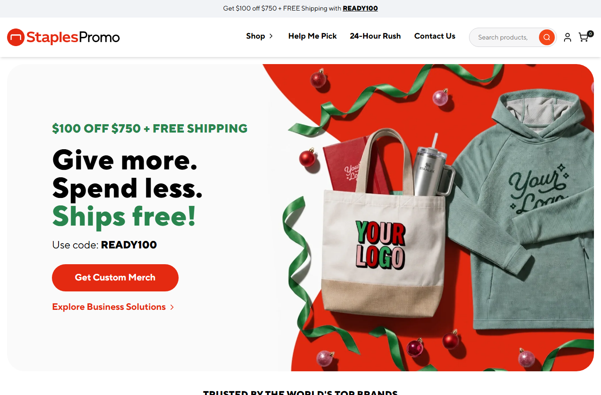
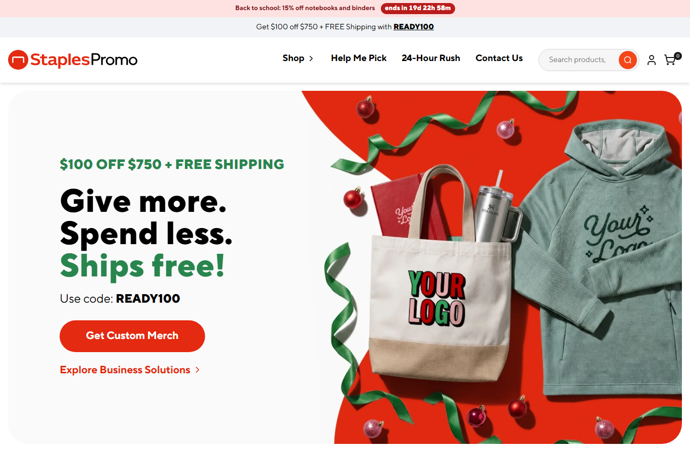
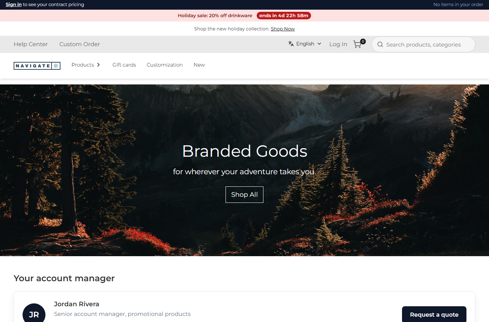
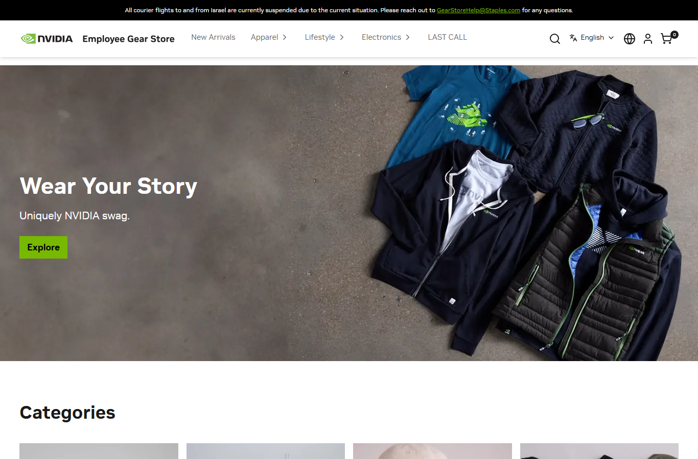
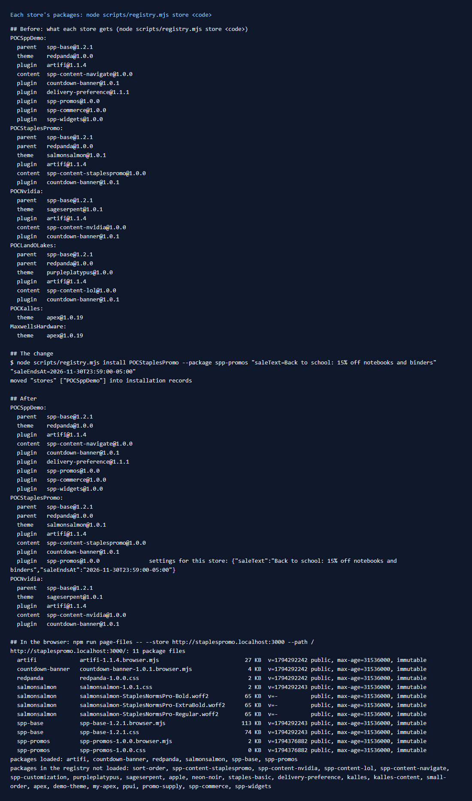

# 154: Can each store have different plugins?

**Listed:** Yes. **Result here:** Yes, confirmed on six stores served by one webstore from one plugin folder. Each
store's plugin list is its own. The example change rolls out one more plugin to one more store. A new command shows
what any store gets, worked out the way the store works it out.

| Store | Theme (chain) | Plugins |
|---|---|---|
| POCSppDemo | spp-base → redpanda | artifi, countdown-banner, delivery-preference, spp-promos, spp-commerce, spp-widgets |
| POCStaplesPromo | spp-base → redpanda → salmonsalmon | artifi, countdown-banner, **spp-promos (new)** |
| POCNvidia | spp-base → sageserpent | artifi, countdown-banner |
| POCLandOLakes | spp-base → redpanda → purpleplatypus | artifi, countdown-banner |
| POCKalles, MaxwellsHardware | apex | none |

(Content packages, one per POC store, are left out of the table; they are in [output.txt](output.txt).)

**Before:** StaplesPromo has no sale bar. **After:** spp-promos is on StaplesPromo too, with its own sale. POCSppDemo
keeps its own sale, and NVIDIA is unchanged:

| Before: StaplesPromo | After: StaplesPromo |
|---|---|
|  |  |

| After: POCSppDemo (unchanged) | After: NVIDIA (no spp-promos) |
|---|---|
|  |  |



## The example: roll a promo plugin out to a second store

spp-promos (the sale bar with a countdown) ran on POCSppDemo only. StaplesPromo runs a back-to-school sale with a
different message and end date, and gets the same plugin:

```
node scripts/registry.mjs install POCStaplesPromo --package spp-promos \
  "saleText=Back to school: 15% off notebooks and binders" "saleEndsAt=2026-11-30T23:59:00-05:00"
```

- The store now loads `spp-promos-1.0.0.browser.mjs` and its CSS (`npm run page-files`). NVIDIA and Land O'Lakes don't
  load them, and nothing changed on their pages.
- The plugin is installed once. Placing it on a store is a registry record, with no new build and no restart. The dev
  server picks up the changed `plugins.json` on the next request.
- The settings per store are row [156](../156-settings-per-store/README.md).

## Tooling: `scripts/registry.mjs`

- **`store <code>`** (new): everything one store gets, in the order the store applies it (theme chain from the root,
  then plugins in registry order), with that store's setting overrides. It follows the store's rules
  (`registry-index.ts`, `resolveStoreEntries`):
  - a package with installation records is placed by them, and its own `stores` is ignored
  - `"*"` or no `stores` means every store
  - a store's own placement wins over an every-store one
  - `"enabled": false` switches a package off everywhere
- **`install <stores> [key=value ...]`** and **`remove <stores>`** (new): add or remove a package's installation
  record. The first record also moves the entry's existing `"stores"` into records. Without that, adding StaplesPromo
  would have silently taken spp-promos off POCSppDemo, because the store stops reading `"stores"` once a package has
  records. The output shows `moved "stores" ["POCSppDemo"] into installation records`.
- **`themes <code>`** now reads installation records too.

The `store` command is checked against what the browser actually loaded (`npm run page-files`) on all five hosts, and
they match.

## How it renders

**In the webstore (base):** for each request, the store code from the host decides which packages run
([§2 A](../../RENDER-FLOW.md#2-which-store-which-packages-every-request)).

**How this customization joins it:** `resolveStoreEntries` returns the store's theme chain and plugins
([§2 B.2](../../RENDER-FLOW.md#2-which-store-which-packages-every-request)). Only those packages' bundles, CSS, slots,
hooks and routes are used for that store.

End-to-end flow, with file and line references in the webstore: [docs/RENDER-FLOW.md](../../RENDER-FLOW.md).

## Where

- `scripts/registry.mjs`: `store`, `install`, `remove`; `themes` reads installation records
- Store configuration (`plugins.json`, outside this repo): `installations` records for spp-promos (POCSppDemo,
  POCStaplesPromo)

## How a client does this

Install a plugin once, then place it per store with `node scripts/registry.mjs install <StoreA,StoreB> --package
<plugin>` (or `"stores"` on the entry for the simple case). Check a store with `node scripts/registry.mjs store <code>`,
and the browser with `npm run page-files -- --store <url>`.
