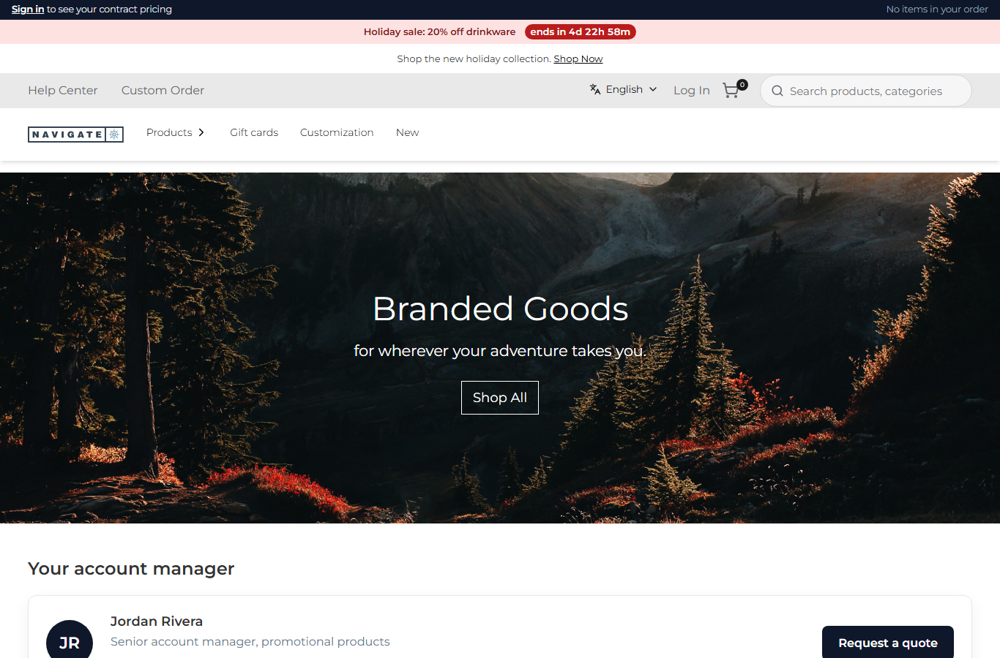
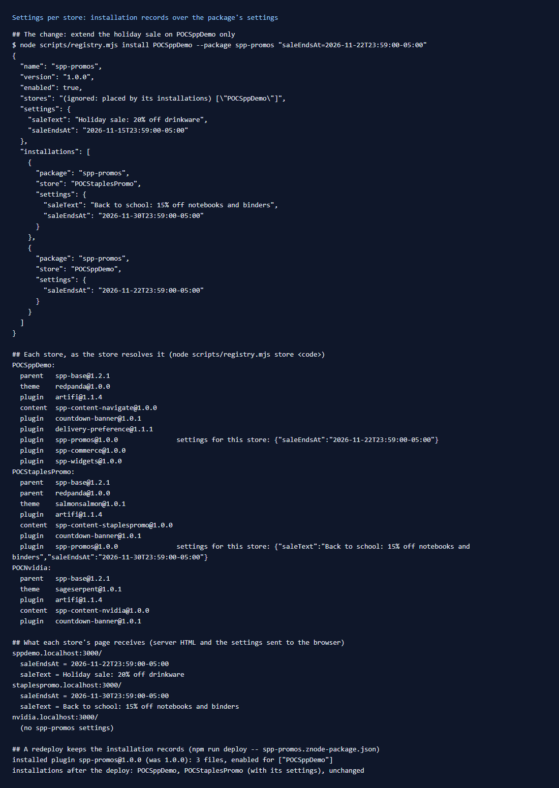

# 156: Can settings differ per store?

**Listed:** Partial. **Result here:** Yes, confirmed: the same plugin runs with different settings on two stores. Each
store gets the package's settings, with its own installation record's settings merged on top, key by key. Only
the keys a store changes need to be in its record. The limits are listed below. The main one: a previewed theme shows
its package settings, not a store's.

| Store | `saleText` | `saleEndsAt` |
|---|---|---|
| (package settings, the defaults) | Holiday sale: 20% off drinkware | Nov 15 |
| POCSppDemo | (default) | **Nov 22** (its record) |
| POCStaplesPromo | **Back to school: 15% off notebooks and binders** (its record) | **Nov 30** (its record) |
| POCNvidia | (spp-promos not placed) | |

**Before:** POCSppDemo's holiday sale ended Nov 15 ("ends in 4d"), the package's own date. **After:** extended to Nov 22
on POCSppDemo only ("ends in 11d"). StaplesPromo keeps its own sale:

| Before: POCSppDemo | After: POCSppDemo | After: StaplesPromo |
|---|---|---|
|  |  |  |



## The example: extend a sale on one store

The holiday sale did well on POCSppDemo, so it runs a week longer there. Elsewhere it ends on the planned date.

```
node scripts/registry.mjs install POCSppDemo --package spp-promos "saleEndsAt=2026-11-22T23:59:00-05:00"
```

The record has only `saleEndsAt`, and the store merges it over the package's settings (`mergeSettings` in
`registry-index.ts`: objects key by key, other values replaced).

## What was checked

1. **The page gets that store's values.** In each store's home HTML (`saleText`/`saleEndsAt`, server render and the
   settings sent to the browser), POCSppDemo has the default text with Nov 22, StaplesPromo has its own text and Nov
   30, and NVIDIA has neither.
2. **Server and browser agree.** The sale bar's text is rendered on the server, and its countdown in the browser. Both
   used the store's values, as the screenshots show.
3. **A redeploy keeps them.** `npm run deploy -- spp-promos.znode-package.json` reinstalled the plugin, and the
   installation records and their settings were unchanged. (The installer's message still says
   `enabled for ["POCSppDemo"]`. It reads the entry's old `"stores"`, which the store ignores once records exist.)

## Limits

- **A previewed theme uses its package settings, not the store's record** (`resolveStoreEntries`: only the active
  theme placed for the store carries its record's overrides). Shown on this theme in row
  [157](../157-two-stores-one-theme/README.md).
- **Parents of a theme** use their own package settings. A store's record applies to the theme placed for it, not to
  its parent.
- **Who edits it:** records live in `plugins.json`, which is changed by an operator or a script (`npm run registry`),
  not in the Znode admin. For values a merchant changes, bind the setting to a Znode store attribute (`"attribute"` in
  the settings schema, as this theme does for `accentColor` → `ThemeAccentColor`). The store's attribute value wins
  over the registry.
- **First request after a change, development server only:** the store reads `plugins.json` while rendering. React's
  development build then copies the file's text into the page (row [159](../159-secrets-on-the-server/README.md)).
  This includes every store's records.

## How it renders

**In the webstore (base):** `registry.server.ts` reads `plugins.json` when it changes and builds the index
(`buildRegistryIndex`). Installation records are placed per store, with their `settings` as overrides.

**How this customization joins it:** `resolveStoreEntries` returns each package with
`mergeSettings(package settings, record settings)`
([§2 B.2](../../RENDER-FLOW.md#2-which-store-which-packages-every-request)). Server code gets them as
`context.settings`. Browser code gets the `browser: true` ones through the host (`settings` in `lib/host.ts`). Both are
per store.

End-to-end flow, with file and line references in the webstore: [docs/RENDER-FLOW.md](../../RENDER-FLOW.md).

## Where

- Store configuration (`plugins.json`, outside the repo): spp-promos record for POCSppDemo with `saleEndsAt`
- Tooling from row 154: `npm run registry -- install|remove|store`

## How a client does this

Keep the package's settings as the defaults. For each store that differs, add an installation record with only the
keys that differ: `npm run registry -- install <Store> --package <name> key=value`. Check the result with `npm run
registry -- store <Store>`. Bind settings that merchants change themselves to Znode attributes instead.
