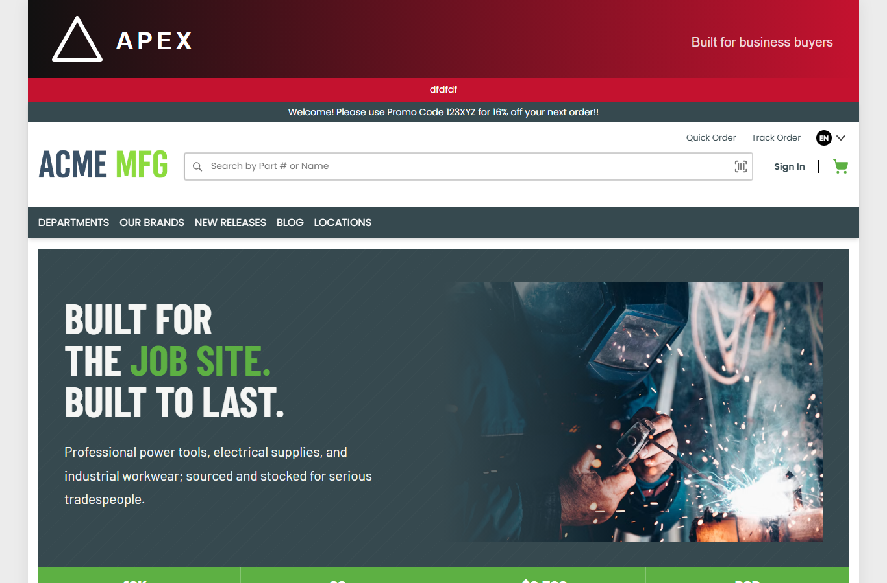
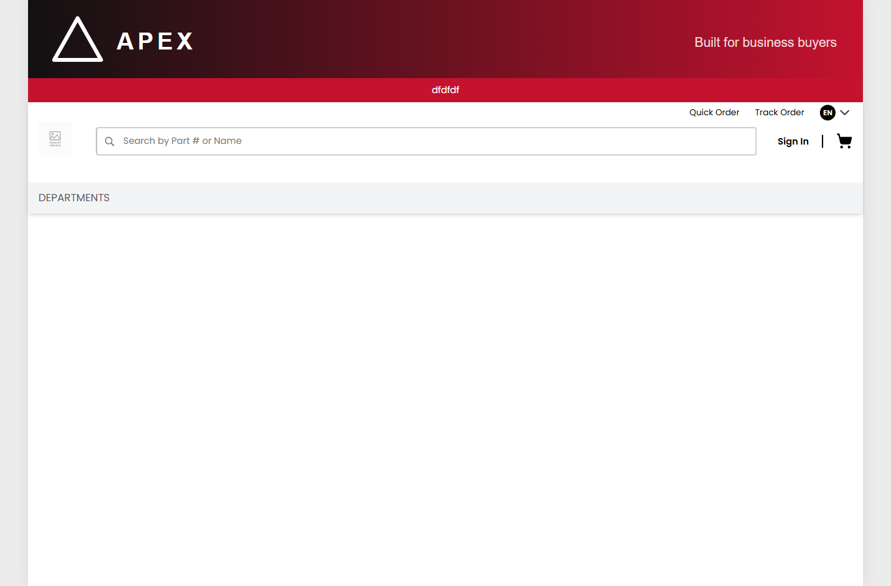
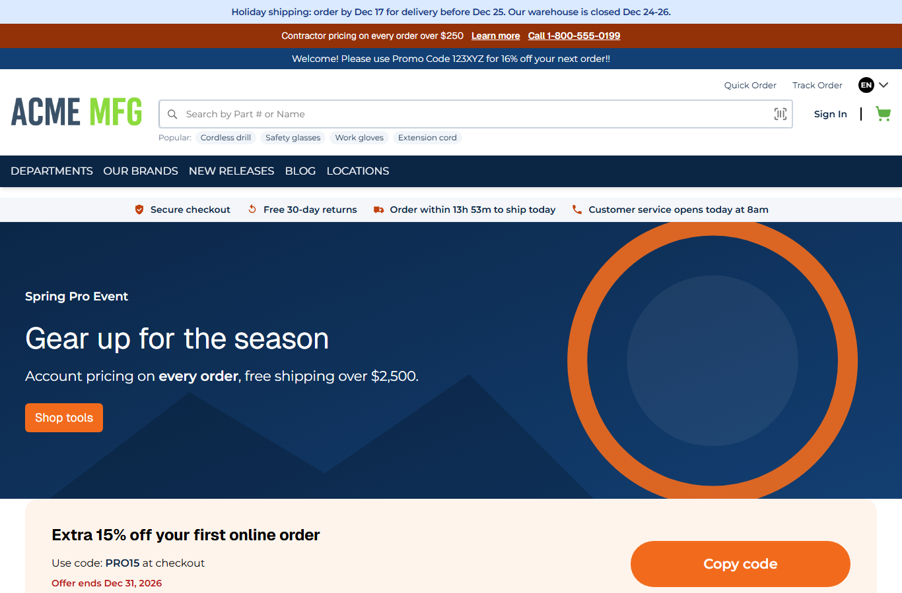
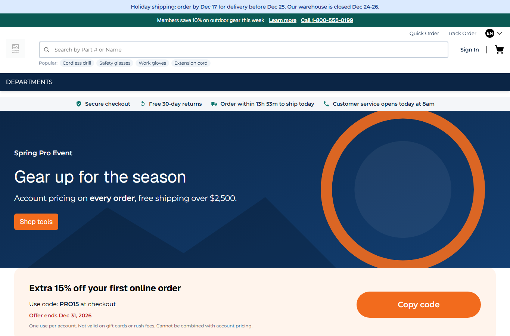
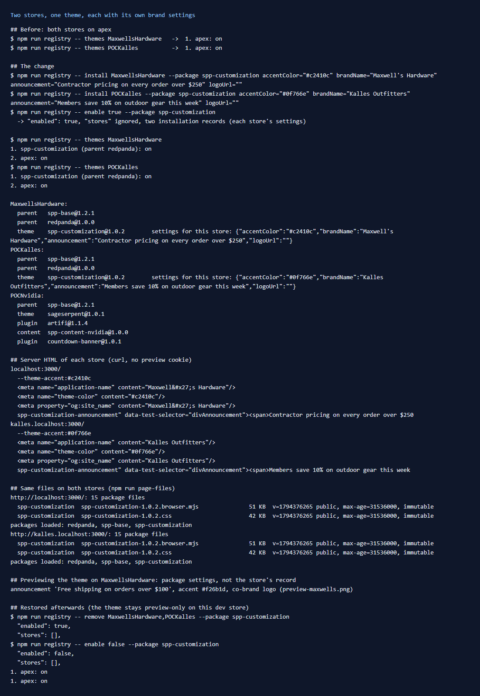
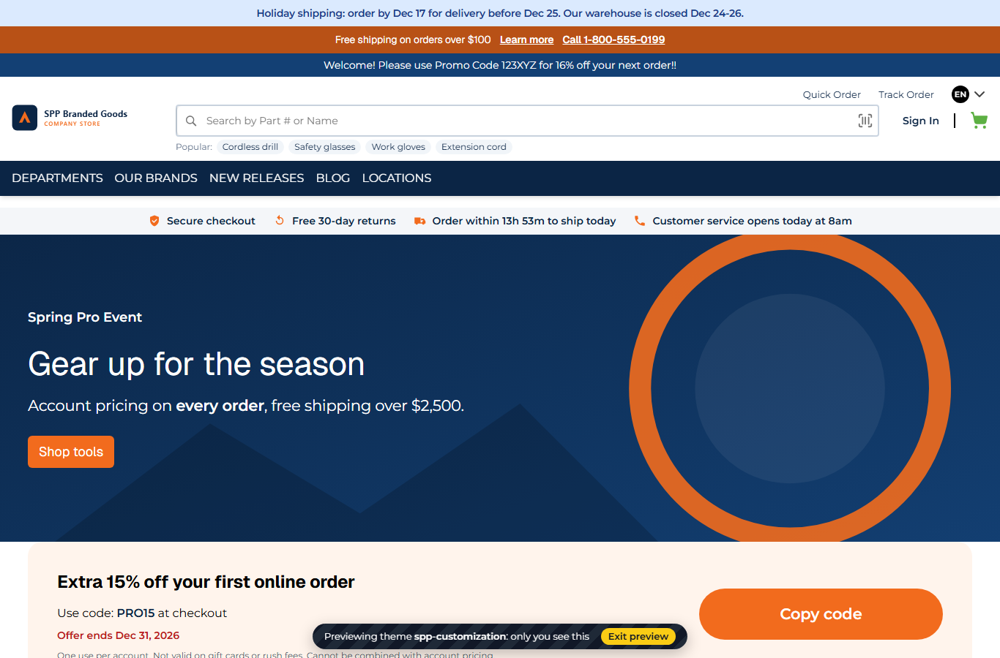

# 157: Can several stores share one theme?

**Listed:** Yes. **Result here:** Yes, confirmed. This theme went live on two stores at once, MaxwellsHardware and
POCKalles, from one install. Each store had its own accent color, announcement, brand name and logo. Both loaded the
same files (`spp-customization-1.0.2.browser.mjs`, `.css`, the same assets and versions). Each store's server HTML
carried its own brand.

| | MaxwellsHardware (`localhost:3000`) | POCKalles (`kalles.localhost:3000`) |
|---|---|---|
| Before |  |  |
| After |  |  |

Before, both run apex. After, both run spp-customization. MaxwellsHardware has a rust accent, "Contractor pricing on
every order over $250", and its own ACME logo. POCKalles has a teal accent and "Members save 10% on outdoor gear this
week". Kalles has no logo in Znode, so its header shows the image placeholder, before and after.



## The example: one brand theme for two stores

```
npm run registry -- install MaxwellsHardware --package spp-customization accentColor="#c2410c" \
  brandName="Maxwell's Hardware" announcement="Contractor pricing on every order over $250" logoUrl=""
npm run registry -- install POCKalles --package spp-customization accentColor="#0f766e" \
  brandName="Kalles Outfitters" announcement="Members save 10% on outdoor gear this week" logoUrl=""
npm run registry -- enable true --package spp-customization
```

- **Which theme a store gets:** the first enabled theme placed for it, in registry order. spp-customization comes
  before apex in `plugins.json`, so `npm run registry -- themes MaxwellsHardware` lists it first and the store picks
  it. Its parents (redpanda, spp-base) come with it.
- **Each store's brand:** the records hold only what differs (row [156](../156-settings-per-store/README.md)).
  Everything else (trust strip, shipping cutoff, support hours, holiday notice, the home page) is the package's. With
  `logoUrl=""`, each store shows its own Znode logo instead of the SPP co-brand mark.
- **Server and browser both:** the server HTML has each store's `og:site_name`, `application-name`, `theme-color`,
  `--theme-accent` (from `ThemeLayout.tsx`) and announcement text ([output.txt](output.txt)).
- **One install, one set of files:** `npm run page-files` shows the same bundle, CSS and asset URLs on both hosts. A
  release of the theme updates both stores at once.

## The limit: a preview shows the package's settings

Previewing the theme on MaxwellsHardware (cookie `runtimeThemePreview`) showed the package's own settings: the orange
accent, "Free shipping on orders over $100" and the co-brand logo. It did not show the store's record:



`resolveStoreEntries` applies a record's overrides only to the theme placed for the store. A previewed theme is looked
up by name. So before a go-live, a preview shows the theme's defaults, not each store's brand. To check a store's
brand before going live, bind the brand settings to Znode store attributes (`ThemeAccentColor` and the others).
Attribute values apply in a preview too, because they are read per request from the store.

## Restored afterwards

This dev store is the baseline for the other scenarios: their "before" pictures are apex, and the theme is previewed.
So after the check, the go-live was undone:

```
npm run registry -- remove MaxwellsHardware,POCKalles --package spp-customization
npm run registry -- enable false --package spp-customization
```

Both stores are back on apex (`themes` lists only apex). Running the three commands above makes it live again.

## How it renders

**In the webstore (base):** the store code from the host picks the store
([§2 A](../../RENDER-FLOW.md#2-which-store-which-packages-every-request)), and the store's built-in theme renders
around the page.

**How this customization joins it:** `resolveStoreEntries` returns the same theme chain (spp-base → redpanda →
spp-customization) for both stores. Only the active theme's settings differ, through each store's record
([§2 B.2](../../RENDER-FLOW.md#2-which-store-which-packages-every-request)). The theme's server slot `layout.root`
writes them as CSS variables, and its browser slots read them from `settings`
([§3 B.1](../../RENDER-FLOW.md#3-the-page-shell-root-layout-head-styles-labels-server-layout)).

End-to-end flow, with file and line references in the webstore: [docs/RENDER-FLOW.md](../../RENDER-FLOW.md).

## Where

- Store configuration (`plugins.json`, outside the repo): two installation records for spp-customization, then
  removed (see above)
- Tooling from row 154: `npm run registry -- install|remove|themes|store`

## How a client does this

Install the theme once. Add an installation record per store with that store's brand values, and enable the theme.
Check each store with `npm run registry -- store <code>`, then the live page. Keep brand values that merchants change
in Znode store attributes.
