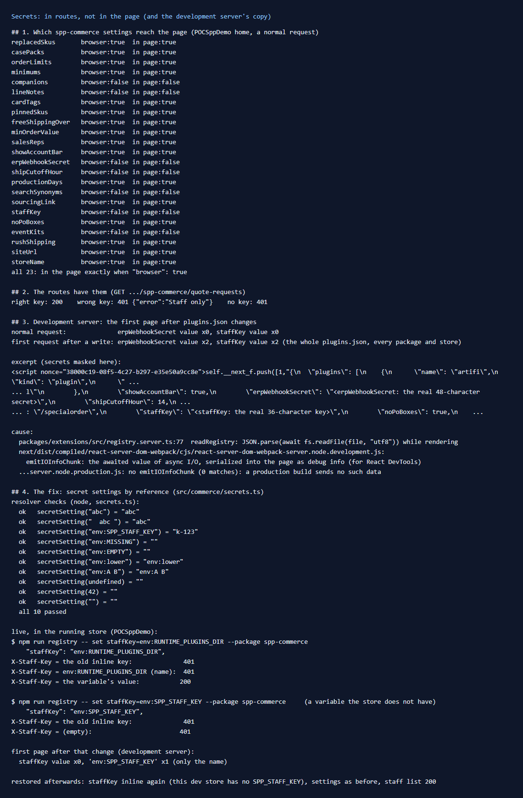

# 159: Do secrets stay on the server?

**Listed:** Yes. **Result here:** Yes for what the store sends on purpose. A setting reaches the page only with
`"browser": true`. All 23 spp-commerce settings were checked against a page, and the two secrets (the ERP webhook
secret and the staff key) are used only in routes.

**One exception, found here: the development server.** On the first page it renders after `plugins.json` changes, a
store running `next dev` copies the **whole registry file** into that page, with every package's settings, every
store's records and both secrets. A production build does not.

**The change:** secret settings can now hold a reference, `env:NAME`, resolved from the store server's environment at
each request. `plugins.json`, and any copy of it, then holds only a variable's name.



## What was checked

1. **Only `browser: true` settings reach the page.** On POCSppDemo's home (a normal request), each of spp-commerce's 23
   setting names was looked up in the HTML. Every one is there exactly when its schema says `"browser": true`.
   `erpWebhookSecret`, `staffKey`, `searchSynonyms`, `eventKits` and the other server-only settings are not, and
   neither are the secret values.
2. **The routes have them.** `GET .../spp-commerce/quote-requests` answers 200 with the staff key, and 401 with a wrong
   key or none. The ERP webhook checks its signature with `erpWebhookSecret` (row [091](../091-plugin-webhooks/README.md)).
3. **The development server's copy.** Fetching the same page right after any change to `plugins.json` gave a 517 KB
   page instead of 342 KB. The extra is the registry file's text in a React data chunk
   (`self.__next_f.push([1,"{\n  \"plugins\": [ ...`), with both secret values. The next request is clean again.

## Why the development server does this

- The store reads `plugins.json` with `await fs.readFile` while it renders the page (`readRegistry`,
  `packages/extensions/src/registry.server.ts:77`). The read happens again only when the file changes.
- React 19.2's **development** build records the result of async I/O awaited during a server render and sends it
  to the browser for React DevTools (`emitIOInfoChunk` in `react-server-dom-webpack-server.node.development.js`). The
  production build has no `emitIOInfoChunk`, so a production store sends nothing of the kind.
- So any dev server that others can reach (a shared test machine, a tunnel, a demo) gives every registry secret, of
  every package and store, to whoever loads a page after a change.

**For the store team (not changed here; this repo does not change the store):** read the registry outside React's
render tracking. For example, `readFileSync`, as the store already does for plugin bundles, or a read started at
module level. Also keep `next dev` private.

## The change: secrets by reference

- **`src/commerce/secrets.ts`** (new): `secretSetting(value)` returns an inline value as before. For `env:NAME`, it
  returns the store server's environment variable `NAME`, read at each request. A variable that is not set gives `""`,
  so the route refuses everything (fail closed). Names are upper-case letters, digits and `_`. The value is used only
  for comparison, never sent or logged.
- **`src/commerce/server.ts`**: the ERP webhook (`erpWebhookSecret`, HMAC check) and the staff list (`staffKey`) use
  it.
- **`spp-commerce.znode-package.json`**: both settings' labels mention `env:NAME`.
- **`npm run secrets-check`** (`scripts/secrets-check.mts`): 10 cases, all passing.

**Checked live in the running store,** without restarting it. `staffKey` was pointed at a variable the store already
has (`env:RUNTIME_PLUGINS_DIR`, not a secret). The variable's value opened the staff list (200). The old inline key and
the variable's name were refused (401). Pointed at `env:SPP_STAFF_KEY`, which this store does not have, every key was
refused. The development server's copy then showed only `env:SPP_STAFF_KEY`, and the staff key value did not appear.

**Restored afterwards:** this dev store's environment has no `SPP_STAFF_KEY` or `SPP_ERP_WEBHOOK_SECRET`, and adding
them needs a restart of the store, so `staffKey` is inline again (settings as before, staff list 200). To finish on a
store:

```
# in the store's environment (e.g. apps/webstore/.env.local), then restart the store
SPP_STAFF_KEY=<a new random key>
SPP_ERP_WEBHOOK_SECRET=<a new random secret, also given to the ERP>

npm run registry -- set staffKey=env:SPP_STAFF_KEY --package spp-commerce
npm run registry -- set erpWebhookSecret=env:SPP_ERP_WEBHOOK_SECRET --package spp-commerce
```

Use new values: the current ones have been in `plugins.json` and its `.history/` copies.

Full output (secrets masked): [output.txt](output.txt).

## How it renders

**In the webstore (base):** the store resolves each package's settings for the store
([§2 B.2](../../RENDER-FLOW.md#2-which-store-which-packages-every-request)). It sends the browser only the
`browser: true` ones, through the runtime data the page carries
([§3 B.1](../../RENDER-FLOW.md#3-the-page-shell-root-layout-head-styles-labels-server-layout)).

**How this customization joins it:** server code (routes, hooks, server slots) gets every setting as
`context.settings`. The browser bundle sees only the `browser: true` ones (`settings` in `src/commerce/host.ts`). Secrets
are read only in routes, through `secretSetting`.

End-to-end flow, with file and line references in the webstore: [docs/RENDER-FLOW.md](../../RENDER-FLOW.md).

## Where

- `src/commerce/secrets.ts` (new), `src/commerce/server.ts`: the two routes
- `spp-commerce.znode-package.json`: setting labels
- `scripts/secrets-check.mts` (new), `package.json` (`npm run secrets-check`), README commands table

## How a client does this

Mark only what the page needs `"browser": true`. `znode check` refuses a setting named like a secret that is.
Keep secrets out of `plugins.json`: reference an environment variable (`env:NAME`) and resolve it in the route. Never
expose a `next dev` store to others.
