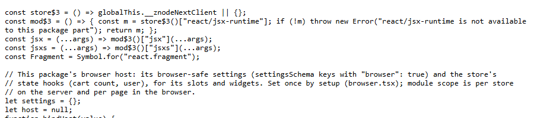
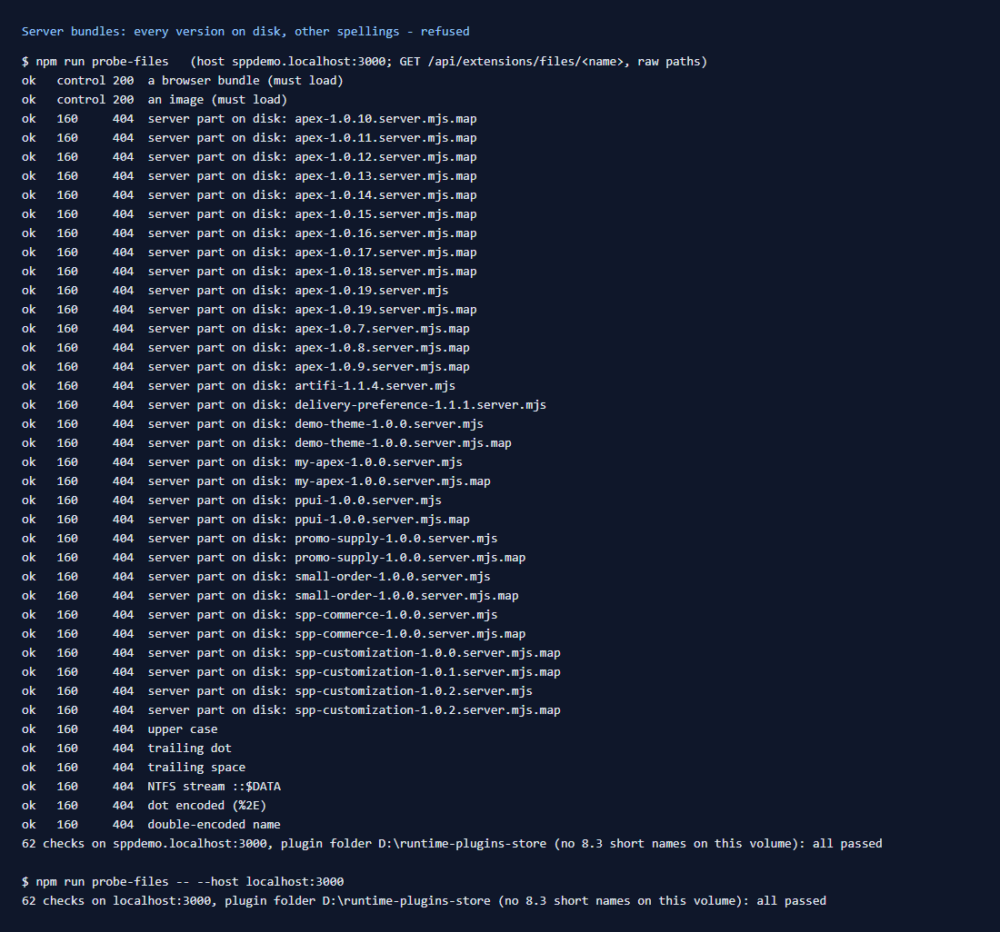

# 160: Are server bundles blocked from download?

**Listed:** Yes. **Result here:** Yes, confirmed with every server bundle on disk, not just this theme's. The store's
files route refuses all 32 server parts in the plugin folder: current versions, older versions the registry no longer
names, and their source maps. It also refuses them under other spellings: upper case, a trailing dot or space, an NTFS
stream name, an encoded dot, a double-encoded name. The browser bundle next to each one loads normally.

| `…/files/spp-customization-1.0.2.server.mjs` | `…/files/spp-customization-1.0.2.browser.mjs` |
|---|---|
|  |  |

## Why it matters

A server bundle holds what a package runs on the server: route code, cart hooks, overrides, the rules behind them. Its
source map has the original TypeScript, comments included. spp-commerce's server part has the ERP webhook, the order
guards and the quote-request handling. None of it is meant for shoppers.

## The tool: `npm run probe-files`

`scripts/probe-files.mjs` (new) sends raw requests (the path exactly as written, no normalization) to
`/api/extensions/files/<name>` with the store's Host header, and reports each status:

- **every `*.server.mjs` and `*.server.mjs.map` in the plugin folder**, read from disk. There are 32 here: apex 1.0.7
  to 1.0.19, artifi, delivery-preference, demo-theme, my-apex, ppui, promo-supply, small-order, spp-commerce and this
  theme 1.0.0 to 1.0.2.
- **other spellings** of one: `SPP-COMMERCE-1.0.0.SERVER.MJS`, `….server.mjs.`, `….server.mjs `,
  `….server.mjs::$DATA`, `%2E` for each dot, the name encoded twice. It also tries Windows 8.3 short names (`SPP-CO~1.MJS`)
  when the volume makes them. This one does not (`dir /x` shows none).
- **two controls** that must load (a browser bundle, an image). Without them, a 404 everywhere could just mean the
  route was down.

It also covers rows [161](../161-registry-blocked/README.md), [162](../162-paths-checked/README.md) and 168. It exits
with 1 if anything is served that should not be. Results: 62 checks, all passed on POCSppDemo and on
MaxwellsHardware ([output.txt](output.txt)).

## How the store refuses them

`readServedFile` (`packages/extensions/src/registry.server.ts`) serves a name only when:

1. its extension is in a fixed list of browser types (`.mjs .js .css .map`, fonts, images);
2. it is a bare file name (`name === path.basename(name)`);
3. it does not end in `.server.mjs` / `.server.js` (with or without `.map`), in any case. This covers older versions
   the registry no longer names;
4. it is not a server file named by a registry entry (`serverFiles`).

The last two rely on names. A server part with another name (one not built by the SDK) is caught only while the
registry names it. If its package is uninstalled and the file left behind, the route would serve it. The SDK always
writes `<name>-<version>.server.mjs`, so for SDK-built packages this cannot happen.

## How it renders

**In the webstore (base):** `apps/webstore/src/app/api/extensions/files/[file]/route.ts` → `serveRuntimeFile`
(`files-route.server.ts`) → `readServedFile`.

**How this customization joins it:** the store links this theme's browser bundle and CSS through that route
([§3 B.1](../../RENDER-FLOW.md#3-the-page-shell-root-layout-head-styles-labels-server-layout)). The server bundle is
loaded only by the store's Node process, straight from the folder (`loadPlugin`, `nativeImport`), and never through a
URL.

End-to-end flow, with file and line references in the webstore: [docs/RENDER-FLOW.md](../../RENDER-FLOW.md).

## Where

- `scripts/probe-files.mjs` (new), `package.json` (`npm run probe-files`), README commands table

## How a client does this

Run `npm run probe-files -- --host <store host>` after each store upgrade and on each environment, including
production behind its CDN. Build packages with the SDK, so server parts keep the `.server.mjs` name.
