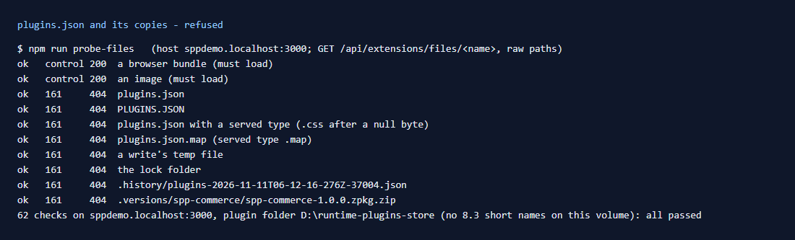

# 161: Is the registry (plugins.json) blocked from download?

**Listed:** Yes. **Result here:** Yes, confirmed through the files route, along with every copy the store and its tools
leave next to it. But a development server copies the registry into a page by another way (row 159).

## What was tried (`npm run probe-files`, row [160](../160-server-bundles-blocked/README.md))

| Request `…/api/extensions/files/<name>` | Status |
|---|---|
| `plugins.json`, `PLUGINS.JSON` | 404 |
| `plugins.json%00.css` (a served type after a null byte) | 404 |
| `plugins.json.map` (a name with a served type) | 404 (no such file) |
| `plugins.json.tmp-1` (the temp file of a write) | 404 |
| `.plugins.lock` (the folder held during a write) | 404 |
| `.history/plugins-2026-11-11T06-12-16-276Z-37004.json` (the copy kept before each change) | 404 |
| `.versions/spp-commerce/spp-commerce-1.0.0.zpkg.zip` (a kept package, server part included) | 404 |

All refused on POCSppDemo and on MaxwellsHardware ([output.txt](output.txt)).

## Why they are refused

`readServedFile` serves only browser file types (`.json` and `.zip` are not among them), and only a bare file name in
the folder itself, so `.history/` and `.versions/` cannot be reached. The registry holds every package's settings for
every store, including server-only ones such as spp-commerce's `staffKey` and `erpWebhookSecret`. The `.history/`
copies hold all their earlier values too.

## The other way it gets out

Through the files route, the registry stays private. But a store running `next dev` sends the whole file inside the
first page it renders after the file changes (React's development debug data; row
[159](../159-secrets-on-the-server/README.md)). In production it does not. Secrets can be kept out of the file with
`env:NAME` references (row 159).

## How it renders

**In the webstore (base):** the registry is read only on the server (`readRegistry`, `registry.server.ts`), when its
modification time changes. It is never linked or fetched by the page.

**How this customization joins it:** the packages reach the browser as files the store names in the page's runtime
data (`/api/extensions/files/<file>?v=…`), never the registry itself
([§2 B](../../RENDER-FLOW.md#2-which-store-which-packages-every-request)).

End-to-end flow, with file and line references in the webstore: [docs/RENDER-FLOW.md](../../RENDER-FLOW.md).

## Where

No change in this step: checked with `npm run probe-files` (row 160).

## How a client does this

Run `npm run probe-files` against each environment. Keep the plugin folder out of any static file server or CDN
origin. Only the store's route should read it.
