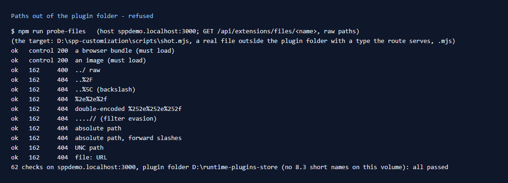

# 162: Are file paths checked so nothing outside the package folder is served?

**Listed:** Yes. **Result here:** Yes, confirmed with ten ways of leaving the folder. The target was a real file one
level up, with a type the route serves (`D:\spp-customization\scripts\shot.mjs`, `.mjs`), so a 404 really means
refused, not "wrong type". Every attempt was refused, while files inside the folder load.

| Request `…/api/extensions/files/<path>` | Status |
|---|---|
| `../spp-customization/scripts/shot.mjs` (raw, unnormalized) | 400 (rejected by the server before the route) |
| `..%2Fspp-customization%2Fscripts%2Fshot.mjs` | 404 |
| `..%5C…` (backslash) | 404 |
| `%2e%2e%2f…` | 404 |
| `%252e%252e%252f…` (double-encoded; the route decodes once more) | 404 |
| `....%2F%2F…` (for filters that strip `../` once) | 404 |
| `D%3A%5Cspp-customization%5Cscripts%5Cshot.mjs` (absolute) | 404 |
| `D:/spp-customization/scripts/shot.mjs` (absolute, forward slashes) | 404 |
| `\\127.0.0.1\D$\…` (UNC) | 404 |
| `file:///D:/…` | 404 |

All refused on POCSppDemo and on MaxwellsHardware ([output.txt](output.txt)).

## Why

`readServedFile` takes the decoded name and serves it only if `name === path.basename(name)`. Any `/` or `\` (on
Windows both are separators), a drive or a UNC prefix makes the base name differ. It then reads
`path.join(dir, path.basename(name))` (`fileInDir`), so even a name that passed would stay in the folder. The double
decoding (Next.js decodes the route parameter, then the route calls `decodeURIComponent` again) turns `%252f` into `/`
before the check, so it is caught too.

## How it renders

**In the webstore (base):** `files/[file]/route.ts` → `serveRuntimeFile` → `readServedFile` → `fileInDir`
(`packages/extensions/src/registry.server.ts`). The same `fileInDir` is used when the store loads a package's server
part, so a registry entry's `file` cannot point outside the folder either.

**How this customization joins it:** all of this theme's files (bundles, CSS, fonts, images) are bare names in the
plugin folder, served by that route
([§3 B.1](../../RENDER-FLOW.md#3-the-page-shell-root-layout-head-styles-labels-server-layout)).

End-to-end flow, with file and line references in the webstore: [docs/RENDER-FLOW.md](../../RENDER-FLOW.md).

## Where

No change in this step: checked with `npm run probe-files` (row [160](../160-server-bundles-blocked/README.md)).

## How a client does this

Run `npm run probe-files -- --host <store host>` on each environment, through the same proxy or CDN shoppers use.
Never let a static file server or CDN origin serve the plugin folder directly: only the store's route checks paths.
